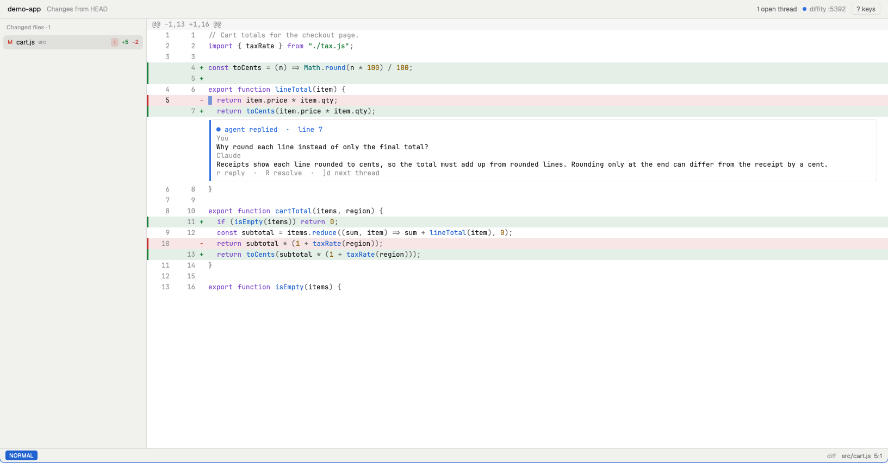

# difftate

Annotate a coding agent's diff, and the coding agent answers or fixes the code.

Review a diff in [diffity](https://www.npmjs.com/package/diffity), comment on any line, and Claude Code or OpenCode replies or edits the code, with the session's full context. Progress shows live in the diffity UI and in the terminal.

## Requirements

- [diffity](https://www.npmjs.com/package/diffity) CLI, tested with `0.9.5`: `npm install -g diffity@0.9.5`
- [Claude Code](https://docs.claude.com/en/docs/claude-code) (`claude`) or [OpenCode](https://opencode.ai) (`opencode`)
- `zsh`, `python3` (standard library only), `git`
- Optional: the [Herdr](https://herdr.dev) app, to review in a Herdr tab (see [Review in Herdr](#review-in-herdr-optional)); its go to definition uses [ripgrep](https://github.com/BurntSushi/ripgrep) (`rg`)

## Install

**With an agent:** paste this into Claude Code (or any coding agent):

```
Install difftate by following https://raw.githubusercontent.com/TripathyM/difftate/main/INSTALL.md
```

It checks requirements, installs diffity, clones the repo, and asks before editing `~/.zshrc`. See [INSTALL.md](INSTALL.md).

**By hand:**

```bash
git clone https://github.com/TripathyM/difftate.git ~/difftate   # any folder works
echo 'source ~/difftate/difftate.zsh' >> ~/.zshrc
source ~/.zshrc
```

`difftate.zsh` finds the watcher next to itself. After editing it, run `source ~/.zshrc` (or open a new terminal).

## Quick start

Run from inside the repo, **on the branch you want reviewed**:

```bash
difftate                    # Claude Code, whole branch vs the default branch, origin/HEAD (short: dtc)
difftate --base develop     # whole branch vs develop
difftate main               # the changes since main (diffity's view)
difftate HEAD~1             # the last commit
difftate HEAD~3             # the last 3 commits
difftate HEAD               # only uncommitted changes (capital HEAD: `head` breaks in worktrees on macOS)
difftate unstaged           # only unstaged changes
difftate staged             # only staged changes
dto                         # OpenCode, same arguments
difftate --session <uuid>   # attach a specific session
difftate --no-session       # headless, no session context
difftate --model <model>    # force the coding agent's model (default: the session's model)
difftate --cmd <command>    # run Claude through another command or alias
difftate --open herdr       # review in a Herdr tab instead of the browser (see "Review in Herdr")
```

Without `--session`, it attaches the latest agent session for the current folder, so comments are answered with that session's full context.

**Always run from the branch's checkout.** The coding agent edits files in the current directory. There is deliberately no "source branch" option: it would let the coding agent write fixes onto the wrong branch. To review another branch without switching, use a worktree (`git worktree add ../repo-x feature-x`, `cd` there, run `difftate`).

**The base** is the repository's default branch (`origin/HEAD`; without one, a local `main` or `master`), unless `--base` gives another. It used to be `master`. A review is one branch against its base, like a pull request; with a detached HEAD, or on the base branch itself, the current commit stands in for the branch.

## Local store (try it early)

```bash
export DT_STORE=local   # default: diffity
```

difftate keeps the review itself, with no diffity: commits don't end a review, so threads survive them. The changeset comes from git (`GET /api/changeset`). The [Review tab in Herdr](#review-in-herdr-optional) shows it (`DT_OPEN=herdr`); difftate's own browser viewer comes later. Other clients reach it through the [review API](#review-api). Views (`HEAD~1`, `staged`, …) come later too: the local store shows all changes against the base.

- Each review is stored in `.git/difftate/reviews/<review>/` (shared by worktrees, never committed): `review.json` (branch, base, start) and `events.jsonl`, plain JSON lines that are only ever appended (threads opened, comments, replies, final notes, status changes, and runs: which comments each run was sent, and how it ended). The current state comes from reading them in order.
- Progress notes show a run's steps live from the watcher's memory. Only their final line is stored, when the run ends.
- A watcher killed during a run (not Ctrl+C) loses nothing: the next one sees the run that never ended, doesn't send its threads again, and marks those with no reply as failed ("no reply (the watcher stopped)").
- Every stored line also goes to the **review history**, `~/.difftate/history/<year>-<month>.jsonl`, with the repository (path and remote), branch and base added, so deleting a clone doesn't lose it.
- Only the watcher writes the store. If `events.jsonl` changes in a way it didn't make (say, the coding agent with the sandbox off), the watcher prints a warning, restores the file, and says so in the final progress note of a thread in the run.

## Example: several Claude setups

Shortcuts go in `~/.zshrc`, after the `source` line. Say `ccw` runs Claude with the default config and `ccp` is a wrapper that sets its own config dir:

```zsh
dtcw() { difftate --cmd ccw "$@"; }                                         # uses ~/.claude, the default
dtcp() { CLAUDE_CONFIG_DIR=~/.claude-personal difftate --cmd ccp "$@"; }   # same dir the wrapper uses
```

Sessions are found in `$CLAUDE_CONFIG_DIR` (default `~/.claude`), the same rule `claude` itself follows. If a wrapper sets a different config dir internally, set `CLAUDE_CONFIG_DIR` in its shortcut as above, or the watcher looks in the wrong place. Don't set it to `~/.claude` explicitly: leave it unset for the default.

## Review in Herdr (optional)

If you use the [Herdr](https://herdr.dev) app, the review can open in a Herdr tab instead of the browser: a small code editor with vim keys, comment threads under the lines, go to definition, fuzzy file open, and quick edits you save yourself. The tab reads and writes through difftate's [review API](#review-api), with whichever store the watcher uses, so the coding agent answers its comments as it does in the browser, and both stay in sync. The tab always shows all changes against the review's base, whatever `--ref` the browser shows.



**Install** (from the difftate folder, `~/difftate` below):

```bash
ln -s ~/difftate/herdr/mods/difftate ~/.config/herdr-app/mods/difftate   # the mod, linked so git pull updates it
```

If `~/.config/herdr-app/mods/difftate` already exists, remove it first: `ln -s` would put the link inside it.

```zsh
# in ~/.zshrc, after the source line
export DT_OPEN=herdr                                              # difftate / dtc / dto open a Review tab
export DT_HERDR="/Applications/Herdr.app/Contents/MacOS/Herdr"   # only if herdr-app isn't on PATH
```

Herdr adds `herdr-app` to `~/.local/bin` when it starts. Check with `command -v herdr-app` in a new terminal; set `DT_HERDR` only if that prints nothing.

Optional: add `"cmd-shift-r": "mod.open:difftate"` to the `global` section of `~/.config/herdr-app/keys.json` (also in [`herdr/keys.json`](herdr/keys.json)) to open the tab for the focused pane's repo.

**Use:** run `difftate` as usual. It opens a **Review · ‹repo›** tab, or switches to it if it's open. If Herdr isn't running or can't be found, it opens the browser. `--open browser` (or `both`) overrides `DT_OPEN` for one run.

- Keys: `?` in the tab lists them. Defaults are in [`herdr/mods/difftate/README.md`](herdr/mods/difftate/README.md). Your own go in `~/.config/difftate/keymap.json`, which updates don't touch.
- After a `git pull`, close and reopen the Review tab: an open tab keeps the code it started with.
- [`herdr/RECIPE.md`](herdr/RECIPE.md) describes the mod for herdr.dev and for rebuilding it.

**Uninstall:** `rm ~/.config/herdr-app/mods/difftate` (removes the link only) and drop the `DT_OPEN` / `DT_HERDR` lines.

## Files

| File | What it does |
|---|---|
| `difftate.zsh` | Shell functions `difftate` / `dtc` / `dto`: pick the session, then start `difftate-watch.py` |
| `difftate-watch.py`, `lib/difftate/` | The watcher: opens the review in its store (diffity, started or reused; or the [local store](#local-store-try-it-early)), serves the [review API](#review-api), dispatches waiting threads to the coding agent, posts "🕒 Queued" notes while the coding agent is busy |
| `bin/dt-reply` | How the coding agent answers a thread: `dt-reply <thread> "<answer>"` |
| `lib/stream_fmt.py` | Reads the coding agent's JSON event stream; prints live progress lines and keeps the progress note updated |
| `tests/` | Watcher tests: a temporary repository, the real watcher, a fake coding agent. See [Tests](#tests) |
| `herdr/mods/difftate/` | The Herdr Review tab (optional): code view, keys, threads, editing. See [Review in Herdr](#review-in-herdr-optional) |
| `herdr/keys.json`, `herdr/RECIPE.md`, `herdr/preview.png` | Herdr's sharing files: the optional key binding, the build brief, the screenshot |
| `herdr/screenshots/` | More screenshots of the Review tab, shown in the mod's README |

## What you see

**In the diffity UI**, each thread gets one status comment, edited in place (UI refreshes every ~2s):

```
[dt-queued] 🕒 Queued — agent is busy with another comment…   ← arrived while the coding agent was busy
[dt-status] ⏳ Thinking… (4s)
[dt-status] ⏳ Working… (12s) · 🧠 context 84k / 1M (8%)
- ✅ `Read src/app.ts`
- ⏳ `Edit src/app.ts`
[dt-status] ✅ Done in 42s · 🧠 context 90k / 1M (9%)       ← checklist removed when done
[dt-status] ❌ Failed after 30s  (+ checklist and reason)
```

The coding agent's reply follows as a separate `[dt-reply]` entry: the coding agent writes only the answer, and difftate adds the prefix diffity needs. Progress notes are never sent to the model (see [What the coding agent gets](#what-the-coding-agent-gets)).

**In the watcher terminal**:

```
[07:40:23] New/changed threads detected — dispatching to claude
  Model: claude-opus-5-5 (from session)
[07:40:24] 🚀 session 3f1c9a20 started · model claude-opus-5-5
[07:40:25] 🔧 Read  src/app.ts
[07:40:26] 💬 <agent text>
[07:40:26] ✅ done in 8s, $0.1429 · 🧠 context 28k / 1M (3%)
[07:40:37] Queued thread b2c07211 (agent busy)
```

## Context size and when to compact

`🧠 context` is the token count of the coding agent's latest model call. In session mode that includes the resumed session's full history, so it is the session's current size.

- Claude reports its window, so you get a percentage.
- OpenCode shows tokens only, unless you set `DT_CONTEXT_WINDOW`.
- With the same model as your session (see below), it should be close to `/context` in that session (not exact: `-p` may load a slightly different system prompt and tool set). A big gap usually means a different model answered.
- At **70%+** it adds `⚠️ consider /compact`. The coding agent can't compact itself: run `/compact` in your own Claude session.

## Which model answers

A Claude session doesn't store its model. Each `claude -p` the watcher starts uses the **current default**, and running `/model` in *any* session changes that default. Without a fix, your Opus session could get its comments answered by Sonnet, which also drops Opus's thinking blocks (its unstated reasoning) and makes 🧠 context disagree with `/context`.

| Tool | Model used |
|---|---|
| `difftate` with a session | Read from the session file: the model of your latest interactive turn (e.g. `claude-opus-5-5`), passed as `--model` |
| `difftate --no-session` | CLI default |
| `dto` (OpenCode) | OpenCode keeps the session's own model on resume, so no detection is needed |
| Any, with `--model` | `--model` always wins |

The watcher prints `Model: <name> (from session)` on every dispatch, and the 🚀 line shows the model the coding agent actually ran.

**Cost note:** prompt caches are per model and expire after ~1h idle. The first comment after a model switch or a long break re-caches the whole session (roughly $1 for a ~120k-token Opus session at list price; cloud providers' pricing differs). Later comments within the hour are cents. Switching models back and forth costs more than staying on one.

## Settings you can change

### Environment variables (set before `difftate` / `dto`)

| Variable | Default | Effect |
|---|---|---|
| `CLAUDE_CONFIG_DIR` | unset (`~/.claude`) | Where Claude sessions are looked up; also read by `claude` itself |
| `DT_CONTEXT_WINDOW` | unset (Claude auto-detects) | Context window in tokens, for the % when the tool doesn't report it. E.g. `export DT_CONTEXT_WINDOW=200000` for OpenCode |
| `DT_OPEN` | `browser` | Where the review opens: `browser`, `herdr` or `both`. `--open` overrides it for one run. See [Review in Herdr](#review-in-herdr-optional) |
| `DT_HERDR` | unset (`herdr-app` on `PATH`) | Path to the Herdr app's binary, for `DT_OPEN=herdr` when `herdr-app` isn't on `PATH` |
| `DT_STORE` | `diffity` | Where the review is kept: `diffity`, or `local` for difftate's own store. See [Local store](#local-store-try-it-early) |

### Constants (edit the file)

| Name | File | Default | Effect |
|---|---|---|---|
| `COMPACT_WARN_PCT` | `lib/stream_fmt.py` | `70` | % of context window that triggers `⚠️ consider /compact` |
| `MAX_STEPS_SHOWN` | `lib/stream_fmt.py` | `8` | Checklist steps shown; older ones collapse to "…N earlier steps" |
| `STATUS_REFRESH_S` | `lib/stream_fmt.py` | `3` | Seconds between status comment refreshes while the coding agent is quiet |
| `TEXT_MAX` | `lib/stream_fmt.py` | `300` | Max characters of coding agent text per terminal line |
| `ANCHOR_MAX_LINES` | `lib/difftate/prompt.py` | `20` | Lines of the commented code included per thread |
| `SUMMARY_MAX` | `lib/difftate/prompt.py` | `200` | Characters per comment in "Other open threads" |
| `MARKERS` | `lib/difftate/diffity.py` | `[dt-reply]`, `[dt-queued]`, `[dt-status]` | Prefixes that tell replies and notes from your comments in diffity. Only the diffity store uses them |

### Watcher flags (`difftate-watch.py --help`)

`--base` (default: `origin/HEAD`), `--ref` (diffity's view; default: the base), `--tool`, `--session`, `--model`, `--cwd`, `--interval` (poll seconds, default 1), `--cmd`, `--open` (browser, herdr, both).

### Internal env vars (set by the watcher, don't set yourself)

| Variable | Purpose |
|---|---|
| `DT_API`, `DT_TOKEN_FILE` | Review API address and token file, for the progress notes (given to `lib/stream_fmt.py` only, never to the coding agent) |
| `DT_NOTES` | The current run's progress notes, `{thread id: note id}`, which `lib/stream_fmt.py` edits |
| `DT_RUN_DIR` | The run's folder, where `dt-reply` leaves the coding agent's answers (given to the coding agent) |

## How it works

1. Every `--interval` seconds the watcher lists open threads. A thread is **waiting** when it has a comment of yours (or another reviewer's) that no run has been sent yet (see [thread state](#review-api)).
2. Waiting threads → one run of the coding agent, in the background, with the prompt below. Runs go **one at a time**; comments that queue up during a run all go into the next one.
3. While it runs, the watcher keeps polling; new threads get `🕒 Queued` within ~1s and go in the next run.
4. Before the run starts, the watcher posts a progress note on each of its threads (or reuses the thread's queued note). `lib/stream_fmt.py` edits them through the review API while the run works. When the run ends (done, failed, or stopped by Ctrl+C: "⏹ Stopped"), the watcher writes each note's final line.
5. The coding agent answers each thread with `dt-reply <thread> "<answer>"`. That writes the answer into the run's folder (a temporary folder per run), and the watcher posts it as a reply. The coding agent never writes to the review itself.
6. Ctrl+C stops the watcher, the running coding agent and its child processes, and diffity (if the watcher started it).

### What the coding agent gets

`lib/difftate/prompt.py` builds the prompt as plain text, without notes or JSON metadata, so the coding agent doesn't need to read the review itself:

```
## Reply to these threads (1)

### Thread 94beac30 — src/user.ts:42-44
Code:
<the commented lines>
reviewer: rename this to fetchUser
you: Should I also rename the test?        ← the coding agent's earlier reply
reviewer (new): yes

## Other open threads (2) — context only
- 824f35ef — src/api.ts:10
  reviewer: why is this retry here?
  you: It handles flaky 502s from the gateway.
```

followed by the rules (reply with `dt-reply`, change code only when asked, never resolve). "Other open threads" lets the coding agent see a related comment elsewhere ("this also fixes your comment on api.ts") at a fraction of the full JSON's size.

Coding agent invocation:
- Claude: `claude -p … --resume <session> --model <model> --settings <run sandbox> --output-format stream-json --verbose < /dev/null`
  - `--settings` lets `dt-reply` write to the run's folder, and keeps the coding agent out of difftate's folder (`<repo>/.git/difftate`) and away from the API token, so it can't resolve threads or edit notes. Its `sandbox.filesystem` part (`allowWrite` the run's folder, `denyWrite` the folder, `denyRead` the token) binds the Bash tool when the sandbox is on; its `permissions.deny` rules (`Edit(//<folder>/**)`, `Read(//<token>)`) bind Claude's own file tools. It's added to your own settings for these runs only.
  - Dispatch posts replies only to threads that were open when the run started, whatever the coding agent writes into its folder.
- OpenCode: `opencode run … --session <session> [--model <model>] --auto --format json < /dev/null`

`< /dev/null` matters: `opencode run` hangs waiting on stdin otherwise.

## Review API

The watcher (Python 3.9 or later, nothing else) serves the **review API** on `127.0.0.1`, for viewers and the progress notes. Every request needs the header `Authorization: Bearer <token>`, with the token from `.git/difftate/token` (readable only by you; a new one each start). `.git/difftate/api.json` gives the port.

| Request | What it does |
|---|---|
| `GET /api/review` | Start or reuse the review: `id` (the local store adds `branch` and `base`) |
| `GET /api/changeset` | The review's changeset, from git: `base`, `commit` (where the branch left the base), `diff` (unified, new untracked files included) |
| `GET /api/threads?status=open` | List threads |
| `POST /api/threads` | Open a thread: `anchor` (`file`, `side` `old`/`new`, `startLine`, `endLine`, `code`; `null` for a general thread), `body` |
| `POST /api/threads/<id>/comments` | Add a comment: `kind` (`comment`, the default; `reply`; `queued` or `progress` for a note), `body` |
| `PATCH /api/notes/<id>` | Edit a note: `kind`, `body`. Anything that isn't a note gets 403; a note whose run has ended gets 409 |
| `PATCH /api/threads/<id>/status` | Set the thread status: `open`, `resolved` or `dismissed` |

Opening a thread and setting its status take an optional `author`, which must be `reviewer`: anyone else gets 403. That enforces the review's rules for difftate's own callers; it isn't a security check (the token is). Threads come back in difftate's own format, the same for every store:

```json
{"id": "…", "anchor": {"file": "app.py", "side": "new", "startLine": 2, "endLine": 2,
                       "code": "    return f'hello {name}'", "commit": "<sha>"},
 "outdated": false, "status": "open", "state": "replied",
 "comments": [{"id": "…", "author": "reviewer", "kind": "comment", "body": "Why an f-string?", "time": "…"},
              {"id": "…", "author": "difftate", "kind": "progress", "body": "✅ **Done** in 12s", "time": "…"},
              {"id": "…", "author": "agent", "kind": "reply", "body": "It reads better.", "time": "…"}]}
```

The **thread state** of an open thread (`null` otherwise) is the one rule the watcher dispatches by:

| State | Meaning |
|---|---|
| `waiting` | It has a reviewer's comment that no run has been sent yet |
| `queued` | Waiting while a run handles other threads |
| `working` | The run in progress has it |
| `replied` | The coding agent spoke last, and every reviewer comment was sent to a run |
| `failed` | Its run ended with no reply to it. Its progress note says "no reply", and it isn't sent again until you comment |

So a follow-up you write while the agent works on the same thread is answered in the next run ([#3](https://github.com/TripathyM/difftate/issues/3)). A comment from a separate reviewing agent (written to diffity as an agent, without a `[dt-…]` prefix) counts as yours. diffity's `[dt-…]` prefixes stay inside the diffity store: the API has comment kinds instead.

## Tests

```bash
python3 -m unittest discover -s tests -v
```

`tests/test_watcher.py` makes a temporary git repository, starts the real watcher with a fake coding agent (`tests/fake_agent.py`, through `--cmd`), and drives it through the review API. `tests/test_stores.py` runs one test suite against every store (memory, local and diffity). The watcher tests run on the diffity store and on the local store (with no diffity on `PATH`). Tests that need diffity 0.9.5 skip without it. CI (`.github/workflows/ci.yml`) runs them on Python 3.9 and the latest, and checks `difftate.zsh` with `zsh -n` (ShellCheck has no zsh support), on every push and pull request.

## Known limitations

- An open Claude/OpenCode terminal on the same session doesn't live-refresh with the watcher's turns.

## Troubleshooting

| Symptom | Check |
|---|---|
| No progress note appears | Watcher terminal for `could not post the progress note on thread …`; is diffity on the port shown? |
| Coding agent never finishes | Run the coding agent's command by hand with `< /dev/null`; look for auth or stdin hangs |
| Wrong diff shown | Check `?ref=` in the page URL; rerun `difftate <ref>` |
| Answer from the wrong model / 🧠 far from `/context` | Check the `Model:` line; force it with `difftate --model <model>` |
| Thread ignored | Its thread state is `replied` or `failed` (`GET /api/threads`): comment again to re-trigger |
| Browser opens instead of the Herdr tab | The watcher prints a `Herdr:` line saying why: `herdr-app` not found (set `DT_HERDR`), Herdr not running, or the mod missing (`herdr-app check ~/.config/herdr-app/mods/difftate`) |
| Herdr tab misses a change after an update | Close the Review tab and open it again: an open tab keeps the code it started with |

## Roadmap

Planned work and known bugs are tracked in [GitHub issues](https://github.com/TripathyM/difftate/issues).

## License

MIT, see [LICENSE](LICENSE).
