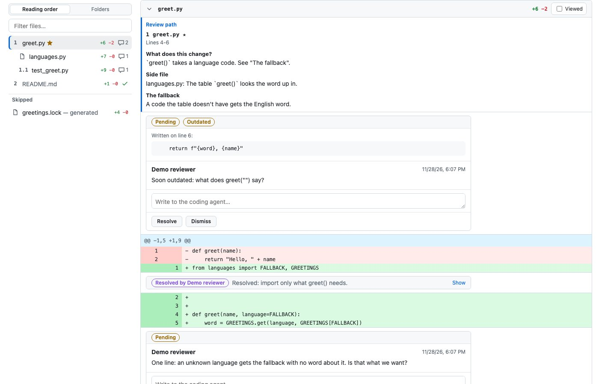

# difftate

Annotate a coding agent's diff, and the coding agent answers or fixes the code.

Review a diff in the browser (or in your own [Neovim](#review-in-neovim)), comment on any line, and Claude Code or OpenCode replies or edits the code. Each run starts a fresh agent session, so any coding agent can answer any branch, whoever wrote it. Progress shows live in the viewer and in the terminal.

## Requirements

- [Claude Code](https://docs.claude.com/en/docs/claude-code) (`claude`) or [OpenCode](https://opencode.ai) (`opencode`)
- `python3` (standard library only), `git`
- For the Neovim viewer (optional): Neovim 0.10 or later with [gitsigns.nvim](https://github.com/lewis6991/gitsigns.nvim). LazyVim is not needed (it has gitsigns already); [Snacks](https://github.com/folke/snacks.nvim) adds the pickers' previews and the files sidebar, which-key the key list, lualine the statusline note

The coding agent answers a comment as it works in your own sessions: it may edit files and run commands in the repository.

## Install

**With an agent:** paste this into Claude Code (or any coding agent):

```
Install difftate by following https://raw.githubusercontent.com/TripathyM/difftate/main/INSTALL.md
```

It asks which viewer you want (the browser only, or the browser and Neovim), checks requirements, clones the repo, and asks before editing `~/.zshrc` or adding the Neovim plugin. Run it again to add the Neovim viewer later. See [INSTALL.md](INSTALL.md).

**By hand:**

```bash
git clone https://github.com/TripathyM/difftate.git ~/difftate   # any folder works
echo 'export PATH="$HOME/difftate/bin:$PATH"' >> ~/.zshrc
source ~/.zshrc
```

That is all the browser viewer needs to open a review. For replies, write [the agent list](#the-agent-list): no coding agent replies until you do. For the Neovim viewer too, add the plugin from the clone ([Review in Neovim](#review-in-neovim)).

`difftate`, `dt-export` and `dt-reply` are programs in the repository's `bin/`, so the board and scripts run them as well as your shell. `difftate` finds the watcher next to itself.

## Quick start

Run from inside the repo, **on the branch you want reviewed**:

```bash
difftate                    # whole branch vs the default branch, origin/HEAD
difftate --base develop     # whole branch vs develop
difftate main               # the commits after main (a view of the same review)
difftate HEAD~1             # the last commit
difftate HEAD~3             # the last 3 commits
difftate HEAD               # only uncommitted changes (capital HEAD: `head` breaks in worktrees on macOS)
difftate unstaged           # only unstaged changes
difftate staged             # only staged changes
difftate --open nvim        # review in Neovim (see "Review in Neovim"); --open takes browser, nvim or both
difftate stop               # stop the watcher
difftate log                # the watcher's log, then new lines until Ctrl+C
```

**One watcher for the machine** ([ADR 0008](docs/adr/0008-one-watcher-for-the-machine.md)). `difftate` starts it in the background when none runs, adds this folder, shows the view when you give one, opens the review in your viewer, and ends: the shell is free again, and closing the terminal doesn't stop the watcher. It serves the review of every checked-out folder that a request names, on one port with one token, and dispatches each folder's runs in that folder. `difftate` in a second folder (a worktree) uses the running watcher; so does `<leader>rr` in Neovim in a folder the watcher hasn't seen yet, and `dt-export` and `dt-reply`: the first request that names a checked-out folder adds it. The watcher never opens a viewer, and viewers never start it: with none running, `<leader>rr` says "No difftate is running: run `difftate` in a terminal". `difftate stop` stops it through the review API; a run in flight ends failed "(the watcher stopped)".

**Where it keeps things:** the difftate folder in your home, `~/.difftate` (set `DIFFTATE_HOME` for another), readable only by you: `api.json` (port and pid) and `token` (the one review API token), `watcher.lock` (a second `difftate` while one starts waits for it), `log` (the watcher's messages: each line has the time, then the folder and branch it is about, or `(watcher)` for the watcher itself; `difftate log` shows it and follows new lines) and `history/`. No folder's git dir gets running files. The coding agent's runs may not write this folder or read the token.

**Who replies** is the repository's agent, else the machine's default, from [the agent list](#the-agent-list). `difftate agent <name>` sets the repository's; `difftate agent` says which one it uses and where that comes from. A reviewer can override the agent for one review from the list, in the browser (the Agent drop-down beside the review mode) or in Neovim (`<leader>rA`), and clear it; the override is a review event, recorded in the review history like the review mode, and wins over the repository's agent. Each run reads the choice when it starts, so changing it needs no restart and never disturbs a run in flight.

Every run starts a fresh agent session of that coding agent. No earlier agent session is found or continued ([ADR 0005](docs/adr/0005-runs-start-fresh.md)), so it doesn't matter which coding agent or account wrote the code, or from which folder.

**Always run from the branch's checkout.** The coding agent edits files in the folder of the review it replies in. There is deliberately no "source branch" option: it would let the coding agent write fixes onto the wrong branch. To review another branch without switching, use a worktree (`git worktree add ../repo-x feature-x`, `cd` there, run `difftate`). Each worktree has its own review on the one watcher, following its own branch, and their runs can work at the same time (one run for each review).

**The base** is the repository's default branch (`origin/HEAD`; without one, a local `main` or `master`), unless `--base` gives another. It used to be `master`. `difftate --base` (or a request naming a base) switches the folder's review to that base; a request that names none keeps the base the folder has. A review is one branch against its base, like a pull request; with a detached HEAD, or on the base branch itself, the current commit stands in for the branch.

**The watcher follows the checked-out branch.** Check out another branch and the watcher and its viewers move to that branch's review (a new one if it has none); check out the first branch again and its review is back as you left it. A run in progress finishes on its own threads first, and its replies land there. Until it ends, the files on disk are the other branch's: the review can't take a new thread or viewed mark (409), no thread is placed in that code (each is listed not in view), and both viewers show a one-line banner (`waitingForRun` and `checkedOut` in `/api/review` and `/api/changeset`). On the base branch itself, a commit counts as a checkout: the review lasts one commit.

## The review

difftate keeps the review itself: commits don't end a review, so threads survive them. The changeset comes from git (`GET /api/changeset`). difftate's own browser viewer shows it (`DT_OPEN=browser`, the default), so does the [Neovim viewer](#review-in-neovim) (`DT_OPEN=nvim`). Other clients reach it through the [review API](#review-api). The argument is the starting **view** of the same review (`HEAD~1`, `staged`, …), and both viewers switch views (the browser's **View** menu, Neovim's `<leader>rV`): a thread written in any view belongs to the review, and the threads list shows every thread.

**The browser viewer** is a simple page the watcher serves: the changeset in the view, threads under their lines with their thread state (waiting, queued, working, replied, failed) and outdated marks, and every thread in the threads list (picking one switches to a view that shows it). Click a line number to comment (shift-click another on the same side for more lines); reply, resolve, dismiss or reopen in a thread; **New general comment** comments on the changes as a whole. With a `review-path.md` in the folder, the file list follows the review path as `<leader>rf` does (tree, ★, viewed marks, skipped files and files not on the path last), and a file's stop (questions, specs, side files, linked sections) shows above its diff in its own style. It updates every 1.5 s. `difftate --open browser` opens it with a single-use launch code (`http://127.0.0.1:<port>/?launch=…&folder=…`, also printed), never the API token, which a coding agent could read in the browser's history. The first visit trades the code for a cookie (`HttpOnly`, `SameSite=Strict`) and lands on a clean `/`; the code is then refused, so each link opens the page once. Reloading keeps working. To open the page again, run `difftate --open browser` in the folder: it opens a new link. Without the cookie every request gets 401, and a restarted watcher needs a new link.



**Done.** When you finish a review, mark it **Done** (`<leader>rD` in Neovim; press again to undo). It is Done at one commit, shown as **Done at ‹commit›**, whether you went through the code or skipped it (write a general thread saying why, resolve it, and mark Done). Open threads, and runs still working, are warned about first, and you can mark Done anyway. A new commit on the branch clears Done; a new thread doesn't. Only the reviewer marks it: the coding agent can't. Every mark (done, undone, cleared by a commit) is kept in the review history with its time and commit.

Read it from outside difftate, in any folder of the repository, with or without a watcher running (it only reads):

```sh
difftate status --json --branch my-branch
```

```json
{"branch": "my-branch", "base": "main", "head": "9f2c…", "done": true, "time": "2026-11-17T10:00:00.000Z",
 "commit": "9f2c…", "lastMark": {"kind": "done", "time": "2026-11-17T10:00:00.000Z", "commit": "9f2c…"},
 "openThreads": 0, "runsInFlight": 0}
```

`done` says whether the review is Done now; `time` and `commit` are its mark (null when it isn't); `lastMark` is the last mark of any kind, `"done"`, `"undone"` or `"cleared"` (by a new commit: `commit` is the new one); `head` is where the branch is now. A review whose branch got a new commit since shows as cleared at once; the watcher keeps the clearing in the review history within a poll. Without `--branch` it reads the checked-out branch's review. Without `--json` it prints one line.

- Each review is stored in `.git/difftate/reviews/<review>/` (shared by worktrees, never committed): `review.json` (branch, base, start) and `events.jsonl`, plain JSON lines that are only ever appended (threads opened, comments, replies, final notes, status changes, Done marks, and runs: which comments each run was sent, and how it ended). The current state comes from reading them in order.
- Progress notes show a run's steps live from the watcher's memory. Only their final line is stored, when the run ends.
- A watcher killed during a run (not Ctrl+C) loses nothing: the next one sees the run that never ended, doesn't send its threads again, and marks those with no reply as failed ("no reply (the watcher stopped)").
- Every stored line also goes to the **review history**, `~/.difftate/history/<year>-<month>.jsonl` (under `DIFFTATE_HOME`), with the repository (path and remote), branch and base added, so deleting a clone doesn't lose it.
- Only the watcher writes the store. If `events.jsonl` changes in a way it didn't make (say, the coding agent with the sandbox off), the watcher logs a warning, restores the file, and says so in the final progress note of a thread in the run of that review (and only that review's).

## Export

An **export** is a copy of the review for an agent session you start yourself, in any coding agent: its commit messages, every thread in full (open, resolved and dismissed, with comments, replies, thread status and thread state), which threads need an answer (open threads no reply answers yet, held ones too), and how to reply with `dt-reply`. It holds no other rule: you say in the session what to do (reply, read and plan, redo). Exporting changes no thread.

```sh
dt-export            # the review of the folder you are in
dt-export ~/work/app # the review of that folder, from anywhere: the reply command names it
```

`dt-export` asks the one watcher, naming the folder, so it must be running; with none, it says "No difftate is running: run `difftate` in a terminal" and exits 1. Thread state shows by name: `held`, `waiting`, `queued`, `working`, `replied` or `failed`. The same text is `GET /api/export`. Both viewers copy it to the clipboard: the **Export** button in the browser viewer, and `<leader>rE` in Neovim; the reply command in what they copy names the folder the watcher runs in, so the session can reply from anywhere.

The session replies with `dt-reply <thread> "<answer>"` (the export's command, with `--folder <folder>` when you gave one). Outside a run, `dt-reply` finds the watcher the same way, naming its folder, and posts the answer through the review API: it shows as the coding agent's reply, with no progress note, and the thread becomes `replied`. It may reply to any thread of the review, open, resolved or dismissed, and changes no thread status. `<thread>` is the 8 characters the export shows, or the whole id; an id that isn't in the review is refused. With no running difftate it says so and exits 1, posting nothing: `dt-reply` never writes the review itself. Inside a run (`DT_RUN_DIR` set) it works as before, through the run's folder, and never reaches the review API.

## The agent list

The coding agents that can reply are listed in one file on the machine, `~/.difftate/agents.toml` (`$DIFFTATE_HOME/agents.toml`): each entry a name, the coding agent (`tool`: `claude` or `opencode`), the command (`cmd`: a program on `PATH`, or its full path, not a shell alias or function), the environment it needs (`env`, optional) and a model (`model`, optional: the coding agent's own default when empty). `tool` and `cmd` are required. **There is no default agent:** with no `agents.toml`, `difftate` says so and opens the review, where you can read and comment, but each run is refused, naming the file to write. A list with one agent needs no `default` line; a list with two or more does. The [install](INSTALL.md#5-the-agent-list) asks which agents reply and writes the file.

An alias such as `ccw='CLAUDE_CONFIG_DIR=~/.claude-work claude'` is written as its program and its variables. An example, for a personal account (`ccp` is a program) and a work account:

```toml
default = "personal"

[agents.personal]
tool = "claude"
cmd = "ccp"                                          # a wrapper program that runs Claude
env = { CLAUDE_CONFIG_DIR = "~/.claude-personal" }   # ~ is your home

[agents.work]
tool = "claude"
cmd = "claude"
env = { CLAUDE_CONFIG_DIR = "~/.claude-work" }

[agents.open]
tool = "opencode"
cmd = "opencode"
model = "anthropic/claude-opus-5-5"
```

```bash
difftate agent work      # this repository, and all its worktrees, are answered by `work`
difftate agent           # which agent replies here, and whether the repository or the machine default says so
```

The choice is kept in the repository's own git config (`difftate.agent`, shared by its worktrees, never committed). A name that isn't in the list is refused with the names; so is an agent whose command isn't found. A run whose agent has gone from the list, or whose command isn't found, fails with a note saying so, and the watcher keeps going.

## Review in Neovim

The Neovim viewer reviews in your own Neovim (LazyVim or any other config with gitsigns), on the real files, with your own keys, pickers and LSP ([ADR 0007](docs/adr/0007-reviews-happen-in-the-reviewers-own-editor.md)). It is a Lua plugin at the top of this repository (`lua/difftate/`, `plugin/difftate.lua`), a client of the [review API](#review-api) like the browser.

**Install** from your clone, so one `git pull` updates the plugin and the watcher together. Without lazy.nvim (vim-plug, packer, a plain `init.lua`), link it as a Neovim package and call `setup` in `init.lua`:

```bash
mkdir -p ~/.local/share/nvim/site/pack/difftate/start
ln -s ~/difftate ~/.local/share/nvim/site/pack/difftate/start/difftate
echo 'require("difftate").setup({})' >> ~/.config/nvim/init.lua
```

The keys are under `<leader>r` of your own config (Space in LazyVim, `\` in plain Neovim); `setup({ keys = { ... } })` renames them. With lazy.nvim, in `~/.config/nvim/lua/plugins/difftate.lua`:

```lua
return {
  {
    dir = "~/difftate", -- your clone, so one `git pull` updates the plugin and the watcher together
    name = "difftate",
    main = "difftate",
    opts = {}, -- keys = { toggle = "<leader>rr", expand = "<leader>re", thread = "<leader>rt", comment = "<leader>rc", add_comment = "<leader>ra", resolve = "<leader>rR", reopen = "<leader>rO", general = "<leader>rG", threads = "<leader>rs", files = "<leader>rf", files_sidebar = "<leader>rF", next = "]r", previous = "[r", mode = "<leader>rM", agent = "<leader>rA", submit = "<leader>rS", done = "<leader>rD", export = "<leader>rE", viewed = "<leader>rv", views = "<leader>rV", browser = "<leader>rB", side_by_side = "<leader>rd" } is the default; false maps none
  },
  -- The note "review open · live · git signs show changes since <base>" in the statusline
  -- (batched: "review open · batched · 2 held · git signs ..."), while a review is open
  -- (it shows nothing otherwise)
  {
    "nvim-lualine/lualine.nvim",
    optional = true,
    opts = function(_, opts)
      table.insert(opts.sections.lualine_x, 1, { function() return require("difftate").status() end })
    end,
  },
}
```

**Open it with difftate:** `difftate --open nvim` (or `DT_OPEN=nvim`) opens the Neovim viewer. `--open` names the viewer, not the host: difftate opens no tab, pane or window of its own. In a terminal (stdin and stdout both ttys: iTerm, tmux, a Herdr tab, anything) it runs `nvim +DifftateOpen` right there, in the repository's folder: difftate ends and Neovim takes its place; with no `nvim` on `PATH` it prints `difftate: nvim not found on PATH` to stderr and exits 1. With `--open both` the browser opens first, then Neovim. With no terminal (a watcher started in the background, a script) it opens nothing and prints the command to run (`cd <folder> && nvim +DifftateOpen`); a tool that hosts terminals can run that command in its own tab. It never falls back to the browser. Neovim runs with your normal config.

**Use:** run `difftate` once (it starts the watcher), then in Neovim in any checked-out folder press `<leader>rr` (or `:DifftateOpen`; `nvim +DifftateOpen` opens it at start-up). It finds the one watcher as `dt-export` does (the difftate folder in your home) and names its folder, which the watcher serves from then on, so a new worktree needs no `difftate` of its own. With none running, it says "No difftate is running: run `difftate` in a terminal" and starts nothing: Neovim never starts the watcher. While the review is open, gitsigns compares every buffer against where the branch left the review's base (`git merge-base <base> HEAD`, computed again at every poll, so it follows a new commit), so `]h`, `[h` and hunk preview move through the review's changes, committed ones too. `<leader>rr` again (or `:DifftateClose`) puts gitsigns back on the index. `:DifftateStatus` says whether a review is open.

**Threads:** while the review is open, every thread whose file is in a buffer is drawn under its lines, with a sign at its first line (below the signs of git and diagnostics, so it never hides one; the line number is coloured too). An open thread is drawn in full: its thread status and thread state, each comment, reply and note with the reviewer name. Resolved and dismissed threads are one line (their comment count and the first words); an open outdated thread stays in full, with the code it was written on; `<leader>re` expands them all, and collapses them again. Text wraps to the window and wraps again when it resizes, a thread moves with its code as you edit before saving, and a reply or note the coding agent writes appears at the next poll, with no key press. A thread on a deleted line is drawn where the line was deleted, with the deleted code quoted. Each thread is a box: every line has the background of floating windows (`NormalFloat`), padded to the window's text width, so it stands apart from code. `<leader>rt` opens the thread on the cursor's line in a read-only markdown float (with the code it was written on when it is outdated) that you can yank from and search; `q` or `<Esc>` closes it. `K` is still LSP hover. Closing the review removes every thread from every buffer.

**Writing:** `<leader>rc` on a line, or on a visual selection, opens a floating markdown buffer (wrapped) under the lines; `:w` or `<C-s>` posts it as a new thread through the review API (anchored to the file, side new, the lines and the code on disk at them), and it shows inline at once. A multi-line comment keeps its line breaks. `q` closes the float and keeps the text: the same `<leader>rc` again (same lines), `<leader>ra` (same thread) or `<leader>rG` brings it back, until it is sent. In a buffer with unsaved changes it says "Save the file to comment on it" and opens nothing, since the anchor is the file on disk. On a thread's line, `<leader>ra` adds a comment to the thread (same float; a reply is the coding agent's), `<leader>rR` resolves and `<leader>rO` reopens it; with several threads on the line it asks which, and with none it says so. `<leader>rG` writes a general thread, one with no line. The reviewer name is the review API's default (the repository's `git config user.name`). When the review API says no (no watcher, a refusal) the message is shown and the float stays with its text. Completion is off in the float (`vim.b.completion = false` on its own buffer, which blink.cmp honours), so Enter is always a new line, never an accepted suggestion. The `q`, `:w` and `<C-s>` keys are set on the float's own buffer only: LazyVim's `<C-s>` (save) is untouched everywhere else. Deleted lines can't be commented on.

**Moving:** `]r` and `[r` go to the next and previous open thread: general threads first (in the read float), then the files' threads in the changeset's order, opening the next file as it goes; at the end they wrap round and say so. `<leader>rs` lists every thread (outdated and resolved too) with its status and state, general ones at the top, open ones first in each group; picking a thread on a line goes to it, and picking a general one (or one whose code is on another branch) opens it in the read float, where `<leader>ra`, `<leader>rR` and `<leader>rO` act on it. `<leader>rf` lists the changeset's files with the ones marked viewed ticked, and opens the picked one; with Snacks its preview of a stop wraps long lines at word breaks. Both pickers use `Snacks.picker` when it is loaded, else `vim.ui.select`. `]r` and `[r` are mapped by neither LazyVim nor its default plugins; with LazyVim's refactoring extra, `<leader>rs` and `<leader>rf` are its keys: pick others in `opts.keys`.

**Files sidebar:** with Snacks, `<leader>rF` shows a list of the changed files on the right (it is hidden when a review opens), with the rows of the `<leader>rf` picker (the review path's stops, the files it skips, the files it doesn't name; viewed ones ticked) and no preview. It follows the poll: a viewed mark or a new review path shows within a poll. Enter opens the file in the window you were in, and the sidebar stays. `<leader>rF` again hides it (on show, the cursor goes into it); `<leader>rf` is still the pop-up picker. Closing the review closes it. Without Snacks there is no sidebar (`<leader>rF` says so). LazyVim's `<leader>e` tree on the left works alongside. `<leader>rF` is free in LazyVim's core.

**Review mode and Submit:** `<leader>rM` switches the review between live and batched, as the browser viewer's mode switch does, and says what it did ("Batched: comments are held until you submit"). Changing to live submits what is held, so it says how many ("Live: 2 held threads submitted to the coding agent"). In a batched review a new thread or comment is held: it says "Comment held until you submit", and the thread shows `open · held until you submit` inline and in the threads picker. `<leader>rS` submits the held threads as one run ("Submitted 2 held threads"); with none held, or in a live review, it says so ("Nothing is held: nothing to submit", "Not a batched review: nothing to submit") and starts no run. The statusline note names the mode, and in a batched review how many threads are held. The mode is the review API's, so a switch or a thread from another viewer shows at the next poll. `<leader>rM` and `<leader>rS` are free in LazyVim's core and in its refactoring extra.

**Agent:** the statusline note names the agent that replies (`agent work`, or `agent work (this review)` for an override). `<leader>rA` opens a picker of the machine's agent list: choosing one makes it reply in this review from the next run; the first entry clears the choice. It asks the review API for the list, so it needs no agent list of its own.

**Done:** `<leader>rD` marks the review Done at the commit the branch is at, as the browser viewer does, and says which ("Done at 0123456. A new commit clears it."); pressed again it undoes it. Before marking it warns of what is still going on ("2 threads still open · 1 run still working. Mark Done anyway?") and lets you go on or stop; undoing asks nothing. The statusline note shows `Done at 0123456` until a new commit clears it (the next poll shows it) or you undo it; a mark made in another viewer shows there too. A refusal from the review API (another branch checked out, not the reviewer) is shown as it says. `<leader>rD` is free in LazyVim's core and in its refactoring extra.

**Export:** `<leader>rE` copies the review's export (`GET /api/export`) to the system clipboard, as the browser viewer does, for an agent session you start, and says what it holds ("Export copied (2 threads need an answer): paste it into an agent session"). Where Neovim has no clipboard provider it goes to the unnamed register instead and says so (paste it with `p`). The export names this folder in its reply command, so the session can reply from anywhere. Exporting changes no thread. `<leader>rE` is free in LazyVim's core and in its refactoring extra.

**Viewed file:** `<leader>rv` marks the file of the current buffer viewed, or not, as the browser viewer's checkbox does ("Viewed app.py" / "Not viewed: app.py"). It goes from what the review API says now, so a mark made in another viewer isn't marked again. The mark stays until the file's diff changes; the files picker (`<leader>rf`) shows it (✓) each time it opens, so it is always in step. A file that isn't in the changeset says so and changes nothing. `<leader>rv` is free in LazyVim's core and in its refactoring extra.

**View:** `<leader>rV` opens a picker of the views, as the browser viewer's **View** menu does: all changes, the uncommitted changes, the unstaged changes, the last commit and the last 2, 3, … commits (each with the subject of the oldest it includes). The staged view stays in the browser: gitsigns compares the file on disk, so while the browser shows it, Neovim says so in the note and shows all changes. The choice is made in the review API (`PUT /api/view`), so every viewer shows it, and a view chosen in another viewer is followed within a poll. gitsigns' base follows the view the way it follows the review's base: a commit view (`HEAD~2`, `HEAD`) compares the file on disk with that commit, the unstaged view with the index, so `]h` and `[h` walk only the view's changes; closing the review still puts back the base gitsigns had. A thread whose code the view doesn't show (a thread on a deleted line, most often) is not placed on a line: the threads picker (`<leader>rs`) lists it ("not in this view") and opens it in its float. The files picker (`<leader>rf`) lists the view's files. While a view other than all changes is shown, the note says so ("review open · showing the last 2 commits · live · git signs show changes since HEAD~2"). A comment is anchored to the code on disk, whatever the view. `<leader>rV` is free in LazyVim's core and in its refactoring extra.

**Side by side:** `<leader>rd` shows the file in the current window next to its old version, with gitsigns' `diffthis`: the base of the view shown (where the branch left the review's base for all changes, the commit of a commit view, the index for the unstaged view) on the left, your file on the right, where the cursor stays, so you never type the base. Threads and every `<leader>r` key keep working in your file. Pressed again, from either side, it closes the split and puts the cursor back in your file; the options diff mode changed (`foldenable` in your window, `scrollopt`) are put back too. The split stays on the file it was opened for and on the base it was opened with: after a new file or view, press `<leader>rd` again. Threads on removed lines aren't shown in the old window. LazyVim's `<leader>ghd` is still gitsigns' plain `diffthis` against the buffer's own base: the viewer doesn't touch it. `<leader>rd` is free in LazyVim's core and in its refactoring extra.

**The diff:** while the review is open, a buffer with changes against the review's base also shows them, from the hunks gitsigns already has (the plugin only reads `get_hunks`; it never turns on gitsigns' `linehl`, `word_diff` or `show_deleted`). The deleted text is drawn where it was, as lines in the delete colour (`DiffDelete`) across the window, so a changed line is its old text over its new text; the added and changed lines are tinted (`DiffAdd`). `opts = { diff = { tint = false } }` leaves them untinted, for instance to use gitsigns' own `:Gitsigns toggle_linehl` instead; with both on, gitsigns' own highlight is drawn over the tint. In a gap, the order is the line before, the threads on it, the threads on the deleted lines (each quotes its code), then the deleted text. Neovim shows what is drawn above a buffer's first line only after the window scrolls up one line (`<C-y>`), so text deleted at the very top is there but out of sight until then. Both go when the review closes, and follow edits (a moment after typing, when gitsigns has the new hunks) and a moved base. The groups are the plugin's own (`DifftateAdd`, `DifftateDeleted`, `DifftateBox`, `DifftateBody`), linked to the colorscheme's with `default`, so a colorscheme or your own `nvim_set_hl` wins.

The plugin only adds: it maps no key that is mapped already (it says which option to change instead), sets no option (side by side leaves none changed once closed), and changes nothing but gitsigns' base, and only while the review is open. Its keys are under `<leader>r`, a "review" group in which-key (added only while a key is mapped under it); LazyVim's core doesn't use it, only its refactoring extra: with that extra, pick other keys in `opts.keys`.

## Files

| File | What it does |
|---|---|
| `bin/difftate`, `bin/dt-export`, `bin/dt-reply` | The programs: `difftate` starts the watcher in the background and opens a review (`difftate stop`, `difftate status`); `dt-export` and `dt-reply` are for agent sessions. They go on your `PATH` |
| `difftate-watch.py`, `lib/difftate/` | The watcher (one for the machine, started by `difftate`): opens the [review](#the-review) of each folder it serves, serves the [review API](#review-api) and the browser viewer, dispatches waiting threads to the coding agent in the folder, posts "🕒 Queued" notes while the coding agent is busy |
| `bin/dt-reply` | How the coding agent answers a thread: `dt-reply [--folder <folder>] <thread> "<answer>"`: into the run's folder in a run, through the review API in an exported session |
| `bin/dt-export` | Prints the [export](#export) of a review, for an agent session you start: `dt-export [<folder>]` |
| `lib/difftate/main.py` | The composition root: picks the adapters (which store, coding agent and viewers, in one marked block), binds them to the core's use cases, and runs the command line |
| `lib/difftate/core/` | The core: the Review, the changes and Dispatch, with no technology ([ADR 0003](docs/adr/0003-the-core-knows-no-technology.md)). It reaches the rest only through its ports |
| `lib/difftate/adapters/inbound/cli/` | The command line: options and help, `difftate` (starting the watcher under the machine-wide lock, `stop`), opening a viewer, the watcher's table of folders, each folder's loop (following its checked-out branch), the log |
| `lib/difftate/core/dispatch/` | Dispatch: the loop, one run at a time, the queued and progress notes, the prompt (`prompt.py`) |
| `lib/difftate/adapters/outbound/coding_agents/` | Claude Code and OpenCode: command line, model, sandbox settings, and the reader of each one's JSON event stream. `reply_channel/` is the run's folder that `dt-reply` writes to |
| `lib/difftate/adapters/outbound/terminal/` | The watcher log's lines for Dispatch |
| `lib/difftate/adapters/inbound/review_api/` | The [review API](#review-api) (`server.py`, the thread format in `json_format.py`) and, in `web/`, difftate's own browser viewer, which reads and writes the review through it |
| `lib/difftate/adapters/outbound/` | The other driven adapters: `local_store/` and `memory_store/` keep the review, `history_files/` records the review history, `git/` reads the code |
| `tests/` | Watcher tests: a temporary repository, the real watcher, a fake coding agent. See [Tests](#tests) |
| `lua/difftate/`, `plugin/difftate.lua` | The Neovim viewer: a lazy.nvim plugin. See [Review in Neovim](#review-in-neovim) |

## What you see

**In the viewer**, each thread of a run gets one progress note, edited in place (the browser viewer refreshes every 1.5 s):

```
🕒 Queued — agent is busy with another comment…   ← a queued note: arrived while the coding agent was busy
⏳ Thinking… (4s)
⏳ Working… (12s)
- ✅ `Read src/app.ts`
- ⏳ `Edit src/app.ts`
✅ Done in 42s                                 ← checklist removed when done
❌ Failed after 30s  (+ checklist and reason)
```

The coding agent's reply follows as a separate entry in the thread (kind `reply`): the coding agent writes only the answer, and difftate marks it a reply. Notes are never sent to the model (see [What the coding agent gets](#what-the-coding-agent-gets)).

**In the watcher's log** (`difftate log` comes later; for now `tail -f ~/.difftate/log`), each line starts with the folder and review it is about (`/work/app (feature): `):

```
[07:40:23] New/changed threads detected — dispatching to personal
  Model: claude-opus-5-5 (from the agent list)
[07:40:24] 🚀 session 3f1c9a20 started · model claude-opus-5-5
[07:40:25] 🔧 Read  src/app.ts
[07:40:26] 💬 <agent text>
[07:40:26] ✅ done in 8s, $0.1429
[07:40:37] Queued thread b2c07211 (agent busy)
```

## Which model answers

The model is the agent's `model` in [the agent list](#the-agent-list) when it gives one, else the coding agent's own default. A Claude Code default is the current one, which running `/model` in *any* Claude session changes; to keep replies on one model, give `model`.

The watcher prints `Model: <name> (from the agent list)` (or `Model: CLI default`) on every dispatch, and the 🚀 line shows the model the coding agent actually ran.

**Cost note:** each run starts a fresh agent session, so a run's cost grows with its prompt, not with earlier runs.

## Settings you can change

### Environment variables (set before `difftate`)

| Variable | Default | Effect |
|---|---|---|
| `DT_OPEN` | `browser` | The viewer the review opens in: `browser`, `nvim` (the [Neovim viewer](#review-in-neovim)) or `both`. `--open` overrides it for one run |
| `DIFFTATE_HOME` | `~/.difftate` | The difftate folder of the machine: the watcher's port, pid and token, lock and log, and the review history. Tests and trials point it elsewhere |
| `DT_INTERVAL` | `1` | Seconds between polls, read by the `difftate` that starts the watcher. The tests set it small |

### Constants (edit the file)

| Name | File | Default | Effect |
|---|---|---|---|
| `MAX_STEPS_SHOWN` | `lib/difftate/core/dispatch/model.py` | `8` | Checklist steps shown; older ones collapse to "…N earlier steps" |
| `REFRESH_S` | `lib/difftate/core/dispatch/model.py` | `3` | Seconds between progress note refreshes while the coding agent is quiet |
| `TEXT_MAX` | `lib/difftate/adapters/outbound/terminal/__init__.py` | `300` | Max characters of coding agent text per log line |
| `ANCHOR_MAX_LINES` | `lib/difftate/core/dispatch/prompt.py` | `20` | Lines of the commented code included per thread |

### Command line (`difftate --help`)

`difftate [<view>] [--base <branch>] [--open browser|nvim|both]` and `--cwd` (a folder of the repository); `difftate agent [<name>]`; `difftate stop`; `difftate status`. Who replies is the agent list's, not an option. `difftate-watch.py --help` lists the watcher process's own flag, which `difftate` passes it.

### Internal env vars (set by the watcher, don't set yourself)

| Variable | Purpose |
|---|---|
| `DT_RUN_DIR` | The run's folder, where `dt-reply` leaves the coding agent's answers (given to the coding agent) |

## How it works

1. Every second (`DT_INTERVAL`) the watcher lists the threads of each folder's review, on a loop of its own for each folder. A thread is **waiting** when it has a comment of yours (or another reviewer's) that no run has been sent yet (see [thread state](#review-api)).
2. Waiting threads → one run of the coding agent, in the background, with the prompt below. One review has **one run at a time**; comments that queue up during a run all go into the next one. Runs of different reviews (two worktrees) work at the same time.
3. While it runs, the watcher keeps polling; new threads get `🕒 Queued` within ~1s and go in the next run.
4. Before the run starts, the watcher posts a progress note on each of its threads (or reuses the thread's queued note). The watcher reads the coding agent's event stream and edits them with its steps while the run works. When the run ends (done, failed, or stopped by `difftate stop`: "⏹ Stopped"), the watcher writes each note's final line.
5. The coding agent answers each thread with `dt-reply <thread> "<answer>"`. That writes the answer into the run's folder (a temporary folder per run), and the watcher posts it as a reply. The coding agent never writes to the review itself.
6. `difftate stop` stops the watcher, every running coding agent and its child processes.

### What the coding agent gets

`lib/difftate/core/dispatch/prompt.py` builds the prompt as plain text, without notes or JSON metadata, so the coding agent doesn't need to read the review itself:

```
## The decisions behind the code: the review's commit messages (2), oldest first

Each commit from the base to the branch. Read them to know why the code is as it is.

### Commit 1
Fetch users by id

Chose one request per user over a batch endpoint: the API has none yet.

### Commit 2
Retry flaky gateway calls

## Reply to these threads (1)

### Thread 94beac30 — src/user.ts:42-44
Code:
<the commented lines>
reviewer: rename this to fetchUser
you: Should I also rename the test?        ← the coding agent's earlier reply
reviewer (new): yes

## Other threads (2) — context only

### Thread 824f35ef — src/api.ts:10 — open
Code:
<the commented lines>
reviewer: why is this retry here?
you: It handles flaky 502s from the gateway.

### Thread 5d1e07aa — general thread (not tied to a line) — dismissed
reviewer: should we cache users?
you: A cache would need invalidation on every write. Shall I add one?
reviewer: no, keep it simple
```

followed by the rules (reply with `dt-reply`, change code only when asked, never resolve). Each run starts a fresh agent session, so the commit messages are how the coding agent knows why code it didn't write is as it is: every commit from the base to the branch (`git log <base>..<branch>`), whatever the view you look at. A review with no commits yet has no such section. "Other threads" are every other thread of the review in full (every comment and reply, uncut, without notes): open, resolved and dismissed, each marked with its thread status, as context only. A question in one thread informs the answer in another ("this also fixes your comment on api.ts"), and a fix, preference or rejected suggestion in a resolved or dismissed thread is not undone or suggested again. The run is sent only the waiting threads. It replies to those, and to another open thread only when what it does in this run also addresses it.

Coding agent invocation:
- Claude: `claude -p … [--model <model>] --settings <run sandbox> --output-format stream-json --verbose < /dev/null`
  - `--settings` lets `dt-reply` write to the run's folder, and keeps the coding agent out of difftate's folders (the repository's `<repo>/.git/difftate`, and the watcher's own folder, `~/.difftate`) and away from the one API token and the watcher's folder, so it can't resolve threads or edit notes. Its `sandbox.filesystem` part (`allowWrite` the run's folder, `denyWrite` the two folders, `denyRead` the token and the watcher's folder) binds the Bash tool when the sandbox is on; its `permissions.deny` rules (`Edit(//<folder>/**)`, `Read(//<path>)`) bind Claude's own file tools. It's added to your own settings for these runs only.
  - Dispatch posts replies only to threads that were open when the run started, whatever the coding agent writes into its folder.
- OpenCode: `opencode run … [--model <model>] --auto --format json < /dev/null`

`< /dev/null` matters: `opencode run` hangs waiting on stdin otherwise.

## Review API

The watcher (the latest Python, nothing else) serves the **review API** on `127.0.0.1`, for viewers and the progress notes: one watcher for the machine, on one port, with one token. Every API request needs the header `Authorization: Bearer <token>`, with the token from `~/.difftate/token` (readable only by you; a new one each start); `~/.difftate/api.json` gives the port and the pid. **Every request names its folder** (the checked-out folder it is about) as a query parameter, `?folder=<path>`, and may name a base, `&base=<branch>` (the folder's own base, the default branch for a new folder, when none is given). A request without a folder gets 400. The first request that names a checked-out folder adds it to what the watcher serves; a path that isn't in one gets 400. The only requests that name no folder are `POST /api/stop` (it stops the watcher) and the browser page's own files. Two worktrees each have their own review on the one watcher (detached at the same commit, they open the same review: on a detached HEAD the commit stands in for the branch, [ADR 0002](docs/adr/0002-a-review-on-the-base-branch-lasts-one-commit.md)). The same server serves the browser viewer: `/?launch=<code>&folder=<path>` trades a single-use launch code for its cookie, and the page, its scripts and its API calls use that cookie instead of the token (API calls only with the header `X-Difftate: page`, from the page's own origin), naming the folder the link carried.

| Request | What it does |
|---|---|
| `GET /api/review` | Start or reuse the review of the checked-out branch: `id`, `branch` and `base` (they change when the watcher follows another branch), `mode` and `held` (as `GET /api/mode`), and `folder`, the checked-out folder the watcher runs in (what a viewer passes to `GET /api/export` as `reply_folder`), and `warnings` about the review (each with an `id`, a `time` and a `text`; a `review-path.md` that can't be read as a review path is one, and it is gone from the next answer once the file is fixed) |
| `GET /api/view` | The view viewers show: `view` (`""` all changes, a commit such as `HEAD~2` for the commits after it, `HEAD` uncommitted, `staged`, `unstaged`) |
| `PUT /api/view` | Show another view: `view`. `difftate <view>` sends this, then opens the viewer itself: the watcher never opens one |
| `GET /api/changeset?view=<view>` | The review's changeset in a view (default: the one viewers show), from git: `view`, `base`, `commit` (where the branch left the base), `diff` (unified, new untracked files included) |
| `GET /api/review-path?view=<view>` | The review path the coding agent wrote (`review-path.md` in the folder, read at each request): `{"path": null}` with no file, and when the file is broken (a warning in `GET /api/review`); else its `stops` (the tree: `number`, `file`, `key`, `viewed`, `questions`, `side_files`, `children`), `skipped` and `not_on_the_path`. In a view (default: the one viewers show; `?view=` is all changes) the path is cut down to the view's files with their numbers kept, and `skipped` and `not_on_the_path` list the view's files only |
| `GET /api/threads?status=open&view=<view>` | List threads. With a view, each anchor's lines are where its code is in that view, and a thread whose code isn't in it has `inView: false` |
| `POST /api/threads` | Open a thread: `anchor` (`file`, `side` `old`/`new`, `startLine`, `endLine`, `code`; `null` for a general thread), `body`, `view` (the view its lines are in; default all changes) |
| `POST /api/threads/<id>/comments` | Add a comment: `kind` (`comment`, the default; `reply`; `queued` or `progress` for a note), `body` |
| `PATCH /api/notes/<id>` | Edit a note: `kind`, `body`. Anything that isn't a note gets 403; a note whose run has ended gets 409 |
| `PATCH /api/threads/<id>/status` | Set the thread status: `open`, `resolved` or `dismissed`. Answers `id`, `status` and `statusBy` |
| `GET /api/mode` | The review mode: `mode` (`live` or `batched`) and `held` (the ids of the held threads) |
| `PUT /api/mode` | Change the review mode: `mode`. Answers as `GET /api/mode`, with `submitted`: the ids of the threads a change to `live` submitted (`[]` for none) |
| `GET /api/agent` | Who replies in this review: `agent` (its name), `source` (`review` for an override, else `repository` or `machine`) and `names` (the machine's agent list) |
| `PUT /api/agent` | Choose the agent for this review: `agent` (a name on the list, or `null`/`""` to clear it). Answers as `GET /api/agent`; 400, naming the list, for a name that isn't on it. A run in flight keeps its agent |
| `GET /api/export?reply_folder=<folder>` | The [export](#export) of the review as `text/plain`; with a `reply_folder`, its reply command names that folder. Writes no event |
| `POST /api/launch` | A link to the browser viewer on the review, with a single-use launch code: `url` |
| `POST /api/stop` | Stop the watcher (it answers first). `difftate stop` sends this. A run in flight ends failed "(the watcher stopped)". Names no folder |
| `POST /api/submit` | Submit a batched review: its held threads go to the coding agent as one run (queued while a run is busy). Answers as `PUT /api/mode`; `submitted: []` when nothing was held, and no run starts |

Opening a thread, setting its status, changing the review mode, choosing the agent and submitting take an optional `author`, which must be `reviewer`: anyone else gets 403. That enforces the review's rules for difftate's own callers; it isn't a security check (the token is).

Opening a thread, adding a comment and setting the thread status also take an optional `reviewer`: the **reviewer name**, which says which reviewer wrote the comment or changed the status (one line of text, at most 100 characters). Give each reviewing agent its own name, such as `security-bot`. Without one, the name is the repository's `git config user.name`, so your own viewers need nothing. The name is what the caller says: any token holder can give any name. Each comment comes back with its `by` (`null` for a reply, a note, or a comment written before reviewer names), and each thread with `statusBy`, the name of its last status change. The prompt shows the coding agent each comment's reviewer name, and the review history keeps it. Threads come back in difftate's own format:

```json
{"id": "…", "anchor": {"file": "app.py", "side": "new", "startLine": 2, "endLine": 2,
                       "code": "    return f'hello {name}'", "commit": "<sha>"},
 "outdated": false, "status": "open", "statusBy": null, "state": "replied",
 "comments": [{"id": "…", "author": "reviewer", "by": "security-bot", "kind": "comment", "body": "Why an f-string?", "time": "…"},
              {"id": "…", "author": "difftate", "by": null, "kind": "progress", "body": "✅ **Done** in 12s", "time": "…"},
              {"id": "…", "author": "agent", "by": null, "kind": "reply", "body": "It reads better.", "time": "…"}]}
```

The **thread state** of an open thread (`null` otherwise) is the one rule the watcher dispatches by:

| State | Meaning |
|---|---|
| `held` | The review is batched, and it has a reviewer's comment that no run has been sent yet, written since the last submit: it waits for you to submit |
| `waiting` | It has a reviewer's comment that no run has been sent yet |
| `queued` | Waiting while a run handles other threads |
| `working` | The run in progress has it |
| `replied` | The coding agent spoke last, and every reviewer comment was sent to a run |
| `failed` | Its run ended with no reply to it. Its progress note says "no reply", and it isn't sent again until you comment |

**Review mode.** A review is `live` until you change it: each comment is dispatched as soon as you write it. In a `batched` review, each comment you (or a reviewing agent) write makes its thread `held`, and no run starts until you submit: then every held thread goes to the coding agent in one run. Changing a batched review to live submits it. Changing a live one to batched leaves a run in progress alone, and holds every other thread with a comment no run has been sent yet. A reply on a held thread makes it `replied`, so a later submit doesn't send it. The mode, each change and each submit are kept in the review, so they survive a restart, and in the review history.

So a follow-up you write while the agent works on the same thread is answered in the next run ([#3](https://github.com/TripathyM/difftate/issues/3)). A comment from a separate reviewing agent (written through the review API, as a comment) counts as yours.

**Outdated threads**: when a thread is written, difftate stores a snapshot of the whole file in git's object database (`anchor.snapshot`). When the file changes, it diffs the snapshot against the file now: if only line numbers moved, the thread follows its code (line 12 becomes 15); if any of the thread's lines changed, the thread is `outdated` for good, and keeps the lines and `code` it was written on. Old-side threads follow the file where the branch left the base. If the file changed since the viewer showed it, the thread is written on the version the viewer showed (the changeset's `versions`, sent back as `anchor.version`): it moves with its code to where it is now, or is outdated at once when that code changed. A viewer that sends no version gets a thread on the file now, outdated at once when its code isn't on those lines. An outdated thread is still dispatched when you comment on it: the prompt marks it outdated, with its original code.

## Tests

```bash
python3 tests/run.py         # the full suite, tests side by side (-j: how many at once)
python3 tests/run.py fast    # what a Lua-only change needs: the Neovim viewer's tests
```

`tests/run.py` (standard library only) runs one test at a time in each of its workers (one per CPU, at most 8) and lists the slowest; it takes module, class or test names too (`python3 tests/run.py test_watcher.WatcherTest`). `python3 -m unittest discover -s tests -v` still runs the same tests one after another.

`tests/test_watcher.py` makes a temporary git repository and a temporary `DIFFTATE_HOME`, starts the real watcher with the `difftate` program and a fake coding agent (`tests/fake_agent.py`, named in the temporary agent list), and drives it through the review API; `tests/test_one_watcher.py` covers the one watcher: starting and stopping it, naming folders, and two worktrees on it. Nothing in the tests touches your own `~/.difftate` or a watcher running there. `tests/test_review_api.py` runs a scripted review through every review API route and compares each answer with `tests/fixtures/review_api_script.json`. The core's tests (`tests/test_core_*.py`) need no repository and no process. `tests/test_core_boundary.py` checks that the core imports no technology, and that only `main.py` wires adapters to the core: an adapter imports the core and itself, never another adapter (one named exception: the history files share the local store's event line format). `tests/test_stores.py` runs one test suite against every store (memory and local). `tests/test_neovim_viewer.py` starts the watcher, then a headless Neovim with only the plugin and gitsigns (`tests/nvim/init.lua`; never your own config, as HOME and the XDG folders are temporary), and drives it as the reviewer does; it needs `nvim` 0.10 or later and `DIFFTATE_TEST_GITSIGNS` set to a gitsigns.nvim checkout, and skips without (`DIFFTATE_TEST_GITSIGNS=~/.local/share/nvim/lazy/gitsigns.nvim` uses LazyVim's, read only). CI (`.github/workflows/ci.yml`) runs them with `tests/run.py` on the latest Python, runs the Neovim viewer's tests with Neovim and gitsigns installed, on every push and pull request.

## Troubleshooting

| Symptom | Check |
|---|---|
| No progress note appears | The watcher's log (`~/.difftate/log`) for `could not post the progress note on thread …`; is the watcher still running (`difftate`)? |
| Coding agent never finishes | Run the coding agent's command by hand with `< /dev/null`; look for auth or stdin hangs |
| Wrong diff shown | Check the view (the browser's **View** menu, `GET /api/view`); rerun `difftate <view>` |
| Answer from the wrong model | Check the `Model:` line; set `model` on the agent in `agents.toml` |
| Thread ignored | Its thread state is `replied` or `failed` (`GET /api/threads`): comment again to re-trigger |

## Roadmap

Planned work and known bugs are tracked in [GitHub issues](https://github.com/TripathyM/difftate/issues).

## License

MIT, see [LICENSE](LICENSE).
