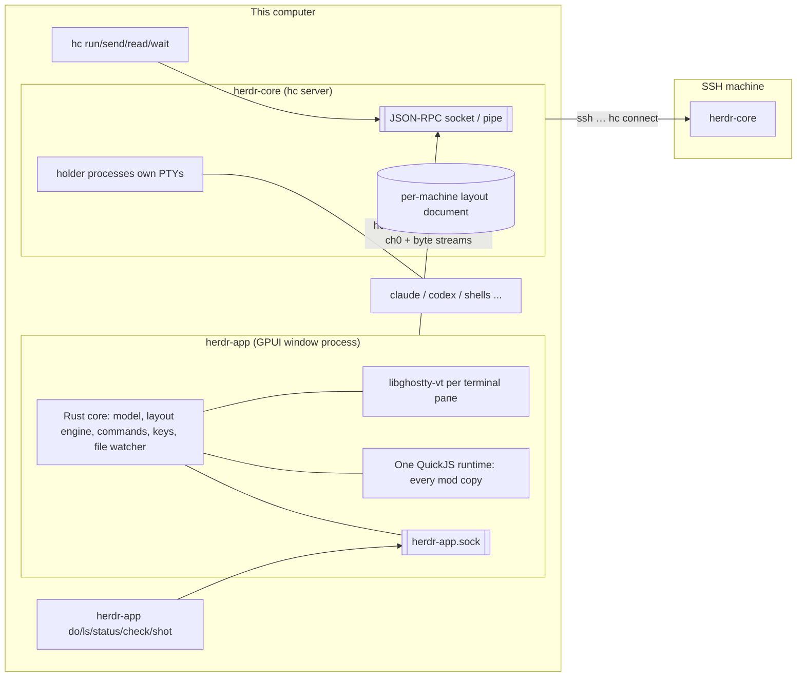
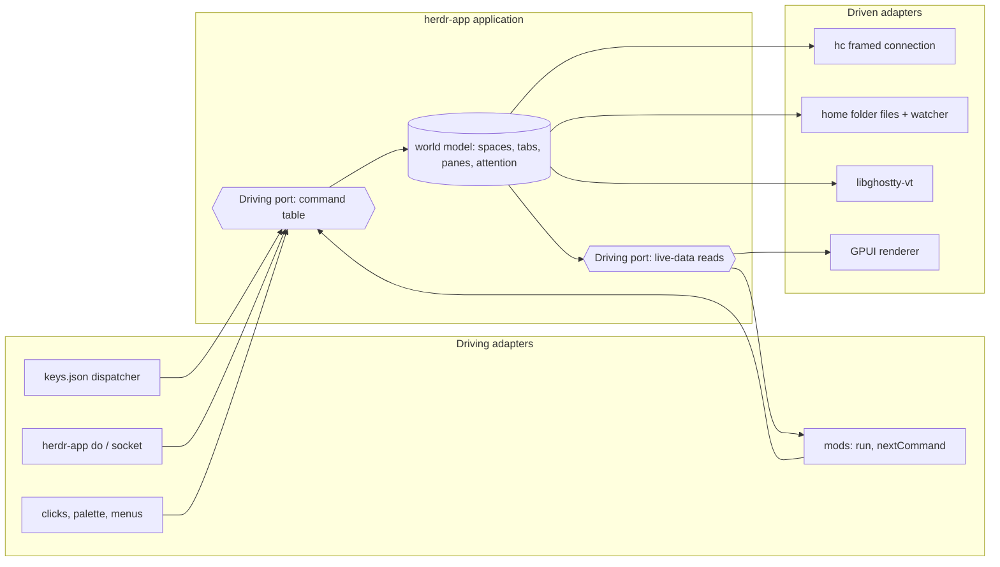

# Herdr (v2) architecture: an app made of mods

Research notes on how the Herdr app (the "Herdr 2" desktop app plus herdr-core) is built, and in particular how it is designed to be customised by coding agents. Researched 2026-11-07 against:

- herdr-app at `adf94cb` (2026-11-07, app version 0.1.13)
- herdr-core at `9ce385d` (2026-11-07, core 0.1.18)
- the v1 TUI repo `herdrdev/herdr` at `ee5bfb5` (2026-10-29, TUI 0.9.5)
- herdr.dev pages
- the locally installed app home `~/.config/herdr-app/` (read only)
- the difftate mod in this repo

Sections 7 and 9, and any paragraph marked **(synthesis)**, are my interpretation. Everything else is cited. The vocabulary in section 7 follows [hexagonal-architecture.md](hexagonal-architecture.md) section 0.

---

## 0. Cheat sheet (one page)

**The one idea.** The window is a small native Rust core. Almost everything you see is drawn by **mods**: small JavaScript programs that describe native GPUI elements. That includes the sidebar, agents list, tab bar, menus, dialogs and toasts. The built-in UI uses the same mods, API and files that users and their agents get. "Nothing in the default interface is special: the spaces sidebar, the agents list, the tab bar, menus, dialogs and notifications are built from the same parts you have" ([guide L13-15][g5]).

**Two programs** ([guide L17-25][g17]; [core README L6][cr6]):

| Program | Role | Draws? |
|---|---|---|
| `hc` / herdr-core | Terminal runtime. It runs every terminal and agent, keeps them alive, reads status (OSC 7501) and serves an OpenRPC API. | No. "Core draws nothing." |
| `herdr-app` | A native GPUI window. It is one client of core, and it shows spaces, tabs, panes, layouts and mods. | Yes |
| Herdr TUI (`herdr`, v1) | The original. A ratatui terminal app with its own server. It does not share agents with v2 and still works. | In a terminal |

**The customisation stack**, from shallow to deep. All of it is plain files in `~/.config/herdr-app/`, reloaded live ([guide L74-91][g74]):

1. `settings.json`: the person (zoom, fonts, theme, sounds).
2. `themes/*.json`: colours.
3. `keys.json`: any key mapped to any command, with sections `global`, `layout:<name>`, `terminal` and `mod:<name>`.
4. `programs.json`: how programs and agents are named and shown.
5. `layouts/<name>.json`: the whole window as a tree of `row`/`column`/`stack`/`block` nodes. A block shows a mod, a terminal, the active tab or the focused agent.
6. `mods/<name>/main.js`: panels written in JS against the `gpui-kit` UI and the `herdr` API.

**Designed for agents, not just users:**

- `AGENTS.md` and generated `herdr.d.ts` / `gpui-kit.d.ts` files are written into the home on every start, matching the running version ([app AGENTS.md L34-42][aa34]).
- There are CLI manuals: `herdr-app --skill` and `hc --skill`.
- `herdr-app check` validates a mod, and `herdr-app shot` screenshots the window so an agent can see its work.
- `herdr-app do <command>` drives the window.
- The gallery's install flow is one line you paste to your agent: "Read ~/.config/herdr-app/AGENTS.md, then add this layout: herdr.dev/layouts/…".
- Sharing works through a `RECIPE.md`, a brief another agent can rebuild the layout or mod from.

**One command list.** Keys, menus, mods (`run(name, args)`), the CLI and agents all go through the same command table ([guide L529-530][g529]; [commands.rs L1-3][cmds1]).

**The core stays small, by rule.** Before adding anything to the app's core, the maintainers ask three questions ([app AGENTS.md L15-29][aa15]):

1. Does the app itself act on it?
2. Can only the app see it?
3. Can mods not do it correctly?

If all three answers are no, it goes in a mod, "even at the price of some repetition". Issues asking for features a mod can do are closed ([CONTRIBUTING L3-11][contrib]).

**Safety model.** Mods are trusted code, not sandboxed:

- `exec` and the network are unrestricted.
- Files can be read under home and written only under the app home.
- None of this is a security boundary ([security.md L3-10][sec]; [mods.rs L1140-1149][caps]).

**Robustness model** ([guide L51-61][g51]):

- A broken save keeps the last good version and writes `<name>.error`.
- Shipped mods and layouts are replaced on every start. You `mod.clone` or `layout.clone` before editing, and a hand-edited shipped file is moved aside to `<name>-edited`.
- `ctrl-alt-shift-escape` always resets the layout and keys.

**Main trade-offs:**

- Mods have full user access.
- There is no declared API version or compatibility range per mod.
- The UI runtime (gpui-shell) calls itself "milestone M0 … not a stable interface" ([gpui-shell README L28][gs28]).
- All mods share one JS runtime in the window process.
- The terminal renderer itself is not pluggable.

---

## 1. Overview: herdr-core, herdr-app, the TUI

### 1.1 What each one is

- **herdr-core (`hc`)** is "a terminal runtime for coding agents" ([core AGENTS.md L5-8][ca5]).
  - It runs programs in terminals and keeps them alive.
  - It relays raw bytes to any viewer and reads status from OSC 7501.
  - It lets agents start, talk to, read, wait on and be notified by other agents.
  - "It draws nothing."
  - Its governing rule: "Core is a runtime, not a multiplexer. If a feature only makes sense with a layout or a workspace to return to, it does not belong here" ([core AGENTS.md L22-25][ca22]).
- **herdr-app** is "The Herdr 2 desktop app (`herdr-app`): a native GPUI client of herdr-core" ([app AGENTS.md L3-4][aa3]). Its README says: "The window arranges terminals. The core runs them" ([app README L59][ar59]).
- **Herdr TUI** (`herdr`, repo `herdrdev/herdr`, v0.9.5) is described on the homepage as "the original Herdr", a terminal app with its own server. "The two don't share agents, and Herdr TUI keeps working" ([herdr.dev][home]). It is a Rust binary using `ratatui` and `crossterm` ([TUI Cargo.toml L34-41][tuicargo]) and advertises "one rust binary, no electron" ([TUI README L38][tuireadme]).

### 1.2 Languages and frameworks

| Piece | Tech | Source |
|---|---|---|
| App window | Rust 2024. GPUI from the published `gpui-pre` crate 0.3.8, with platform crates for macOS, Linux (Vulkan via wgpu) and Windows, several of them vendored and patched (`HERDR:` markers). | [app Cargo.toml L19-23, L71-94][acargo]; [app README L13][ar13] |
| Terminal emulation (app side) | libghostty-vt through the `ghostty-sys` bindgen crate (Zig build). "libghostty-vt fed with the relayed bytes, read back as frames to draw, and asked to encode keys and mouse input." | [vt.rs L1-2][vt]; [ghostty-sys Cargo.toml][gsys]; [app README L117][ar117] |
| Terminal runtime (core) | Rust, with its own `ghostty-vt` crate. libghostty-vt "comes from fresh upstream Ghostty master". | [core AGENTS.md L32-33][ca29]; core `crates/` listing |
| Mod runtime | **gpui-shell** (part of a vendored `gpui-kit`), which embeds **QuickJS** (`rquickjs`, a `quickjs-jit` fork) | [gpui-shell README L1-26, L424-447][gs1]; [app Cargo.toml L71-94][acargo] |
| Mod UI kit | `gpui-kit` (GPUI elements plus a style surface), `gpui-base` (unstyled components: Button, Input, Editor, Table, VirtualList, DockArea…) | [gpui-kit.d.ts header][dts] |
| App↔core protocol | JSON-RPC 2.0 over a Unix socket or named pipe, with a framed binary mode for terminal streams. `hc connect` carries it over stdio, and so over SSH. | [core schema/README L22-48][csr] |
| App control socket | `$HERDR_APP_HOME/herdr-app.sock`, "one JSON line each way" | [control.rs L1-3][ctl] |

What "no web view" means here: gpui-shell "is not an Electron or a Tauri. There is no WebView, no DOM, no HTML or CSS, no browser engine, and no Node.js. A script never renders. It describes an interface once, and Rust replays that description into real GPUI elements on every frame after it" ([gpui-shell README L15-20][gs15]).

### 1.3 Process and runtime model



Facts behind the diagram:

- **Terminals live in core.** Holder processes own the terminals, so a core restart or update can leave programs running ([core security.md L8-11][csec]). Closing or updating the app leaves terminals running ([app README L59-61][ar59]).
- **The app keeps one framed connection to core** through `hc connect`: JSON-RPC on channel 0, terminal byte streams on their own channels ([hc.rs L1-2][hcrs]). Each terminal pane feeds the relayed bytes into libghostty-vt and draws the frames with GPUI ([terminal.rs L1-2][term]).
- **Structure is stored in core.** Spaces, tabs and splits live in each machine's core "`herdr-app` document", not in the app home. Connected screens share the structure but not focus or zoom ([guide L95-103][g95]; [security.md L22-23][sec]).
- **One JS runtime per window.** The window creates a single `ShellRuntime`, and if it fails, "mods are off" ([window.rs L464][win464]). Each mod copy gets its own `Policy`: its own `herdr` module instance with its props and identity, and its own `localStorage` file under `data/<mod>/` ([mods.rs L1170-1196][prep]).
- **Control socket.** The app serves `herdr-app.sock`, and a second launch just raises the running window ([control.rs L19-36, L59-60][ctl]).
- **Remote machines.** Remote work goes through the core over SSH, and other machines run their own cores ([security.md L28][sec]; [core README L94-104][cr94]).

---

## 2. The v1 TUI to v2 app change

**What I could and could not find.** None of the following states why they rewrote:

- the blog (latest post Sep 8, 2026)
- the app and core changelogs
- the TUI changelog
- the TUI page

The blog has no post about Herdr 2, herdr-core or mods ([herdr.dev/blog][blog]). The TUI's `docs/next/product-announcement.json` is `null`. I found no ADRs in any of the three repos. The rationale below is therefore partly **inferred** from what each side says about itself.

### 2.1 What they say

- "This is a new app on a new core. Your herdr workspaces stay where they are; nothing moves over." "Same idea as before: spaces, tabs and terminals." (welcome screen, [welcome/main.js L276][welcome])
- 0.1.6: "Coming from herdr? The welcome says what carries over and gives you one line for your agent to bring your keybinds and settings across" ([app CHANGELOG L164][achg164]). The migration itself is delegated to an agent.
- Core rules: "Fresh code. Do not copy from Herdr 1 … Read it for ideas, lessons and edge cases" ([core AGENTS.md L29-31][ca29]). "Status comes only from OSC 7501. No screen detection, no agent registry, no vendor-specific logic. This is the one most likely to be helpfully added; don't" ([L34-36][ca29]).
- The homepage presents v2 as "a new, separate program built on herdr-core". herdr-core is "a small server on your machine, not in the window" ([herdr.dev][home]).
- Timeline: core's first public release was 0.1.10 on 2026-10-23 ([core CHANGELOG L104][cchg]). The app's changelog starts at 0.1.4, also 2026-10-23 ([app CHANGELOG L196][achg196]).

### 2.2 What changed (from comparing the two)

| Concern | v1 Herdr TUI | v2 Herdr app + core |
|---|---|---|
| UI tech | ratatui in your terminal ([TUI Cargo.toml][tuicargo]) | Native GPUI window ([app AGENTS.md L3][aa3]) |
| Server | Herdr's own server inside the same binary ("a server running in the background, and the terminals live inside it", [herdr.dev/tui][tui]) | Separate runtime `hc` that "draws nothing". The app is "one client of it" ([guide L20-23][g17]) |
| Agent status | Detection: "22 agents detected out of the box" ([herdr.dev/tui][tui]); the TUI installs per-agent integrations such as Claude Code and Codex hooks ([TUI CHANGELOG L867, L932][tuichg]) | Only self-reported OSC 7501. "No screen detection, no agent registry" ([core AGENTS.md L34-36][ca29]) |
| Look and feel | `config.toml` with built-in themes, keybindings, custom command keys, and sidebar rows as token arrays such as `["state_icon","workspace"]` ([TUI configuration.mdx L124-310, L362-380][tuiconf]) | Layout JSON for the whole window, plus mods that draw any panel ([guide L168-230][g168]) |
| Extensions | **Plugins**: a `herdr-plugin.toml` manifest declaring actions, event hooks, terminal panes and link handlers. Commands are any argv program (Bash, JS, Lua, Rust…) that call back through the Herdr CLI and socket. "There is no separate plugin SDK… The entire Herdr CLI is the plugin API." "Runtime action registration and native non-terminal plugin UI are not part of plugin v1" ([TUI plugins.mdx L6-32][tuiplug]) | **Mods**: in-process JS describing native UI, with live data and commands. The built-in UI is itself mods ([guide L819-829][g819]) |
| Plugin panes | Terminal programs placed as `overlay`, `popup`, `split`, `tab` or `zoomed` ([TUI plugins.mdx L299-330][tuiplug299]) | Any block in a layout, a pane (`pane.split {mod}`), a tab (`tab.new {mod}`), an overlay (dialog, popup or window), or floating blocks and drawers ([guide L372-420][g372]; [herdr.d.ts `openOverlay`][dts]) |
| Versioning of extensions | `min_herdr_version` is required in the manifest, and install is refused if it is newer than the binary ([TUI plugins.mdx L95-99][tuiplug]) | No version field in `mod.json` (it holds only `place`, `size`, `focusable`, [mods.rs L336-345][hint]). Instead, types are regenerated per version and there is a compatibility rule for the maintainers (section 5) |
| Distribution | Marketplace from the GitHub topic `herdr-plugin`, `herdr plugin install` with a source preview ([herdr.dev/tui/plugins][tuiplugins]) | Gallery from the GitHub topics `herdr-layout` / `herdr-mod`. Install means "tell your agent" one line, and the agent reads the files ([guide L424-475][g424]; gallery) |

**Inferred reasons (synthesis):**

1. **The plugin ceiling.** v1 plugins could only add terminal programs and CLI calls, explicitly with no "native non-terminal plugin UI". A TUI cannot easily host arbitrary native panels. v2 makes native UI the extension unit.
2. **Separate the runtime from the viewer.** "Core is a runtime, not a multiplexer" lets several clients (the app, a phone app, scripts, other agents) share one terminal world. The changelog notes that "Seen and pinned agents are shared between Herdr windows and the phone app" ([app CHANGELOG L49][achg49]).
3. **Agent-native customisation.** Every user-facing surface is a file plus a guide, so "ask your agent" replaces config reference docs.

---

## 3. Extension architecture in depth

### 3.1 The pieces a user or agent can change

```
~/.config/herdr-app/                     (app home; HERDR_APP_HOME overrides)
├── AGENTS.md         generated guide        ─┐ rewritten on every start
├── herdr.d.ts        generated herdr API     │ (don't edit)
├── gpui-kit.d.ts     generated UI API       ─┘
├── settings.json     the person (zoom, fonts, theme, sounds)          live
├── keys.json         every key binding                                 live
├── programs.json     how programs/agents show                          live
├── themes/*.json     colour schemes                                    live
├── layouts/<name>.json  whole-window trees; layouts/.state/ = clicks   live
├── mods/<name>/      main.js + mod.json + assets                       hot reload
├── frame/            the app's own screens (welcome, settings, palette) rewritten
├── shared.json, data/<mod>/store*.json   mod state                     app-written
└── herdr-app.sock    control socket
```

Sources: [guide L74-91][g74]; [mods.rs L64-80][ws]; [security.md L14-27][sec]. The watcher reloads only `mods/`, `layouts/`, `themes/`, `settings.json`, `keys.json` and `programs.json`, using one OS watcher (FSEvents, inotify) ([files.rs L1-3, L60-69][files]). It skips the files the runtime writes into a mod (typings, jsconfig) and editors' hidden or backup files ([files.rs L72-75][files]).

### 3.2 What a mod is

**Shape** ([guide L786-800][g786]):

```
mods/<name>/
  main.js     required; default-exports a class extending View
  mod.json    { "place": "right"|"left"|"top"|"bottom"|"none", "size": 320, "focusable": true }
  *.js, *.svg, fonts/   more ES modules ("./ui.js"), icons, fonts
```

- **Manifest.** `mod.json` is a *placement hint*, not a contract. The app parses only `place`, `size` and `focusable` ([mods.rs L336-345][hint]). "The first time Herdr sees a folder, it docks one copy per `mod.json` into the shown layout (`"none"`: only where a layout or another mod puts it). After that, the layouts decide" ([guide L801-803][g786]). Shipped mods also put `title` and `overlay` defaults in `mod.json`, for example `picker` with `{"kind":"popup","at":"top",…}` (`defaults/mods/*/mod.json`). The terminal-menu docs say a mod's `mod.json` overlay width and height override the popup defaults ([guide L268-275][g168]).
- **Entry point and lifecycle** ([guide L880-905][g880]):
  - `init(props, cx)` runs once.
  - `render(cx)` returns a description. It reruns after `cx.notify()` *and automatically whenever live data it read changes* (spaces, agents, terminals, focus, theme, shared state). "Don't poll those."
  - Optional `async close(cx)` gets one bounded final call with a 250 ms budget.
  - Each callback gets its own `cx`: "Never keep a `cx` and use it later."
  - There is no `setTimeout`; use `cx.timer.every` and `cx.spawn`.
- **Dependency tracking is real.** The app records which snapshot keys a copy read (`layout`, `spaces`, `agents`, `panes`, `terminals`, `focused`, …) and re-renders only copies whose read keys changed revision ([mods.rs L582-665][snap]).
- **Instances ("copies").** "A copy starts the first time it shows, then stays alive while its block is in the layout, shown or not". Hidden copies keep their timers. "Another layout starts its mods fresh (pane mods belong to their tab and stay)". "`<mod>.<command>` reaches shown copies only" ([guide L809-816][g809]; [mods.rs L668-699][snap]).
- **Rendering cost model.** "`render` does not run every frame… A hover, a scroll, a blinking cursor or an animation repaints without entering the VM at all" ([gpui-shell README L288-292][gs288]). The guide forbids timer-driven animation, because "every redraw of a mod redraws the whole window". Use `.frames()`, `.spin()`, `.loop()` and `.transition()` instead ([guide L907-918][g907]).

```mermaid
sequenceDiagram
  participant FS as file watcher
  participant App as herdr-app (Rust)
  participant RT as QuickJS (gpui-shell)
  participant Mod as mod copy
  App->>RT: prepare_load(copy): Policy{herdr module, storage file, capabilities}
  RT->>Mod: import main.js, new View; init(props, cx)
  loop on notify or live-data change
    App->>Mod: render(cx)
    Mod-->>App: element description (spec)
    App->>App: replay spec as GPUI elements every frame
  end
  Mod->>App: run("pane.split", {...}) / exec / fetch / setShared
  FS->>App: mods/<name>/main.js saved
  App->>RT: reload every module; on failure keep old build, report in status
  App->>Mod: close(cx) when block/pane/overlay goes (250 ms)
```

### 3.3 Loading, isolation, hot reload, versioning

- **Hot reload.** "Saving any file reloads every copy in place … The old build's tasks and timers stop … A broken save keeps the old version running and shows in `herdr-app status`; its top-level code has already run, so keep side effects on `globalThis` out of the module's top level" ([guide L803-808][g786]). gpui-shell: "A reload re-reads every module, entry included. If the new code fails to load, the previous view keeps running" ([gpui-shell README L149-151][gs149]). The memory note that a symlinked install does not hot reload is consistent with the watcher using paths relative to the home ([files.rs][files]). I did not verify this.
- **Isolation.**
  - Each copy has its own policy object and storage file, and plugin unload cancels every task carrying that policy ([gpui-shell README L420][gs420]).
  - All copies share one runtime and one process ([window.rs L464][win464]), and the Cargo file notes that modules "must share its quickjs-jit VM" ([app Cargo.toml L71][acargo]). I did not verify whether each copy gets a separate JS context.
  - Mods "can't … read or change other mods' code at run time" ([guide L35-37][g27]). They communicate through `shared(key)` / `setShared` (persisted, and every mod re-renders) and through `<mod>.<command>` messages ([herdr.d.ts][dts]).
- **Permissions.** gpui-shell's own model is capability-based and denies by default. It has fine-grained `fs`, `network.hosts` and `network.http` grants in a `gpui-shell.json` ([gpui-shell README L298-330][gs300]). Herdr uses that machinery but grants one policy to *every* mod ([mods.rs L1140-1149][caps]):

  ```rust
  Capabilities::new()
      .read_roots([home()]).write_roots([app_dir()])
      .execute(ExecuteGrant::Unrestricted).network(NetworkGrant::Unrestricted)
      .storage(true).clipboard_read(true).clipboard_write(true)
  ```

  The docs say so plainly: "Mods are trusted code, not sandboxed extensions" ([app README L93][ar93]). "The built-in file API limits writes to the app home, but a mod can run a program to write elsewhere. That is not a security boundary" ([security.md L5-9][sec]).
- **Shipped versus personal.**
  - Shipped mods and layouts are embedded in the binary and "replaced whole on every start".
  - If you edited one, "the next start moves it to `<name>-edited` … restores Herdr's version and shows a toast" ([guide L186-212][g186]).
  - The mechanism is per-file fingerprints recorded in `installed.json` ([mods.rs L99-136][sync]).
  - `mod.clone` / `layout.clone` make a personal copy that is "yours and never updated". It records `cloned_from: {name, version}` and rewrites its own asset paths ([guide L194-205][g186]).
- **Versioning.** There is no API version in `mod.json` and no compatibility range per mod. What exists instead:
  1. Generated `.d.ts` files rewritten on every start "to match this version" ([guide L45-47][g39]). The repo's current `herdr.d.ts` already has an `exec(..., {timeout})` option that the copy in this repo's mod lacks, which shows the typings tracking each release ([herdr.d.ts L10-13][hdts]).
  2. A maintainer rule: "Preserve compatibility with released versions and installed user data" ([app AGENTS.md L9-13][aa9]).
  3. Clones record `cloned_from` versions.

### 3.4 The mod API surface

Two kinds of import ([guide L39-47][g39]; [gpui-kit.d.ts L1-27][dts]): `gpui-kit` / `gpui-base` (UI) and `herdr` (the app). There are also Node-ish shims (`fs/promises`, `path`, `crypto`, `net`, `websocket`, `process`), `fetch`, `localStorage` and `console`.

| Area | API | Notes |
|---|---|---|
| UI elements | `div()`, `svg()`, `image()`, `list`, `uniform_list`; chained GPUI style methods in snake_case (`.size_full().p(10).gap(4)`) | The style surface is generated from GPUI's reflection tables, "so a style method that type-checks exists at run time" ([gpui-kit.d.ts L19-23][dts]; [gpui-shell README L153-162][gs149]) |
| Components | `gpui-base`: Button, Checkbox, Switch, Tabs, Table, Popover, Select, Combobox, Input/Textarea, **Editor/EditorState** (code editor with syntax colours, line numbers, folding, read-only or editable), `v_virtual_list`, resizable panels, `DockArea` | Unstyled by contract: "Button.new("save") with no styling draws nothing but its children" ([gpui-shell README L30-38][gs1]) |
| Live data | `spaces()`, `machines()`, `agents()`, `panes()`, `terminals()`, `focused()`, `layout()`, `layouts()`, `theme()`, `themes()`, `settings()`, `keys()`, `commands()`, `window()`, `placement()`, `updates()` | Reads are tracked; a change re-renders ([herdr.d.ts][dts]; [mods.rs L649-665][snap]) |
| Act | `run(command, args)`: the same commands as keys and the CLI | ([herdr.d.ts `run`][dts]) |
| Commands in | `nextCommand()`: an async stream of `<mod>.<command>` from keys.json, the CLI (`herdr-app do difftate.refresh`) and `pane.go` focus | ([guide L1006-1011][g942]) |
| Overlays | `openOverlay({mod, props, kind: dialog\|popup\|window, layout?, key, keep})`, `closeOverlay`, `notify()` (drawn by the replaceable `toast` mod) | Windows can hold a *layout* containing live terminals ([guide L970-985][g942]) |
| Machine | `exec(cmd, args, {cwd, on})` (real env; `on` runs on a remote machine through core), `hc(args)`, `knownAgents()`, `pickFolder()`, `playSound()` | 30 s / 8 MiB limits ([herdr.d.ts][dts]) |
| Files | `readTextFile(path, {on})`, `writeTextFile(path, text, expected)` (compare-and-swap: rejects a stale snapshot), `watchFolder(dir)` | ([herdr.d.ts][dts]) |
| State | `props()` (per copy), `shared()`/`setShared()` (global, persisted to `shared.json`), `localStorage` (per copy) | ([guide L1006-1015][g942]) |
| Terminal access | A layout block `{terminal: "t7"}` / `{tab:"active"}` / `{agent:"focused"}`; commands `terminal.open/keep/park/peek/show/scroll/kill`; `hc read` for text | Mods cannot change how a terminal draws text ([guide L35-37][g27]) |

**Keymaps** ([guide L477-525][g477]):

- Sections are `global`, `layout:<name>`, `terminal` and `mod:<name>`, and the more specific section wins.
- An action is a command (`name` or `name:value`), `send:<text>`, `<mod>.<command>`, or `terminal` (pass the key through).
- Objects pass typed arguments.
- An untouched `keys.json` is upgraded to new defaults. Any edit freezes it as yours.

**Themes.**

- A theme defines `background`, `foreground`, `selection` and `ansi[16]`, and panel colours are derived from those.
- The look cascades: layout look, then settings, then the theme picker ([guide L297-345][g297]).
- Mods read semantic names (`surface`, `chrome`, `accent`, `working`, `blocked`…) so they follow light and dark modes ([herdr.d.ts `theme`][dts]). The app also maps the theme onto gpui-base tokens ([mods.rs L1116-1138][caps]).

### 3.5 Dogfooding: are the built-in features mods?

**Yes for the chrome and panels; no for the terminal.**

- The shipped `main` layout is built from mods `spaces`, `agents`, `tabs`, `workspace-chrome`, `workspace-status`, `files`, `changes` and `pane` (`defaults/layouts/main.json`). The guide lists the defaults as mods to read as examples: `spaces`, `agents`, `tabs`, `menu`, `prompt`, `confirm`, `help`, `toast`, `picker`, `peek`, `pane`, `worktree` ([guide L819-829][g819]). There are 21 shipped mods, about 6,300 lines of JS (`defaults/mods/`).
- The app's own screens (welcome, settings, palette, feedback, what's new) are mods too, in `frame/`. They are "rewritten by Herdr on every start … so no edit or broken mod can break them", and are loaded as `frame-<name>` ([mods.rs L25-30][ws]; [guide L74-91][g74]).
- **The terminal is native**: libghostty-vt plus a Rust GPUI pane ([terminal.rs L1-2][term]). Layout nodes (row, column, stack, block, floating, pane frames) are also native ([layout.rs], [guide L220-260][g168]).
- **The "code editor".** What ships is the `Editor`/`EditorState` *component* in `gpui-base`. Its source folder includes highlighting, search, diagnostics, indentation and LSP integration (`vendor/gpui-kit/crates/base/src/input/README.md`). The shipped `files` mod uses it read-only (`defaults/mods/files/main.js` L141). The official "Code" gallery layout says plainly that "the code view is a fixed, read-only slice of one CSS file" (gallery data). Herdr ships editor *parts* and leaves the editors to mods. The difftate mod in this repo builds its own vim-style editor from `v_virtual_list` rather than `Editor` (`herdr/mods/difftate/main.js` L13, `edit.js`).

### 3.6 The difftate mod as a worked example

From [herdr/mods/difftate](../../herdr/mods/difftate):

- **`mod.json`:** `{"place":"none","title":"Review","overlay":{"kind":"popup",…}}`. The mod is never docked automatically. Opened with `mod.open difftate`, it starts as a tiny popup, sees `props().overlay`, closes itself, and runs `tab.new {mod:"difftate", props:{folder}}`. This is a "launcher" pattern (`main.js` L104-123).
- **Imports:** `View, div` from `gpui-kit`; `v_flex, h_flex, InputState, Input, Scrollbar, v_virtual_list` from `gpui-base`; and `exec, readTextFile, theme, settings, props, run, closeOverlay, focused, panes, spaces, nextCommand, appHome, home` from `herdr` (`main.js` L12-14).
- **Driven side:** it uses `exec("git", …)`, `readTextFile` of `<git-common-dir>/difftate/api.json`, and `fetch` to the watcher's local HTTP API (`api.js` L13-27, L53). It saves with `writeTextFile(target, text, disk)`, using the compare-and-swap argument for conflict detection (`edit.js` L370-385).
- **Driving side:** a `nextCommand()` loop, so every action is reachable as `difftate.<action>` from `keys.json` or `herdr-app do` (`main.js` L175-177; README "Actions").
- **Own keymap layer:** the mod keeps vim-style `keymap.json` defaults and a user override file outside the app home (`keymap.json`, `README.md`). This is a mod-level customisation layer on top of Herdr's `keys.json`.
- **Typings:** a `gpui-kit.d.ts` file (gpui-shell 0.7.1) is written into the mod folder by the runtime, and a `jsconfig.json` gives editor type-checking ("Written once by gpui-shell, then yours").

---

## 4. Designed to be customised by coding agents

- **The guide is for the agent, and it lives in the app.** herdr.dev/guide says: install, start an agent from `+`, and "Point it at the guide. That's the whole tutorial". The guide "always matches the version you have" ([herdr.dev/guide][guide]). The guide page has no subpages. Its single deep link is `defaults/AGENTS.md`, which is the installed `~/.config/herdr-app/AGENTS.md`. The page lists example prompts: a board layout, per-tab timers, adding a machine, a reviewer agent, a worktree per issue, theme changes, ntfy notifications, installing a gallery item ([herdr.dev/guide][guide]).
- **The guide opens with intent → files.** "When someone asks for something ("a sidebar of my PRs", "give ctrl+1 back to the shell", "make it warmer", "move the agents list to the right"), you do it by editing these files or writing a mod" ([guide L10-15][g5]).
- **Docs are kept true by tests.** "A change to what users or agents can do … updates it in the same commit. `cargo test` checks that it names every command and settings.json key". The `.d.ts` files "are generated and are the full API" ([app AGENTS.md L34-42][aa34]; test at [commands.rs L172-177][cmds172]). The core does the same: the CLI is "one call per command", generated from one method table that is also the published schema ([core AGENTS.md L38-41][ca29]).
- **Typed, generated, local API files.** `herdr.d.ts` and `gpui-kit.d.ts` are written into the home and into each mod folder. gpui-shell: "a style method that type-checks exists at run time" ([gpui-kit.d.ts L19-23][dts]).
- **Feedback tools for an agent's loop:**
  - `herdr-app check <mod>`: "Never call a mod done without a passing check".
  - `herdr-app status`: shows errors from files and mods.
  - `herdr-app shot`: a PNG of the real frame, with no screen-recording permission needed ([guide L54-72][g51]; [SKILL.md L124-136][skill]). The changelog states the purpose: "Agents can see the window… so an agent building a mod can check its work" ([app CHANGELOG L184][achg184]).
- **Skills.**
  - `herdr-app --skill` prints the window manual ([src/SKILL.md][skill]).
  - `hc --skill` prints the core manual.
  - An installable stub skill tells agents to prefer hc "over your own sub-agent tool, shell '&', nohup or tmux" ([core skills/herdr-core/SKILL.md L1-15][cskill]).
- **Commands that never prompt agents.** "When the user runs a command without a required name … Herdr asks them. **You never get a dialog**: pass every required argument". Unknown argument names are errors ([guide L527-535, L630][g529]).
- **Guard rails written into the guide:** "One mod per idea", "Don't touch other mods unless the request needs it", use theme colours, native animation, and the escape hatch ([guide L1030-1035][g1034]; [L59-61][g51]).
- **Gallery and recipes.**
  - The gallery lists 215 layouts, 435 mods and 393 people ([herdr.dev][home]).
  - Install: copy a "Tell your agent" line such as `Read ~/.config/herdr-app/AGENTS.md, then add this layout: herdr.dev/layouts/herdrdev/board` (gallery `data-line`).
  - The guide tells the agent to read every file first, warn about network, `exec` and outside-folder reads, never overwrite (rename on a name clash), merge `keys.json`, and run `check` ([guide L424-449][g424]).
  - Sharing: put the item in a public repo with the topic `herdr-layout` or `herdr-mod`, plus a `RECIPE.md` and a `preview.png`. The recipe is "a brief: another agent with an empty folder builds the layout or mod from it", with fixed sections: What you see / How it behaves / Built from / Watch out / Done when ([guide L450-475][g424]; gallery "Share yours").
  - Recipes make the source of truth *the spec, not the code*: "If the files don't work on this version … build it from the recipe instead" ([guide L438-440][g424]).
- **A project policy that pushes users to agents.** "Herdr is built to be changed by your agent. If what you want can be done with a mod or a layout, build it". Issues for custom mods get closed, and shipped mods take fixes only ([CONTRIBUTING L3-11][contrib]).

---

## 5. Core versus extension boundary

```
┌──────────────────────── fixed (Rust, herdr-app) ──────────────────────────┐
│ world model: spaces/tabs/panes/focus/attention   (model.rs)               │
│ command table (one list)                          (commands.rs)           │
│ layout engine: row/column/stack/block, floating, pane frames (layout.rs)  │
│ terminal pane: libghostty-vt + GPUI drawing       (vt.rs, terminal.rs)    │
│ keys dispatch, file watcher, settings/theme cascade, updates, telemetry   │
│ control socket, check/shot, mod host + herdr module (mods.rs)             │
├──────────────────────── pluggable (files + JS) ───────────────────────────┤
│ every panel/menu/dialog/toast/header/sidebar (mods)                       │
│ window arrangement & look (layouts, themes, settings)                     │
│ every key (keys.json), program names/icons (programs.json)                │
│ agent-list order (setAgentOrder), terminal right-click menu (layout root) │
└───────────────────────────────────────────────────────────────────────────┘
┌──────────────────────── fixed (herdr-core) ───────────────────────────────┐
│ PTYs, holders, keep/recover, status from OSC 7501, parent/child agents,   │
│ machines over SSH, OpenRPC API (grows only)                               │
└───────────────────────────────────────────────────────────────────────────┘
```

- **The admission test** for growing the app core is the three questions in section 0 ([app AGENTS.md L15-29][aa15]). The test puts in core only what the app *acts on*, what only the app *can see*, or what mods *cannot do correctly*. Agent navigation order is an example of the line: the app owns `agent.next`, but "Agent navigation order belongs to the mods", which call `setAgentOrder()` ([guide L161-163][g95]).
- **"Every layout shows the same world; a layout may show less, never a different one"** ([guide L95][g95]). The model is fixed, and views are free.
- **Stable contracts:**
  - The **core API "only grows"**. `released.openrpc.json` is checked in, and "a test fails on any change that would break a client of it". "A real break needs a new protocol generation, decided on purpose" ([core schema/README L14-19][csr]). Feature flags are negotiated in `hello` (for example `automatic_input`, `resize_notifications`) ([core schema/README L74-100][csr]).
  - The **app** has a written rule, not a mechanical check: "Preserve compatibility with released versions and installed user data. Discuss breaking changes … before changing documented behavior" ([app AGENTS.md L9-13][aa9]). The command table is checked against the guide, and unknown arguments are rejected for every command ([commands.rs L172-185][cmds172]).
  - **Personal files are never overwritten.** Edited `keys.json` is kept, clones are never updated, and edited shipped files are moved aside rather than lost ([app AGENTS.md L44-52][aa44]; [mods.rs L99-136][sync]). A `0.1.x` layout is "kept aside quietly" by name in a test ([mods.rs L1476][sync]).
- **What is not stable:** gpui-shell, the UI runtime itself, is "milestone M0: a feasibility baseline, not a stable interface" ([gpui-shell README L28][gs28]), and its engine seam is "dependency isolation, not a replaceable-engine contract" ([L436][gs1]). The mod API has no explicit version. Breaking changes would show up as `check` failures after an update, with the recipe as the fallback.

---

## 6. Control surface

| Surface | Talks to | Examples | Source |
|---|---|---|---|
| `herdr-app do <cmd> [--k v \| json]` | the window over `herdr-app.sock` | `tab.new --name "fix login" --argv '["claude"]' --task "…"`, `pane.split --direction right --pane p12`, `layout.switch`, `mod.clone`, `difftate.refresh` | [SKILL.md L33-68][skill]; [docs/commands.md][acmd] |
| `herdr-app ls / status / commands / check / shot / --skill` | inspect the window; `commands` works without a window | | [app README L95-111][ar93] |
| mod `run(name,args)` | the same command table | | [guide L529][g529] |
| `keys.json` | the same command table, plus `send:` and `terminal` | | [guide L489-500][g477] |
| `hc run/send/read/wait/ls/attach/events/get/label` | core | `hc run --bg --name review reviewer "…"`, `hc wait --children all` | [core README L28-104][cr6] |
| Core JSON-RPC (plain or framed), `hc schema` (OpenRPC), `hc connect` (stdio, works over ssh) | core | custom clients | [core schema/README][csr] |

Commands are grouped as `space.*`, `tab.*` (including `settle`), `pane.*`, `terminal.*`, `agent.*`, `layout.*`, `mod.*`, `overlay.*`, `app.*` and `window.*`. They print created ids or `{error}` and exit 1 on failure ([guide L531-640][g529]).

**Agent detection.** Status is self-reported by the program over OSC 7501 (working, blocked, done, idle). "Core stores what it reports. It does not guess from screen text or recognize agent brands" ([core README L106-112][cr106]). "done" means it finished while you were not looking ([guide L153-157][g95]). The display identity (name, icon) comes from `programs.json` plus the agent's own `app` report ([guide L744-770][g744]).

**External tools join the window through labels.** "A terminal with those labels shows up there, even one you start yourself: `hc run --keep --label herdr.space=<id> --label herdr.tab=<id> -- claude`". Unlabelled workers stay hidden ([guide L138-151][g140]; [SKILL.md L91-96][skill]). Sub-agents started with `hc run` inside a terminal are recorded as children ([core README L82-85][cr6]).

---

## 7. A ports-and-adapters reading (synthesis)

This is my mapping, using the vocabulary of [hexagonal-architecture.md §0](hexagonal-architecture.md). Herdr does not describe itself in these terms.

There are really **two hexagons**:

1. **herdr-core** is a clean hexagon. Its application is "terminals that stay alive + parent/child agents + status".
   - Driving port: the OpenRPC method table. Its adapters are the `hc` CLI, the JSON-RPC socket and `hc connect`, all generated from one table ([core AGENTS.md L38-41][ca29]).
   - Driven ports: PTY and process spawning (behind `platform/`), SSH machines, and state on disk.
   - Its rules ("Deciding code stays separate from IO, so it tests without processes"; OS quirks only in `platform/` behind one interface) are literally hexagonal ([core AGENTS.md L45-49][ca29]).
2. **herdr-app** is a second hexagon whose application is "the world model plus the command table".



- **Driving ports.**
  - (a) The **command table**. It is one interface used by four adapters: keys, mods, socket CLI, and menus or palette. This is Cockburn's "equally driven by users, programs, automated test or batch scripts" almost word for word.
  - (b) The **live-data query** (`spaces()`, `agents()`…), which works like a read-model port.
- **Driven ports:**
  - the core connection (terminals, layout document)
  - the home folder (settings, layouts, keys, mods, shared state)
  - libghostty-vt (terminal emulation)
  - the renderer
  - `exec` / `fetch` for mods
- **Mods are an inversion.** They are *driving adapters* (they call commands) and also *presentation adapters* (they render the live-data read port). The built-in UI is "just adapters", which is why it can be replaced wholesale. This is the strongest hexagonal property in Herdr: the default UI has no privileged access to the application. In Cockburn's terms the UI sits outside the hexagon, and Herdr enforces that by making its own UI go through the public port.
- **Composition root.** In practice this is the **layout file**. It declares which adapter (mod) fills which slot, with which props. The `herdr` module instance per copy (`prepare_load`) is the wiring point in code ([mods.rs L1170-1196][prep]). The app's `main.rs` and `write_workspace` (installing defaults, writing guide and types) are the bootstrap ([mods.rs L64-80][ws]).
- **Weak spots in hexagonal terms:**
  - Mods also get raw `exec`, `fetch` and file access. That is a side door around the ports, so the application cannot reason about what a mod does.
  - The read port is untyped JSON snapshots, typed only by the `.d.ts` files.

---

## 8. Strengths, trade-offs, limits, open questions

**Strengths:**

- **Uniformity.**
  - One command table for keys, CLI, mods and agents.
  - One file-based home for every setting.
  - The default UI made of the same mods users get.
  
  As a result, any change a person can click, an agent can script ([guide L529-530][g529]).
- **Agent-legible by construction.** The docs live where the files are, they are version-matched, they are checked by tests against the command and settings tables, there are typed `.d.ts` files, and agents get `check` / `status` / `shot` as a feedback loop ([app AGENTS.md L34-42][aa34]).
- **Fails safe.**
  - The last good version keeps running and errors go to `*.error` or `status`.
  - The escape-hatch key cannot be rebound.
  - Shipped files are restored, and edits are preserved as `-edited`.
  - Personal files are never touched on upgrade ([guide L51-61, L186-212][g51]).
- **Native performance for scripted UI.** Scripts produce descriptions, and repaints, hovers and animations do not enter the VM ([gpui-shell README L288-292][gs288]). Changelog entries show ongoing CPU work on mods: "Mods use less CPU while they wait for work", and "The window no longer freezes … while mods run" ([app CHANGELOG][achg]).
- **A clean runtime/viewer split.** Terminals survive app crashes and updates, several clients share one world, and remote machines are first-class ([guide L17-25][g17]).
- **A recipe-based ecosystem** that survives API drift, because an agent can rebuild from the brief ([guide L438-440][g424]).

**Trade-offs and limits:**

- **No sandbox.** Every mod has your shell, network and file-read access ([security.md L3-10][sec]). Trust moves to "your agent reads every file first" ([guide L433-435][g424]). That is review by an LLM, not enforcement.
- **No per-mod API versioning or capability declaration**, even though gpui-shell supports per-app capability grants ([gpui-shell README L300-330][gs300]). v1 had `min_herdr_version`, and v2 dropped it (section 2.2).
- **The UI runtime is officially unstable** (M0) and vendored and patched ([gpui-shell README L28][gs28]; [app Cargo.toml L71-94][acargo]).
- **One shared JS runtime** in the window process ([window.rs L464][win464]). A runaway mod can affect the whole window. Earlier releases fixed "The window no longer freezes or spikes the CPU for seconds at a time while mods run" ([app CHANGELOG 0.1.11][achg]).
- **Fixed parts:** "change how a terminal itself draws text" is not possible, and neither are HTML/CSS, Node APIs or `setTimeout` ([guide L35-37][g27]). Per-block looks are "coming" ([guide L339][g297]).
- **Repetition is accepted by design.** The core-growth rule prefers duplicated code across mods to a bigger core ([app AGENTS.md L27-28][aa15]).
- **Telemetry is on by default** ([security.md L45-49][sec]).

**Open questions (not verified):**

- Whether each mod copy runs in its own QuickJS context, or only with its own policy in a shared context.
- How the app intends to evolve the mod API without a version field. Are breaking changes planned as "protocol generations", as in core?
- The explicit reason for the v1→v2 rewrite. No post or ADR was found.
- Whether a symlinked mod folder hot-reloads. The user's memory says no; the watcher code suggests it watches home-relative paths, but I did not test it.

---

## 9. Principles worth borrowing (synthesis)

Candidate ideas for difftate, not a mapping:

1. **Make the built-in UI use the public extension API.** If difftate's own review views went through the same API a third-party view would use, the API would be honest by construction.
2. **One command table for every driver.** Keys, CLI, agents and UI all call the same named commands with typed arguments, never prompt agents, and reject unknown arguments. Generate the CLI help and docs from the table.
3. **Ship an agent guide that is generated or test-checked against the code**, written into the user's config location on every run with typings, plus a `--skill` command.
4. **Give agents a feedback loop:** a `check` (load and render once), a `status` that shows errors, and a screenshot or snapshot command.
5. **Last good version plus an escape hatch.** Invalid config never breaks the running tool, and there is an unbindable reset.
6. **Shipped versus personal files.** Replace shipped defaults on upgrade, preserve edits by moving them aside, and offer `clone` for customising.
7. **An admission test for the core**, like the three questions: put features in core only if the core acts on them, only the core can see them, or extensions cannot do them correctly.
8. **An API that only grows, checked against a released snapshot** (`released.openrpc.json`), with deliberate "generations" for real breaks.
9. **Recipes over packages.** Share a brief another agent can rebuild from, so extensions survive API drift.
10. **Self-reported status over detection** (OSC 7501). Let producers say what state they are in instead of guessing it.

---

## Sources and access notes

**Loaded and used:**

- herdr.dev home, gallery (the full HTML was fetched with curl to read the `data-line` install prompts and the official layout blurbs), guide, core, tui, tui/plugins and blog pages
- the three repos, shallow-cloned at the SHAs above
- `~/.config/herdr-app/` (installed AGENTS.md, d.ts files, mod list)
- this repo's mod

**Not found or not available:**

- No explicit v1→v2 rationale (blog, changelogs, ADRs).
- The herdr.dev guide has **no subpages**; it is one page linking to `defaults/AGENTS.md`, which this document cites in full.
- I did not open the per-item gallery pages (`herdr.dev/layouts/<owner>/<name>`) or the TUI docs site beyond the repo copies.
- A web search for a Herdr 2 announcement returned only third-party posts, which I did not use.

Line numbers for `defaults/AGENTS.md` ("guide") are from the repo at `adf94cb`. The installed copy in `~/.config/herdr-app/AGENTS.md` is an earlier version, with nearly the same text but line numbers shifted by about 1 to 16.

[home]: https://herdr.dev/
[guide]: https://herdr.dev/guide/
[blog]: https://herdr.dev/blog/
[tui]: https://herdr.dev/tui/
[tuiplugins]: https://herdr.dev/tui/plugins/
[g5]: https://github.com/herdrdev/herdr-app/blob/adf94cb2c9b6f1cadbb31c51f84114b1aa332f0a/defaults/AGENTS.md?plain=1#L5-L15
[g17]: https://github.com/herdrdev/herdr-app/blob/adf94cb2c9b6f1cadbb31c51f84114b1aa332f0a/defaults/AGENTS.md?plain=1#L17-L25
[g27]: https://github.com/herdrdev/herdr-app/blob/adf94cb2c9b6f1cadbb31c51f84114b1aa332f0a/defaults/AGENTS.md?plain=1#L27-L37
[g39]: https://github.com/herdrdev/herdr-app/blob/adf94cb2c9b6f1cadbb31c51f84114b1aa332f0a/defaults/AGENTS.md?plain=1#L39-L47
[g51]: https://github.com/herdrdev/herdr-app/blob/adf94cb2c9b6f1cadbb31c51f84114b1aa332f0a/defaults/AGENTS.md?plain=1#L49-L72
[g74]: https://github.com/herdrdev/herdr-app/blob/adf94cb2c9b6f1cadbb31c51f84114b1aa332f0a/defaults/AGENTS.md?plain=1#L74-L91
[g95]: https://github.com/herdrdev/herdr-app/blob/adf94cb2c9b6f1cadbb31c51f84114b1aa332f0a/defaults/AGENTS.md?plain=1#L93-L166
[g140]: https://github.com/herdrdev/herdr-app/blob/adf94cb2c9b6f1cadbb31c51f84114b1aa332f0a/defaults/AGENTS.md?plain=1#L138-L151
[g168]: https://github.com/herdrdev/herdr-app/blob/adf94cb2c9b6f1cadbb31c51f84114b1aa332f0a/defaults/AGENTS.md?plain=1#L168-L295
[g186]: https://github.com/herdrdev/herdr-app/blob/adf94cb2c9b6f1cadbb31c51f84114b1aa332f0a/defaults/AGENTS.md?plain=1#L186-L218
[g297]: https://github.com/herdrdev/herdr-app/blob/adf94cb2c9b6f1cadbb31c51f84114b1aa332f0a/defaults/AGENTS.md?plain=1#L297-L345
[g372]: https://github.com/herdrdev/herdr-app/blob/adf94cb2c9b6f1cadbb31c51f84114b1aa332f0a/defaults/AGENTS.md?plain=1#L372-L420
[g424]: https://github.com/herdrdev/herdr-app/blob/adf94cb2c9b6f1cadbb31c51f84114b1aa332f0a/defaults/AGENTS.md?plain=1#L422-L475
[g477]: https://github.com/herdrdev/herdr-app/blob/adf94cb2c9b6f1cadbb31c51f84114b1aa332f0a/defaults/AGENTS.md?plain=1#L477-L525
[g529]: https://github.com/herdrdev/herdr-app/blob/adf94cb2c9b6f1cadbb31c51f84114b1aa332f0a/defaults/AGENTS.md?plain=1#L527-L644
[g744]: https://github.com/herdrdev/herdr-app/blob/adf94cb2c9b6f1cadbb31c51f84114b1aa332f0a/defaults/AGENTS.md?plain=1#L744-L784
[g786]: https://github.com/herdrdev/herdr-app/blob/adf94cb2c9b6f1cadbb31c51f84114b1aa332f0a/defaults/AGENTS.md?plain=1#L786-L808
[g809]: https://github.com/herdrdev/herdr-app/blob/adf94cb2c9b6f1cadbb31c51f84114b1aa332f0a/defaults/AGENTS.md?plain=1#L809-L818
[g819]: https://github.com/herdrdev/herdr-app/blob/adf94cb2c9b6f1cadbb31c51f84114b1aa332f0a/defaults/AGENTS.md?plain=1#L819-L833
[g880]: https://github.com/herdrdev/herdr-app/blob/adf94cb2c9b6f1cadbb31c51f84114b1aa332f0a/defaults/AGENTS.md?plain=1#L844-L906
[g907]: https://github.com/herdrdev/herdr-app/blob/adf94cb2c9b6f1cadbb31c51f84114b1aa332f0a/defaults/AGENTS.md?plain=1#L907-L918
[g942]: https://github.com/herdrdev/herdr-app/blob/adf94cb2c9b6f1cadbb31c51f84114b1aa332f0a/defaults/AGENTS.md?plain=1#L942-L1016
[g1034]: https://github.com/herdrdev/herdr-app/blob/adf94cb2c9b6f1cadbb31c51f84114b1aa332f0a/defaults/AGENTS.md?plain=1#L1030-L1035
[aa3]: https://github.com/herdrdev/herdr-app/blob/adf94cb2c9b6f1cadbb31c51f84114b1aa332f0a/AGENTS.md?plain=1#L3-L5
[aa9]: https://github.com/herdrdev/herdr-app/blob/adf94cb2c9b6f1cadbb31c51f84114b1aa332f0a/AGENTS.md?plain=1#L9-L13
[aa15]: https://github.com/herdrdev/herdr-app/blob/adf94cb2c9b6f1cadbb31c51f84114b1aa332f0a/AGENTS.md?plain=1#L15-L29
[aa34]: https://github.com/herdrdev/herdr-app/blob/adf94cb2c9b6f1cadbb31c51f84114b1aa332f0a/AGENTS.md?plain=1#L34-L42
[aa44]: https://github.com/herdrdev/herdr-app/blob/adf94cb2c9b6f1cadbb31c51f84114b1aa332f0a/AGENTS.md?plain=1#L44-L52
[ar13]: https://github.com/herdrdev/herdr-app/blob/adf94cb2c9b6f1cadbb31c51f84114b1aa332f0a/README.md?plain=1#L13
[ar59]: https://github.com/herdrdev/herdr-app/blob/adf94cb2c9b6f1cadbb31c51f84114b1aa332f0a/README.md?plain=1#L59-L61
[ar93]: https://github.com/herdrdev/herdr-app/blob/adf94cb2c9b6f1cadbb31c51f84114b1aa332f0a/README.md?plain=1#L93-L111
[ar117]: https://github.com/herdrdev/herdr-app/blob/adf94cb2c9b6f1cadbb31c51f84114b1aa332f0a/README.md?plain=1#L117
[contrib]: https://github.com/herdrdev/herdr-app/blob/adf94cb2c9b6f1cadbb31c51f84114b1aa332f0a/CONTRIBUTING.md?plain=1#L3-L11
[sec]: https://github.com/herdrdev/herdr-app/blob/adf94cb2c9b6f1cadbb31c51f84114b1aa332f0a/docs/security.md?plain=1
[acmd]: https://github.com/herdrdev/herdr-app/blob/adf94cb2c9b6f1cadbb31c51f84114b1aa332f0a/docs/commands.md
[skill]: https://github.com/herdrdev/herdr-app/blob/adf94cb2c9b6f1cadbb31c51f84114b1aa332f0a/src/SKILL.md?plain=1
[achg]: https://github.com/herdrdev/herdr-app/blob/adf94cb2c9b6f1cadbb31c51f84114b1aa332f0a/CHANGELOG.md?plain=1
[achg49]: https://github.com/herdrdev/herdr-app/blob/adf94cb2c9b6f1cadbb31c51f84114b1aa332f0a/CHANGELOG.md?plain=1#L49
[achg164]: https://github.com/herdrdev/herdr-app/blob/adf94cb2c9b6f1cadbb31c51f84114b1aa332f0a/CHANGELOG.md?plain=1#L164
[achg184]: https://github.com/herdrdev/herdr-app/blob/adf94cb2c9b6f1cadbb31c51f84114b1aa332f0a/CHANGELOG.md?plain=1#L184
[achg196]: https://github.com/herdrdev/herdr-app/blob/adf94cb2c9b6f1cadbb31c51f84114b1aa332f0a/CHANGELOG.md?plain=1#L196
[welcome]: https://github.com/herdrdev/herdr-app/blob/adf94cb2c9b6f1cadbb31c51f84114b1aa332f0a/defaults/frame/welcome/main.js#L276
[acargo]: https://github.com/herdrdev/herdr-app/blob/adf94cb2c9b6f1cadbb31c51f84114b1aa332f0a/Cargo.toml#L19-L94
[gsys]: https://github.com/herdrdev/herdr-app/blob/adf94cb2c9b6f1cadbb31c51f84114b1aa332f0a/crates/ghostty-sys/Cargo.toml
[vt]: https://github.com/herdrdev/herdr-app/blob/adf94cb2c9b6f1cadbb31c51f84114b1aa332f0a/src/vt.rs#L1-L2
[term]: https://github.com/herdrdev/herdr-app/blob/adf94cb2c9b6f1cadbb31c51f84114b1aa332f0a/src/terminal.rs#L1-L2
[hcrs]: https://github.com/herdrdev/herdr-app/blob/adf94cb2c9b6f1cadbb31c51f84114b1aa332f0a/src/hc.rs#L1-L2
[ctl]: https://github.com/herdrdev/herdr-app/blob/adf94cb2c9b6f1cadbb31c51f84114b1aa332f0a/src/control.rs#L1-L60
[cmds1]: https://github.com/herdrdev/herdr-app/blob/adf94cb2c9b6f1cadbb31c51f84114b1aa332f0a/src/commands.rs#L1-L3
[cmds172]: https://github.com/herdrdev/herdr-app/blob/adf94cb2c9b6f1cadbb31c51f84114b1aa332f0a/src/commands.rs#L172-L185
[files]: https://github.com/herdrdev/herdr-app/blob/adf94cb2c9b6f1cadbb31c51f84114b1aa332f0a/src/files.rs#L1-L80
[win464]: https://github.com/herdrdev/herdr-app/blob/adf94cb2c9b6f1cadbb31c51f84114b1aa332f0a/src/window.rs#L464
[ws]: https://github.com/herdrdev/herdr-app/blob/adf94cb2c9b6f1cadbb31c51f84114b1aa332f0a/src/mods.rs#L25-L80
[sync]: https://github.com/herdrdev/herdr-app/blob/adf94cb2c9b6f1cadbb31c51f84114b1aa332f0a/src/mods.rs#L99-L136
[hint]: https://github.com/herdrdev/herdr-app/blob/adf94cb2c9b6f1cadbb31c51f84114b1aa332f0a/src/mods.rs#L336-L345
[snap]: https://github.com/herdrdev/herdr-app/blob/adf94cb2c9b6f1cadbb31c51f84114b1aa332f0a/src/mods.rs#L560-L700
[caps]: https://github.com/herdrdev/herdr-app/blob/adf94cb2c9b6f1cadbb31c51f84114b1aa332f0a/src/mods.rs#L1110-L1149
[prep]: https://github.com/herdrdev/herdr-app/blob/adf94cb2c9b6f1cadbb31c51f84114b1aa332f0a/src/mods.rs#L1170-L1196
[hdts]: https://github.com/herdrdev/herdr-app/blob/adf94cb2c9b6f1cadbb31c51f84114b1aa332f0a/defaults/herdr.d.ts#L10-L13
[dts]: ../../herdr/mods/difftate/gpui-kit.d.ts
[gs1]: https://github.com/herdrdev/herdr-app/blob/adf94cb2c9b6f1cadbb31c51f84114b1aa332f0a/vendor/gpui-kit/crates/shell/README.md?plain=1#L1-L40
[gs15]: https://github.com/herdrdev/herdr-app/blob/adf94cb2c9b6f1cadbb31c51f84114b1aa332f0a/vendor/gpui-kit/crates/shell/README.md?plain=1#L15-L20
[gs28]: https://github.com/herdrdev/herdr-app/blob/adf94cb2c9b6f1cadbb31c51f84114b1aa332f0a/vendor/gpui-kit/crates/shell/README.md?plain=1#L28
[gs149]: https://github.com/herdrdev/herdr-app/blob/adf94cb2c9b6f1cadbb31c51f84114b1aa332f0a/vendor/gpui-kit/crates/shell/README.md?plain=1#L143-L162
[gs288]: https://github.com/herdrdev/herdr-app/blob/adf94cb2c9b6f1cadbb31c51f84114b1aa332f0a/vendor/gpui-kit/crates/shell/README.md?plain=1#L288-L292
[gs300]: https://github.com/herdrdev/herdr-app/blob/adf94cb2c9b6f1cadbb31c51f84114b1aa332f0a/vendor/gpui-kit/crates/shell/README.md?plain=1#L298-L330
[gs420]: https://github.com/herdrdev/herdr-app/blob/adf94cb2c9b6f1cadbb31c51f84114b1aa332f0a/vendor/gpui-kit/crates/shell/README.md?plain=1#L416-L422
[cr6]: https://github.com/herdrdev/herdr-core/blob/9ce385d9c8abb041dd4437476d770365b3fb5282/README.md?plain=1#L1-L104
[cr94]: https://github.com/herdrdev/herdr-core/blob/9ce385d9c8abb041dd4437476d770365b3fb5282/README.md?plain=1#L94-L104
[cr106]: https://github.com/herdrdev/herdr-core/blob/9ce385d9c8abb041dd4437476d770365b3fb5282/README.md?plain=1#L106-L118
[ca5]: https://github.com/herdrdev/herdr-core/blob/9ce385d9c8abb041dd4437476d770365b3fb5282/AGENTS.md?plain=1#L5-L8
[ca22]: https://github.com/herdrdev/herdr-core/blob/9ce385d9c8abb041dd4437476d770365b3fb5282/AGENTS.md?plain=1#L22-L25
[ca29]: https://github.com/herdrdev/herdr-core/blob/9ce385d9c8abb041dd4437476d770365b3fb5282/AGENTS.md?plain=1#L27-L56
[csr]: https://github.com/herdrdev/herdr-core/blob/9ce385d9c8abb041dd4437476d770365b3fb5282/schema/README.md?plain=1
[csec]: https://github.com/herdrdev/herdr-core/blob/9ce385d9c8abb041dd4437476d770365b3fb5282/docs/security.md?plain=1#L8-L16
[cchg]: https://github.com/herdrdev/herdr-core/blob/9ce385d9c8abb041dd4437476d770365b3fb5282/CHANGELOG.md?plain=1#L104
[cskill]: https://github.com/herdrdev/herdr-core/blob/9ce385d9c8abb041dd4437476d770365b3fb5282/skills/herdr-core/SKILL.md?plain=1
[tuicargo]: https://github.com/herdrdev/herdr/blob/ee5bfb5041bb3e4a49d591c72308aae3c81ecdde/Cargo.toml#L34-L41
[tuireadme]: https://github.com/herdrdev/herdr/blob/ee5bfb5041bb3e4a49d591c72308aae3c81ecdde/README.md?plain=1#L30-L38
[tuichg]: https://github.com/herdrdev/herdr/blob/ee5bfb5041bb3e4a49d591c72308aae3c81ecdde/CHANGELOG.md?plain=1#L867
[tuiconf]: https://github.com/herdrdev/herdr/blob/ee5bfb5041bb3e4a49d591c72308aae3c81ecdde/docs/next/website/src/content/docs/configuration.mdx?plain=1#L124-L380
[tuiplug]: https://github.com/herdrdev/herdr/blob/ee5bfb5041bb3e4a49d591c72308aae3c81ecdde/docs/next/website/src/content/docs/plugins.mdx?plain=1#L6-L99
[tuiplug299]: https://github.com/herdrdev/herdr/blob/ee5bfb5041bb3e4a49d591c72308aae3c81ecdde/docs/next/website/src/content/docs/plugins.mdx?plain=1#L299-L330
[layout.rs]: https://github.com/herdrdev/herdr-app/blob/adf94cb2c9b6f1cadbb31c51f84114b1aa332f0a/src/layout.rs
