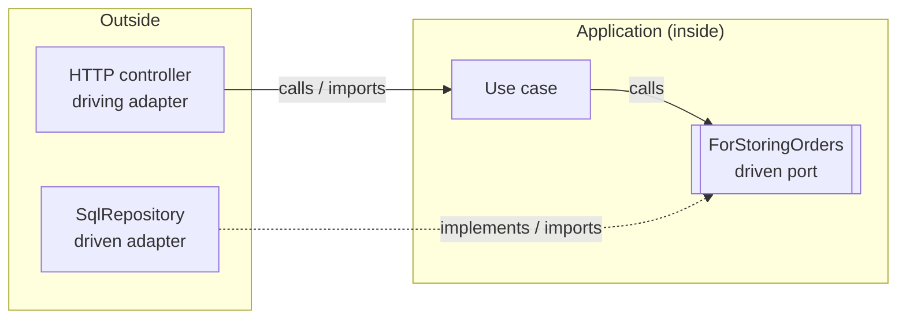

# Hexagonal architecture (ports and adapters), onion and clean architecture

Research notes, gathered 2026-11-07. These notes describe the patterns only and say nothing about this repository.

How the citations work: each claim links to the primary source that owns it, written as *(Author, year)*. The full list is in [Sources](#sources) at the end. Text marked **Opinion** is a judgement by the named author. Text marked **My synthesis** or **Illustration** is mine and has no source behind it. Where sources disagree, a **Disagreement** box says so.

---

## 0. Cheat sheet (one page)

**The one idea.** Keep the application (business rules plus use cases) free of any knowledge of the technology around it. Talk to the outside world only through interfaces that the application itself defines, named by purpose. Plug technology-specific adapters into those interfaces. Decide which adapters to plug in at one place at startup. ([Cockburn 2005][c2005]; [Cockburn 2025][c2025])

**The stated intent.** "Allow an application to equally be driven by users, programs, automated test or batch scripts, and to be developed and tested in isolation from its eventual run-time devices and databases" ([Cockburn 2005][c2005]).

**The strong form.** "The app cannot know anything about the external technology." A driven port written in SQL obeys the letter of the pattern but is "weak" conformance ([Cockburn 2025][c2025]).

| Term | One-line meaning | Owner |
|---|---|---|
| Application / hexagon | Everything that matters for the business problem. It has no references to technology. | — |
| Port | "A purposeful conversation." It is an interface at the application boundary, named `ForDoingX`. | The application ([Cockburn 2025][c2025]; [Garrido de Paz 2018][gdp2018]) |
| Driving (primary) port | The API the outside calls *into* (the use-case boundary). | The application implements it. |
| Driven (secondary) port | The SPI the application calls *out* through (storage, notifications and so on). | The application declares it. Adapters implement it. |
| Adapter | Converts between a port and one specific technology. | Lives *outside* the application. |
| Configurator / composition root | The one place that builds adapters and the app and wires them together. | `main` / bootstrap ([Seemann 2011][seemann2011]; [cosmicpython ch13][cp13]) |

**The dependency rule.** Source code dependencies point only inward. Control flow may go outward, and dependency inversion handles that ([Martin 2012][martin2012]).

**How the three relate.**
- Hexagonal specifies only *two* layers, inside and outside, and it requires ports.
- Onion and clean have the same dependency direction but add rings inside, and they do not require explicit ports ([Cockburn 2025][c2025]).
- Many practitioners treat all three as "pretty much names for the same thing" ([Percival & Gregory, ch2][cp02]; [Seemann 2013][seemann2013]).

**What the pattern does NOT say.** It says nothing about how to structure the inside: layers, DDD tactical patterns and plain CRUD are all allowed ([Garrido de Paz 2018][gdp2018]; [Cockburn 2025][c2025]).

**Python idioms** ([Percival & Gregory][cp]):
- Port = an `abc.ABC`, a `typing.Protocol` or just a duck type.
- Adapter = a concrete class.
- Composition root = `bootstrap.py`.
- Tests use hand-written fakes, not `mock.patch`.
- Most tests go through the service layer, plus one end-to-end test per feature.

**Test shape** ([Cockburn 2005][c2005]; [Percival & Gregory, ch5][cp05]):
- Drive the app through its driving port with a test harness.
- Plug in fakes at the driven ports.
- Integration-test each real adapter on its own.
- Run a few end-to-end tests.

**Main risks:**
- Interfaces for everything, especially 1:1 header interfaces ([Seemann 2010][seemann2010]).
- An anemic domain, with all the logic in services ([Fowler 2003][fowler-anemic]).
- ORM or HTTP types leaking inward ([Martin 2012][martin2012]).
- DTO mapping bloat ([Fowler 2004][fowler-localdto]).
- Indirection added only to make mocking possible ([DHH 2014][dhh2014]).

**When to skip it.** For a simple CRUD wrapper around a database, "you don't need a domain model or a repository" ([Percival & Gregory, ch2][cp02]). Palermo says onion is "not appropriate for small websites" ([Palermo 2008a][p1]).

---

## 1. The three architectures

### 1.1 Hexagonal architecture / Ports and Adapters (Cockburn, 2005)

**Origin.**
- Alistair Cockburn published "Hexagonal Architecture" as technical report HaT 2005.02. The page carries the date 2005-09-04 and says "v 0.9 to be updated after reader comments" ([Cockburn 2005][c2005]). His own article index lists it as "January, 2005" ([Cockburn articles page][c-articles]), so the two first-party dates differ.
- The pattern's main name is "Ports and Adapters". "Hexagonal Architecture" is the alternative name. It is classified as an "Object Structural" pattern ([Cockburn 2005][c2005]; [Garrido de Paz 2022][gdp2022]).
- The 2024 book says "Hexagonal" was a placeholder name and prefers "Ports & Adapters" ([Cockburn & Garrido de Paz 2024, preview][c2024code]).
- Cockburn says he grew up with Smalltalk MVC on the driving side and wanted the same swap-ability on the driven side. He first called the idea "shunt", then "loopback", because "mocks weren't invented then" ([Cockburn 2025][c2025]).
- The book's figures include "The earliest hexagonal picture, from 1994" ([Cockburn & Garrido de Paz 2024, figures][c2024figs]).

**Intent.** "Allow an application to equally be driven by users, programs, automated test or batch scripts, and to be developed and tested in isolation from its eventual run-time devices and databases" ([Cockburn 2005][c2005]).

The 2025 update restates it as a requirement: "Create your application to work without either a UI or a database so you can run automated regression-tests against it, change connected technologies, protect it from leaks between business logic and technologies, work when the database becomes unavailable, and link applications together without any user involvement." It gives the rule behind it as: "Never explicitly name any external object or technology. Always take a parameter for any external object or technology you wish to access." ([Cockburn 2025][c2025])

**Diagnosis.** UI problems and database problems have one cause: "the entanglement between the business logic and the interaction with external entities." The asymmetry that matters is inside versus outside, "not that between left and right sides of the application" ([Cockburn 2005][c2005]).

**Why a hexagon.** "The hexagon is not a hexagon because the number six is important". The shape only leaves room to draw ports and adapters, and it frees the drawing from a one-dimensional layer stack ([Cockburn 2005][c2005]).

Cockburn's case against layer drawings: "First and worst, people tend not to take the 'lines' in the layered drawing seriously" ([Cockburn 2005][c2005]).

**Core picture.**

```
   driving side (primary)                         driven side (secondary)
   "who starts the conversation: them"             "who starts it: the app"

  [ test harness ]--->(adapter)--\               /--(adapter)--->[ in-memory fake ]
  [ web browser  ]--->(HTTP adp)--\   _______   /---(SQL adp)---->[ Postgres       ]
  [ CLI / batch  ]--->(CLI adp)----> / port  \ <----(SMTP adp)--->[ mail server    ]
                                    | APPLI-  |
                                    | CATION  |   ports = interfaces owned by the app,
                                     \_______/    named "for <verb>ing ..."
                                   (inside: no technology names at all)
```

*Illustration, after [Cockburn 2005][c2005] and [Garrido de Paz 2018][gdp2018].*

**Vocabulary.**
- **Port**: "A port identifies a purposeful conversation." Its protocol is an API shaped by the purpose of the conversation, not by any technology ([Cockburn 2005][c2005]).
- **Adapter**: converts "the API definition to the signals needed by that device". Many adapters can fit one port, for example a GUI, FIT harness, batch driver, HTTP, mock DB or SQL DB ([Cockburn 2005][c2005]).
- **Primary actor**: "an actor that drives the application". A secondary actor is one the application drives. You tell them apart by asking who starts the conversation ([Cockburn 2005][c2005]; [Garrido de Paz 2018][gdp2018]).
- **Configurator**: the "hidden fourth object" that "knows all the players and introduces them to each other. That's where source-code dependencies lie" ([Cockburn 2022/2023][c-cs]).
- **Configurable Dependency**: Garrido de Paz calls it "a generalization of Dependency Injection". The name comes from Gerard Meszaros and is Cockburn's preferred term ([Garrido de Paz 2018][gdp2018]).
- **Naming**: Cockburn and Garrido de Paz use driving/driven and primary/secondary, because only those pairs fit all three nouns (actor, adapter, port). You can't have an "inbound actor". Cockburn says he doesn't mind inbound/outbound or API/SPI as synonyms, especially for folder names ([Cockburn 2025][c2025]).

**Number of ports.** Cockburn favours "a small number, two, three or four ports". He says a "wrong" count does little harm, so intuition can decide ([Cockburn 2005][c2005]).

**Use cases.** "The use cases should generally be written at the application boundary (the inner hexagon)". Written that way, use cases are "shorter, easier to read, less expensive to maintain, and more stable over time" ([Cockburn 2005][c2005]).

**Later generalisation.** In "Component + Strategy" (2022, v3a 2023-06-01), Cockburn treats Ports and Adapters as a special case of a more general pattern. It is a component whose boundary is placed "just in front of external technologies". Unlike the general pattern, it "is not nestable" ([Cockburn 2022/2023][c-cs]).

### 1.2 Onion architecture (Palermo, 2008)

**Origin.** Jeffrey Palermo named it in a four-part series:
- Part 1, 29 July 2008 ([Palermo 2008a][p1])
- Part 2, 30 July 2008 ([Palermo 2008b][p2])
- Part 3, 4 August 2008 ([Palermo 2008c][p3])
- Part 4, "after four years", 19 August 2013 ([Palermo 2013][p4])

He says "it's not completely new" and credits Cockburn's hexagonal work. He states their shared premise as: "Externalize infrastructure and write adapter code so that the infrastructure does not become tightly coupled" ([Palermo 2008a][p1]).

**Problem it targets.** In traditional layering, UI and business logic depend on data access, and "Transitive dependencies are still dependencies" ([Palermo 2008a][p1]). As a result, "business logic ends up coupled to infrastructure concerns" ([Palermo 2008c][p3]).

**Core picture.**

```
        +---------------------------------------------------+
        |  UI        Infrastructure (DB, web svc)    Tests  |   <- "things that change often"
        |   +-------------------------------------------+   |
        |   |   Application services                    |   |
        |   |   +-----------------------------------+   |   |
        |   |   |  Domain services                  |   |   |
        |   |   |  (repository INTERFACES live here)|   |   |
        |   |   |   +---------------------------+   |   |   |
        |   |   |   |      Domain model         |   |   |   |
        |   |   |   +---------------------------+   |   |   |
        |   |   +-----------------------------------+   |   |
        |   +-------------------------------------------+   |
        +---------------------------------------------------+
                 all coupling points toward the centre
```

*Illustration, after [Palermo 2008a][p1].*

**Tenets.** Palermo restated these in 2013 ([Palermo 2008c][p3]; [Palermo 2013][p4]):
1. The application is built around an independent object model.
2. Inner layers define interfaces, and outer layers implement them.
3. Coupling points toward the centre.
4. The application core can be compiled and run apart from infrastructure.

**Specifics.**
- The database is not the centre. It is external ([Palermo 2008a][p1]).
- Interfaces such as `IConferenceRepository` and `IClock` sit in the core. Their implementations sit in outer layers. An IoC container wires them at runtime ([Palermo 2008b][p2]).
- Any outer layer may call any inner layer. Strict layering only allows calls to the layer directly below ([Palermo 2008c][p3]).
- Tests "sit at the outskirts because the application core doesn't couple to them" ([Palermo 2008c][p3]).

**Fit.** Palermo writes that onion "is appropriate for long-lived business applications as well as applications with complex behavior" and "is not appropriate for small websites" ([Palermo 2008a][p1]).

In 2013 he added three points ([Palermo 2013][p4]):
- It works "with and without DDD patterns".
- An IoC container is not required. His simplified sample "works just fine without" one.
- The original CodeCampServer sample "has too much going on".

### 1.3 Clean architecture (Martin, 2012)

**Origin.** Robert C. Martin's blog post of 13 August 2012 presents clean architecture as a synthesis of five earlier ideas: Hexagonal (Cockburn), Onion (Palermo), Screaming Architecture (Martin), DCI (Coplien and Reenskaug) and BCE (Jacobson). He says they "vary somewhat in their details" but are "very similar" ([Martin 2012][martin2012]).

**Intent.** Martin lists the properties these architectures share ([Martin 2012][martin2012]):
- independent of frameworks
- testable ("The business rules can be tested without the UI, Database, Web Server, or any other external element")
- independent of UI
- independent of database
- independent of any external agency

**Core picture.**

```
   +-------------------------------------------------------------+
   | Frameworks & Drivers   (web, DB, devices, UI, external)     |
   |   +-----------------------------------------------------+   |
   |   | Interface Adapters  (controllers, presenters,       |   |
   |   |                      gateways; "wholly contain MVC")|   |
   |   |   +---------------------------------------------+   |   |
   |   |   | Use Cases  (application business rules)     |   |   |
   |   |   |   +-------------------------------------+   |   |   |
   |   |   |   | Entities (enterprise business rules)|   |   |   |
   |   |   |   +-------------------------------------+   |   |   |
   |   |   +---------------------------------------------+   |   |
   |   +-----------------------------------------------------+   |
   +-------------------------------------------------------------+
            source dependencies point only inward
```

*Illustration, after [Martin 2012][martin2012].*

**Vocabulary** ([Martin 2012][martin2012]):
- **Entities**: "enterprise wide business rules", "least likely to change when something external changes".
- **Use cases**: application-specific rules that orchestrate data flow to and from entities. "We do not expect changes in this layer to affect the entities."
- **Interface adapters**: convert data between the form that suits use cases and the form that suits external agencies. This ring "will wholly contain the MVC architecture of a GUI".
- **Frameworks and drivers**: mostly glue code. Web and DB are details kept outside "where they can do little harm".
- **"Only four circles?"**: "No, the circles are schematic." The dependency rule still applies whatever the number of rings.
- **Use Case Output Port**: an interface in an inner ring that an outer-ring presenter implements, so that a use case can call outward without naming anything outward.

**Related.** "Screaming Architecture" (30 September 2011) says the top-level structure should "scream about the use cases of the application". It also says: "Frameworks are tools to be used, not architectures to be conformed to" ([Martin 2011][martin2011]).

**Not accessed.** Martin's 2017 book *Clean Architecture* has no first-party excerpt online that I could find. These notes rely only on the 2012 blog post.

---

## 2. How they relate to each other and to DDD

### 2.1 What is the same

All three keep the business core free of infrastructure and make source dependencies point toward the core, using dependency inversion ([Martin 2012][martin2012]; [Palermo 2008a][p1]; [Cockburn 2025][c2025]).

Cockburn says onion and clean "have the same dependency structure as Ports & Adapters" ([Cockburn 2025][c2025]).

Percival and Gregory: "all these are pretty much names for the same thing, and they all boil down to the dependency inversion principle" ([Percival & Gregory, ch2][cp02]).

Seemann argues that applying DIP to a layered architecture gives you Ports and Adapters, with onion and hexagonal as variations of emphasis ([Seemann 2013][seemann2013]).

### 2.2 What differs

| | Hexagonal (P&A) | Onion | Clean |
|---|---|---|---|
| Rings inside the core | **None prescribed.** "Ports & Adapters has only two layers: the inside (the app), and the outside (everything else)" ([Cockburn 2025][c2025]) | Domain model, then domain services, then application services ([Palermo 2008a][p1]) | Entities, then use cases, then interface adapters, then frameworks ([Martin 2012][martin2012]) |
| Explicit ports required | **Yes.** P&A "requires that you organize the external actors so they connect to specific ports" ([Cockburn 2025][c2025]) | Interfaces in the core, but no notion of named ports per actor | Boundaries and output ports, but not a set of purpose-named ports per actor |
| Main metaphor | Inside vs outside. Drivers on one side, driven on the other | Concentric rings, with the database at the edge | Concentric rings with a named dependency rule |
| Where adapters live | Outside the application ([Cockburn 2025][c2025]; [Garrido de Paz 2018][gdp2018]) | Outer ring (UI, infrastructure, tests) | "Interface adapters" ring, plus frameworks ring |
| Stance on DDD | Silent. You may use DDD inside ([Garrido de Paz 2018][gdp2018]) | Works "with and without DDD" ([Palermo 2013][p4]) | Not discussed in the 2012 post |

Cockburn on the extra rings: "Once you have implemented Ports & Adapters, you are welcome to add the layers of clean and onion – or not. Those decisions are outside Ports & Adapters" ([Cockburn 2025][c2025]).

> **Disagreement: is it "layers"?**
> - Martin presents all five source architectures as achieving separation "by dividing the software into layers" ([Martin 2012][martin2012]).
> - Percival and Gregory ([ch2][cp02]) and Seemann ([2013][seemann2013]) treat the names as near-synonyms.
> - Cockburn and Garrido de Paz reject the layered reading. Garrido de Paz on articles that describe three layers (domain, ports, adapters): "There's no layers nowhere". He calls the common drawing *Actor → Port → Adapter → Hexagon* "not correct at all". The correct order is *Actor → Adapter → (Port) Hexagon*, because ports belong to the hexagon ([Garrido de Paz 2018][gdp2018]).
> - Cockburn's book has a figure titled "Ports & Adapters only specifies two layers, inside and outside" ([Cockburn 2025][c2025]; [figures][c2024figs]).

### 2.3 The upside-down picture

In a classic three-layer stack, both calls and dependencies point down to the database.

In Ports and Adapters, the database adapter has a compile-time dependency on the application, the reverse of the classic stack. "The execution sequence goes in the opposite direction of the dependencies on the driven side." The adapter depends on both the application's port and the database's own API, and "neither the invoicing system nor the database depend on each other" ([Cockburn 2025][c2025]).

Cockburn describes a two-step path from layered to hexagonal, credited to Oliver Zihler ([Cockburn 2025][c2025]):
1. Invert the dependencies.
2. Make sure the ports are defined inside the app.

### 2.4 Relation to DDD (Evans, Vernon)

**Evans's Layered Architecture.**
- The DDD Reference (2015, CC-BY) says: "Isolate the expression of the domain model and the business logic, and eliminate any dependency on infrastructure, user interface, or even application logic that is not business logic" ([Evans 2015][evans2015]).
- It also says to "Partition a complex program into layers… that depends only on the layers below" ([Evans 2015][evans2015]). That is classic downward layering, not inward rings.
- Evans then adds: "The key goal here is isolation. Related patterns, such as 'Hexagonal Architecture' may serve as well or better to the degree that they allow our domain model expressions to avoid dependencies on and references to other system concerns" ([Evans 2015][evans2015]).
- So Evans treats hexagonal as an acceptable, perhaps better, way to get the isolation DDD needs.

**Evans's building blocks.** These are what you would put *inside* the hexagon if you choose DDD ([Evans 2015][evans2015]):
- **Entity**: an object "distinguished by its identity, rather than its attributes".
- **Value object**: "Treat the value object as immutable"; it has no identity.
- **Domain service**: "When a significant process or transformation in the domain is not a natural responsibility of an entity or value object, add an operation to the model as a standalone interface declared as a service."
- **Aggregate**: cluster entities and value objects and choose a root. Outside objects hold references to the root only. "Use the same aggregate boundaries to govern transactions and distribution… Across boundaries, handle updates asynchronously."
- **Repository**: "For each type of aggregate that needs global access, create a service that can provide the illusion of an in-memory collection of all objects of that aggregate's root type… Provide repositories only for aggregate roots that actually need direct access."
- **Bounded context**: "Explicitly define the context within which a model applies."
- **Anticorruption layer**: "As a downstream client, create an isolating layer to provide your system with functionality of the upstream system in terms of your own domain model". This is effectively a driven adapter that translates between models. Cockburn's book has a figure titled "Anti-corruption layer blending over the hexagon boundary" ([figures][c2024figs]).

**Evans's application layer.** As quoted by Fowler: "This layer is kept thin. It does not contain business rules or knowledge, but only coordinates tasks and delegates work to collaborations of domain objects" ([Fowler 2003][fowler-anemic]).

**Vernon.**
- *Implementing Domain-Driven Design* (2013), ch. 4 "Architecture", has a section "Hexagonal or Ports and Adapters". **I could not read it.** O'Reilly returned 403, and no first-party excerpt of that section is online.
- His first-party sample code ([Vernon, IDDD_Samples][vernon-samples], created 2013) shows the layout he used (see §7.2): `application/`, `domain/model/<aggregate>/` with the repository *interface* inside the domain package, and `port/adapter/{persistence,messaging,service}/`.
- His aggregate essays (DDD Community, 2011) give the rules most hexagonal codebases borrow for transaction boundaries ([Vernon 2011 Part I][vernon2011a]; [Part II][vernon2011b]):
  - "Model True Invariants In Consistency Boundaries"
  - "Design Small Aggregates"
  - "Reference Other Aggregates By Identity"
  - "Use Eventual Consistency Outside the Boundary"
- Also: "a properly designed bounded context modifies only one aggregate instance per transaction in all cases", which he calls "a rule of thumb" ([Vernon 2011 Part I][vernon2011a]).

**Summary: DDD and hexagonal are orthogonal.** Hexagonal decides the boundary to technology. DDD decides how to model the inside. Both Cockburn's camp and Palermo say you can use one without the other ([Garrido de Paz 2018][gdp2018]; [Palermo 2013][p4]).

---

## 3. Ports

### 3.1 Driving (primary) vs driven (secondary)

| | Driving / primary | Driven / secondary |
|---|---|---|
| Who starts the conversation | The outside actor (user, test, other app, scheduler) | The application |
| Port is | The application's **API**, the use-case boundary | The application's **SPI** (service provider interface) |
| Who implements the port | The application | An adapter outside the app |
| Who calls through the port | A driving adapter | The application |
| Typical adapters | Test harness, CLI, GUI, REST controller, message consumer | In-memory fake, SQL repository, SMTP sender, HTTP client, event publisher |

Sources: [Cockburn 2005][c2005]; [Garrido de Paz 2018][gdp2018]; [Percival & Gregory, Appendix A][cpA].

Garrido de Paz splits driven actors into two kinds ([Garrido de Paz 2018][gdp2018]):
- *repositories*, which the app reads from and writes to
- *recipients*, which the app only sends to (for example SMTP)

Cockburn's 2005 text deliberately treats all ports as alike. Left and right differ "only in implementation". He warns that the left-right split is a consequence of the architecture, not a shortcut ([Cockburn 2005][c2005]). Garrido de Paz: "The application is technology agnostic in both sides", but "Configurable Dependency implementation is different for each side" ([Garrido de Paz 2018][gdp2018]).

### 3.2 Who owns the port interface

**The application owns both kinds of port.**
- Cockburn's book has a figure titled "The sender owns the interface; receivers can be in different modules". The contrasting figure is labelled "Not what we are after just now: The receiver owns the interface, the sender has a compile-time dependency on the receiver" ([figures][c2024figs]).
- For a driven port, the sender is the application. So the app declares `ForGettingTaxRates`, and the database adapter imports it.
- Palermo puts repository interfaces in the application core ([Palermo 2008b][p2]).
- Martin puts the Use Case Output Port in the inner circle ([Martin 2012][martin2012]).
- Vernon puts `ForumRepository` in `domain/model/forum/` ([Vernon, IDDD_Samples][vernon-samples]).

**How to word the port.** It must be in domain terms. "The driven port is expressed purely in terms of concepts that make sense in the application language. It can't even know that there a database, let alone an SQL one" ([Cockburn 2025][c2025]).

> **Disagreement: should the driving port be declared as an interface at all?**
>
> Cockburn's book first declared `ForCalculatingTaxes` and then typed the variable as the concrete `TaxCalculator`, which he calls a mistake. Readers then split into two camps ([Cockburn 2025][c2025]):
> - One camp says to declare the interface and type by it.
> - The other says the app's public methods *are* its driving port, so the interface adds nothing.
>
> Cockburn's verdict: "there are two reasonable schools of thought… decide which way you prefer to write."

> **Observation, from reading the code (not a claim made by the book).** In the final cosmicpython repository ([cosmicpython/code][cp-code], `master`):
> - `AbstractRepository` and `AbstractNotifications` are defined in `src/allocation/adapters/` next to their concrete adapters.
> - `service_layer/unit_of_work.py` imports SQLAlchemy and `allocation.adapters.repository`.
>
> So in that codebase the *domain* is pure, but the service layer has import-time dependencies on the adapters package. That is looser than "the app owns the port" in Cockburn's figure 6.24 or Palermo's core-owned interfaces. Expect to choose where your port definitions live.

### 3.3 Naming ports

Cockburn and Garrido de Paz name ports "for + verb-ing", for example `ForCalculatingTaxes`, `ForGettingTaxRates` and "for adding products to the shopping cart" ([Cockburn & Garrido de Paz 2024, preview][c2024code]; [Garrido de Paz 2018][gdp2018]). Folder names follow the same scheme (`for_calculating_taxes`), but "Actual naming and coding is up to your personal standards, they are not part of the pattern" ([Cockburn 2025][c2025]).

> **Disagreement: port granularity.**
> - Cockburn (2005): "a small number, two, three or four ports" ([Cockburn 2005][c2005]).
> - Garrido de Paz (2018): granularity is a choice. With the Single Responsibility Principle in mind he suggests one port per use case, or command and query ports (CQRS) with a command bus ([Garrido de Paz 2018][gdp2018]).
> - In practice, cosmicpython has one driving entry (the message bus taking commands) and several driven ports (UoW, notifications, publish) ([Percival & Gregory, ch13][cp13]).

### 3.4 Worked mini example

Cockburn's canonical example is the tax calculator, shown here in Java ([Cockburn & Garrido de Paz 2024, preview][c2024code]; corrected in [Cockburn 2025][c2025]):

```java
interface ForCalculatingTaxes { double taxOn(double amount); }    // driving port
interface ForGettingTaxRates  { double taxRate(double amount); }  // driven port

class TaxCalculator implements ForCalculatingTaxes {              // the app
  private ForGettingTaxRates taxRateRepository;
  public TaxCalculator(ForGettingTaxRates r) { this.taxRateRepository = r; }
  public double taxOn(double amount) { return amount * taxRateRepository.taxRate(amount); }
}
class FixedTaxRateRepository implements ForGettingTaxRates {      // driven adapter (test double)
  public double taxRate(double amount) { return 0.15; }
}
class Main {                                                      // configurator + driving actor
  public static void main(String[] args) {
    ForGettingTaxRates taxRateRepository = new FixedTaxRateRepository();
    ForCalculatingTaxes myCalculator = new TaxCalculator(taxRateRepository);
    System.out.println(myCalculator.taxOn(100));
  }
}
```

The book's notes on the example ([Cockburn & Garrido de Paz 2024, preview][c2024code]):
- "TaxCalculator implements the driving port, and uses the driven port."
- "Main acts as both the configurator and, in this tiny case, also the driving actor."
- The book also shows the same app in Ruby with no interface declarations at all, and says this "makes it difficult to see where they are".
- It shows setter injection and a "rate repository broker" (dependency lookup) as other valid configurator styles.

**Illustration: the same example in Python.** This is my translation. It is not code from any source. It uses `typing.Protocol` ([PEP 544][pep544]):

```python
# app/ports.py  -- owned by the application
from typing import Protocol

class ForCalculatingTaxes(Protocol):        # driving port (API)
    def tax_on(self, amount: float) -> float: ...

class ForGettingTaxRates(Protocol):         # driven port (SPI) -- domain words only, no "SQL"
    def tax_rate(self, amount: float) -> float: ...

# app/tax_calculator.py  -- the application; imports only its own ports
class TaxCalculator:                        # structurally satisfies ForCalculatingTaxes
    def __init__(self, rates: ForGettingTaxRates) -> None:
        self._rates = rates
    def tax_on(self, amount: float) -> float:
        return amount * self._rates.tax_rate(amount)

# adapters/driven/fixed_rates.py  -- imports app.ports, never the other way round
class FixedTaxRates:
    def tax_rate(self, amount: float) -> float:
        return 0.15

# adapters/driving/cli.py
def run(app: ForCalculatingTaxes, argv: list[str]) -> None:
    print(app.tax_on(float(argv[1])))

# main.py  -- the configurator / composition root
import sys
if __name__ == "__main__":
    run(TaxCalculator(FixedTaxRates()), sys.argv)
```

Cockburn's own small runnable example is Ruby. Look for *SmallerWebHexagon*, which the book cites at `github.com/totheralistair/SmallerWebHexagon`. It has an in-code rater, a file rater and a Rack HTTP adapter, plus tests that swap each one ([Cockburn & Garrido de Paz 2024, preview][c2024code]). Garrido de Paz's full examples are BlueZone and bluezone_pro ([Cockburn 2025][c2025]).

---

## 4. The dependency rule and dependency inversion

**Martin's dependency rule.** "Source code dependencies can only point inwards. Nothing in an inner circle can know anything at all about something in an outer circle." This covers functions, classes and variables. It also covers data formats: "data formats used in an outer circle should not be used by an inner circle, especially if those formats are generate[d] by a framework in an outer circle" ([Martin 2012][martin2012]).

**DIP.** As quoted by Percival and Gregory ([Introduction][cpIntro]):
1. "High-level modules should not depend on low-level modules. Both should depend on abstractions."
2. "Abstractions should not depend on details. Instead, details should depend on abstractions."

Their gloss on point 1: "Depends on doesn't mean imports or calls, necessarily, but rather a more general idea that one module knows about or needs another module."

**Crossing a boundary against the flow of control.** When a use case must call a presenter or a database, control flows outward but the dependency must point inward. "We usually resolve this apparent contradiction by using the Dependency Inversion Principle." The inner circle declares an interface, and the outer circle implements it ([Martin 2012][martin2012]).



*The solid arrows show control flow. The dotted arrow shows a source dependency, which points inward even though control flows outward to the database. Illustration, after [Martin 2012][martin2012] and [Cockburn 2025][c2025].*

**Applied to the ORM.** Percival and Gregory invert the usual ORM dependency. They use SQLAlchemy "classical" (imperative) mapping so that "the ORM imports (or 'depends on' or 'knows about') the domain model, and not the other way around". The recap: "Our domain model should be free of infrastructure concerns" ([Percival & Gregory, ch2][cp02]). They add that an ORM "already buys you some decoupling" ([Percival & Gregory, ch2][cp02]).

**What may cross a boundary** ([Martin 2012][martin2012]):
- Simple data structures: basic structs, DTOs, function arguments, hashmaps.
- "We don't want to cheat and pass Entities or Database rows."
- The data should take "whatever form is most convenient for the inner circle".

---

## 5. Use cases / application services vs the domain layer

### 5.1 Two kinds of "service"

| | Application service / use case / service layer | Domain service |
|---|---|---|
| Job | Handle a request from outside and orchestrate it. Typically it fetches aggregates from repositories, checks the request against current state, calls domain logic and commits ([Percival & Gregory, ch4][cp04]) | Holds domain logic that "doesn't sit naturally inside a stateful entity or value object" ([Percival & Gregory, ch4][cp04]; [Evans 2015][evans2015]) |
| Contains business rules? | No. Evans: "kept thin… does not contain business rules or knowledge" ([Fowler 2003][fowler-anemic]) | Yes |
| Knows about ports/UoW? | Yes. It is what the driving adapter calls | No. It is pure domain |
| P of EAA definition | "Defines an application's boundary with a layer of services that establishes a set of available operations and coordinates the application's response in each operation" ([Stafford, in Fowler P of EAA][fowler-servicelayer]) | — |

Percival and Gregory apologise for the overloaded word in a box titled "Why is everything called a service?" ([Percival & Gregory, ch4][cp04]).

In hexagonal terms, the application service *is* the implementation of the driving port. Cockburn puts use cases "at the application boundary (the inner hexagon)" ([Cockburn 2005][c2005]).

### 5.2 Where transactions go

- **Fowler / Stafford**: the service layer is where you control transactions ("controlling transactions and coordinating responses", [Fowler P of EAA][fowler-servicelayer]).
- **Evans**: aggregate boundaries govern transactions ([Evans 2015][evans2015]).
- **Vernon**: modify one aggregate instance per transaction, as "a rule of thumb". Use eventual consistency across aggregates ([Vernon 2011 Part I][vernon2011a]; [Part II][vernon2011b]).
- **Percival and Gregory**: the Unit of Work is "our abstraction over the idea of atomic operations". It is a Python context manager that rolls back unless `commit()` is called explicitly, so the system is "safe by default". "Each of our service-layer use cases runs in a single unit of work that succeeds or fails as a block." They "think of the UoW as being part of the service layer" ([Percival & Gregory, ch6][cp06]).
- **Percival and Gregory again**: "One Aggregate = One Repository". Repositories should return only aggregates ([Percival & Gregory, ch7][cp07]).

**My synthesis.** Every source puts the transaction boundary in the application service or use case, with its size set by the aggregate. None of them put it in the domain objects or the adapters.

### 5.3 Where validation goes

Percival and Gregory split validation into three kinds ([Percival & Gregory, Appendix E][cpE]):
- **Syntax** (shape: required fields, types, ranges): "at the edge of the system… a message handler should always receive only a message that is well-formed". This can live on the message or command class.
- **Semantics** (does the message make sense, for example whether the SKU exists): "in the service layer or on the message bus".
- **Pragmatics** (can we comply in context, for example whether there is enough stock): "belongs in the domain model". "If a rule can be tested inside our domain model, then it should be tested in the domain model."

They also recommend the Tolerant Reader: "read only the fields your application needs" ([Percival & Gregory, Appendix E][cpE]).

### 5.4 DTOs and what the use case accepts

> **Disagreement: DTOs at the use-case boundary.**
> - **Martin**: cross boundaries with simple data structures, not entities or rows ([Martin 2012][martin2012]).
> - **Percival and Gregory**: "Express your service layer in terms of primitives rather than domain objects", so that service-layer tests are decoupled from the domain ([Percival & Gregory, ch5][cp05]).
> - **Fowler**: argues *against* DTOs inside one process. They exist "to shift data in expensive remote calls", and the mapping cost is "significant, and it's painful". He would start with a local service layer that uses domain objects. His exceptions are a real presentation/domain mismatch and messages passed between threads ([Fowler 2004][fowler-localdto]).
> - **Seemann** (in comments on the composition root post): DTOs and view models sit "at the boundary" ([Seemann 2011][seemann2011]).
>
> *My synthesis:* all of them agree that inbound data is shaped for the inside. They disagree on whether that needs a separate class per boundary or can just be primitives and domain objects.

---

## 6. Composition root / bootstrap: where wiring happens

**Seemann's definition** ([Seemann 2011][seemann2011]):
- "A Composition Root is a (preferably) unique location in an application where modules are composed together."
- Put it "As close as possible to the application's entry point", for example `Main`.
- "Only applications should have Composition Roots. Libraries and frameworks shouldn't."
- A DI container is optional. If you use one, "A DI Container should only be referenced from the Composition Root".

**Cockburn's term is the Configurator** ([Cockburn 2022/2023][c-cs]; [figures][c2024figs]):
- In early development, "the configurator is inside each test case".
- In production, "the startup module will instantiate the component, the UI, and the adapters".
- Variants: constructor injection, setter injection, and a broker / service locator ("dependency lookup") ([Cockburn & Garrido de Paz 2024, preview][c2024code]).

**Garrido de Paz's startup sequence** ([Garrido de Paz 2018][gdp2018]):
1. Initialise the environment.
2. Create the driven adapters and inject them into the app.
3. Create a driver adapter per driver port, inject the app into it, and run it.

**Python practice: `bootstrap.py`** ([Percival & Gregory, ch13][cp13]). They call the Composition Root "a bootstrap script to you and me" and do "manual DI" without a framework. Their footnote says Seemann calls this "Pure DI".

The bootstrap function:
- declares production defaults as keyword arguments, so tests can override them
- does one-time init (`orm.start_mappers()`, logging)
- injects dependencies into handlers, using closures, `functools.partial` or handler classes with `__call__`
- returns the message bus

```python
def bootstrap(
    start_orm: bool = True,
    uow: unit_of_work.AbstractUnitOfWork = unit_of_work.SqlAlchemyUnitOfWork(),
    notifications: AbstractNotifications = EmailNotifications(),
    publish: Callable = redis_eventpublisher.publish,
) -> messagebus.MessageBus: ...
```

Entrypoints such as Flask and the Redis consumer then call `bus = bootstrap.bootstrap()`. Tests call `bootstrap.bootstrap(start_orm=False, uow=FakeUnitOfWork(), notifications=FakeNotifications(), publish=lambda *a: None)` ([Percival & Gregory, ch13][cp13]).

They also discuss alternatives ([Percival & Gregory, ch13][cp13]):
- The `inspect.signature` auto-injection was something "Bob accused him of overengineering" as, and writing out the lambdas by hand is "perfectly viable".
- A DI framework (Inject, Punq, Dependencies) only earns its place for chained dependencies.

They also tell you to keep `config.py` out of the core: "If you decide to use a bootstrap script, you can make it the only place (other than tests) that config is imported to" ([Percival & Gregory, Appendix B][cpB]).

**Python-specific observation.** "Python developers aren't necessarily used to the concept of needing to compose a set of objects into a working application. We just pick our entrypoint and run code from top to bottom" ([Percival & Gregory, ch13 footnote][cp13]). Their case for explicit dependencies over `mock.patch` is "Explicit is better than implicit" ([Percival & Gregory, ch13][cp13]).

---

## 7. Folder and package layouts

### 7.1 Cosmicpython (Percival & Gregory)

**Layout at chapter 4 / Appendix B**, verbatim from [Percival & Gregory, Appendix B][cpB]:

```
.
├── Dockerfile
├── Makefile
├── docker-compose.yml
├── mypy.ini
├── requirements.txt
├── src
│   ├── allocation
│   │   ├── __init__.py
│   │   ├── adapters
│   │   │   ├── __init__.py
│   │   │   ├── orm.py
│   │   │   └── repository.py
│   │   ├── config.py
│   │   ├── domain
│   │   │   ├── __init__.py
│   │   │   └── model.py
│   │   ├── entrypoints
│   │   │   ├── __init__.py
│   │   │   └── flask_app.py
│   │   └── service_layer
│   │       ├── __init__.py
│   │       └── services.py
│   └── setup.py
└── tests
    ├── conftest.py
    ├── e2e
    │   └── test_api.py
    ├── integration
    │   ├── test_orm.py
    │   └── test_repository.py
    ├── pytest.ini
    └── unit
        ├── test_allocate.py
        ├── test_batches.py
        └── test_services.py
```

**Final layout** of the companion repo ([cosmicpython/code][cp-code], `master`, `src/` and `tests/` only; listed via the GitHub API):

```
src/allocation/
├── adapters/            # secondary (driven) adapters + their abstract ports
│   ├── notifications.py     AbstractNotifications, EmailNotifications
│   ├── orm.py               imperative SQLAlchemy mapping (ORM depends on domain)
│   ├── redis_eventpublisher.py
│   └── repository.py        AbstractRepository, SqlAlchemyRepository
├── bootstrap.py         # composition root
├── config.py
├── domain/              # pure: no I/O imports
│   ├── commands.py
│   ├── events.py
│   └── model.py
├── entrypoints/         # primary (driving) adapters
│   ├── flask_app.py
│   └── redis_eventconsumer.py
├── service_layer/
│   ├── handlers.py          use cases (command/event handlers)
│   ├── messagebus.py
│   └── unit_of_work.py      AbstractUnitOfWork, SqlAlchemyUnitOfWork
└── views.py             # CQRS read side
tests/
├── e2e/          test_api.py, test_external_events.py, api_client.py, redis_client.py
├── integration/  test_email.py, test_repository.py, test_uow.py, test_views.py
└── unit/         test_batches.py, test_handlers.py, test_product.py
```

How the book maps its layers to hexagonal terms ([Percival & Gregory, Appendix A][cpA]):
- **Domain**: entity, value object, aggregate, event, command.
- **Service layer**: handler, unit of work, message bus.
- **Adapters (secondary)**: "Concrete implementations of an interface that goes from our system to the outside world". This covers the repository and the event publisher.
- **Entrypoints (primary adapters)**: "Translate external inputs into calls into the service layer". This covers the web endpoint and the event consumer.

They say this flat structure is a start: "for a more complex project, you'd expect to grow a folder hierarchy that includes domain_model/, infrastructure/, services/, and api/" ([Percival & Gregory, Appendix B][cpB]).

### 7.2 Vernon's IDDD samples (Java, for comparison)

From [Vernon, IDDD_Samples][vernon-samples] (`iddd_collaboration`):

```
com/saasovation/collaboration/
├── application/                    # application services (use cases) + DTO-ish "data"
│   └── forum/  ForumApplicationService, ForumQueryService, data/ForumData ...
├── domain/model/                   # one package per aggregate
│   └── forum/  Forum, ForumId, ForumRepository (interface), ForumStarted (event) ...
└── port/adapter/                   # all adapters, named after hexagonal
    ├── messaging/   persistence/{repository,view}/   service/   event/
        e.g. persistence/repository/EventStoreForumRepository implements ForumRepository
```

The repository interface lives in the domain package, and the implementation lives under `port/adapter`. This is exactly the "sender owns the interface" rule from §3.2.

### 7.3 What Cockburn recommends

Cockburn's book has a figure, "Figure 4.6. Possible folder/project structures", with three variants ([Cockburn 2025][c2025]):
- port definitions inside the app project
- ports in their own folder
- the same, but with inbound/outbound naming

**I could not read the figure itself**, because it is an image in the PDF. The surrounding text says ([Cockburn 2025][c2025]):
- Name driving-port folders after the port, for example `for_calculating_taxes` and `for_admin_purposes`.
- In the driving-adapter and driven-adapter folders, "make a subfolder for each adapter".
- Cockburn dislikes sibling folders called "Driven Adapters" and "Driving Adapters" because they are "just too similar". Inbound/Outbound, Provided/Required or Controllers/Providers are fine.
- "These decisions are not mandated by the pattern", yet "Folder structures that don't match the intentions of the pattern cause confusion and even damage to the project."

Garrido de Paz describes modules rather than folders ([Garrido de Paz 2018][gdp2018]):
- At minimum: one for the hexagon, one per adapter, and one for startup.
- The hexagon depends on nothing, adapters depend on the hexagon, and startup depends on everything.
- If the language can't hide internals, split the hexagon into a `ports` module and an implementation module.
- This "adds complexity and can slow builds".

**Illustration**: a layout that follows Cockburn's text, in Python. This is mine, not from a source:

```
src/<app>/
├── app/                         # the hexagon: imports nothing outside itself
│   ├── ports/
│   │   ├── driving/  for_placing_orders.py        (Protocol or ABC, or omit — see §3.2)
│   │   └── driven/   for_storing_orders.py, for_notifying_customers.py
│   ├── domain/       ...                          (optional DDD inside)
│   └── use_cases/    place_order.py               (implements driving port)
├── adapters/
│   ├── inbound/   cli/  http/                     (driving adapters)
│   └── outbound/  sqlite_orders/  smtp_notify/  in_memory_orders/   (driven adapters, one subfolder each)
└── main.py                      # configurator / composition root
tests/
├── app/          # drive through driving ports with fakes at driven ports
├── adapters/     # contract + integration tests per adapter
└── e2e/
```

### 7.4 Package-by-layer vs package-by-feature / component / bounded context

**Fowler** (26 August 2015) says presentation-domain-data layering suits small programs. "Once any of these layers gets too big you should split your top level into domain oriented modules which are internally layered" ([Fowler 2015][fowler-pdd]). He calls splitting *teams* by layer an antipattern, and says of swapping the data layer that he "rarely hear[s] of someone actually doing it" ([Fowler 2015][fowler-pdd]).

**Simon Brown** (8 March 2015) compares three options ([Brown 2015][brown2015]):
- **Package by layer**: "often turn into a big ball of mud".
- **Package by feature**: layers sit inside feature packages.
- **Package by component**, his hybrid: each component has a public interface plus hidden business logic and data access. Other features "forced to go through the public interface". "Architectural layering" becomes "a secondary organisation mechanism".

**Martin (2011)**: the top-level directories should reveal the domain ("Health Care System"), not the framework ("Rails") ([Martin 2011][martin2011]).

**Evans**: "Choose modules that tell the story of the system". The model should partition "according to high-level domain concepts" ([Evans 2015][evans2015]). Bounded contexts are the coarsest split ([Evans 2015][evans2015]).

> **Note on scope.** Cockburn's hexagon sits at the *outer technology boundary* of one application and "is not nestable". He is against "hexagons everywhere, at different levels inside the system", because the boundary tests then duplicate the system tests and get dropped ([Cockburn 2022/2023][c-cs]).
>
> *My synthesis:* package-by-feature or by bounded context is a decision about the *inside*, and it is compatible with one hexagon per deployable app. Each feature can own its ports, or the ports can be shared at the app boundary.

### 7.5 How Python expresses ports

| Mechanism | What it gives | Source note |
|---|---|---|
| Duck typing (no declaration) | Zero ceremony. "To a Pythonista, a repository is *any* object that has `add(thing)` and `get(id)` methods" | [Percival & Gregory, ch2][cp02]. Cockburn's Ruby example also has no declarations, but "makes it difficult to see where they are" ([2024 preview][c2024code]) |
| `abc.ABC` + `@abstractmethod` | Nominal. Python refuses to instantiate a subclass that misses a method. Can carry shared behaviour (cosmicpython's `AbstractRepository` tracks `seen`) | Used "for didactic reasons". "We've sometimes found ourselves deleting ABCs from our production code, because Python makes it too easy to ignore them" ([Percival & Gregory, ch2][cp02]); [cosmicpython/code][cp-code] |
| `typing.Protocol` (PEP 544) | Structural "static duck typing", checked by mypy or pyright with no inheritance needed. `isinstance` works only with `@runtime_checkable` | [PEP 544][pep544]. Percival and Gregory: "An alternative to look into… typing without the possibility of inheritance" ([ch2][cp02]) |
| A plain `Callable` | For one-function ports, for example `send_mail: Callable`, `publish: Callable` | "This works just fine for simple dependencies" ([Percival & Gregory, ch13][cp13]) |

Percival and Gregory's position: "If you're using an abstract base class, that's the port. If not, the port is just the duck type that your adapters conform to and that your core application expects" ([Percival & Gregory, ch2][cp02]).

**My synthesis.** A `Protocol` lets the port file live in the app, while adapters never need to import it at runtime. It still documents and type-checks the contract, which fits "the sender owns the interface" closely.

---

## 8. Testing strategy

### 8.1 What the pattern was built for

Cockburn: "The natural test adapter to substitute for a primary actor is FIT", and "the natural test adapter to substitute for a secondary actor such as a database is a mock". The goal is "the ability to run the application in a fully isolated mode" ([Cockburn 2005][c2005]).

His later and stronger statement: "One of the things that makes my blood freeze when seeing people claim they have implemented Ports & Adapters… is the absence of tests on both sides." Tests at the outer boundary "are meaningful system tests, worth maintaining" ([Cockburn 2022/2023][c-cs]). The book's development sequence is "Tests and mocks first" ([figures][c2024figs]).

**Build order** suggested by Garrido de Paz ([Garrido de Paz 2018][gdp2018]):
1. Test driver plus mock driven adapters.
2. Add the real driver adapters.
3. Add the real driven adapters, still using the test driver.
4. Real adapters on both sides.

He recommends at least two adapters per port, a real one and a test one. The test one should be "a mock that mimics the real behavior", which is what Fowler would call a fake.

### 8.2 Fakes rather than mocks

Fowler's test-double vocabulary ([Fowler 2006][fowler-testdouble]):
- **Fake**: "actually have working implementations" but take shortcuts.
- **Stub**: gives "canned answers".
- **Spy**: records calls.
- **Mock**: is "pre-programmed with expectations".

Percival and Gregory "avoid using mocks in this book and in our production code too". Their stated instinct is that "mocking frameworks, particularly monkeypatching, are a code smell" ([Percival & Gregory, ch3][cp03]). Their reasons:
- patching "does nothing to improve the design"
- mock tests "tend to be more coupled to the implementation details"
- "Overuse of mocks leads to complicated test suites that fail to explain the code"

They describe themselves as classicist TDD ([Percival & Gregory, ch3][cp03]).

**Fakes as design feedback.** "If it's hard to fake, the abstraction is probably too complicated" ([Percival & Gregory, ch2][cp02]).

**"Don't mock what you don't own."** Fake your own small abstraction (the UoW), not SQLAlchemy's `Session`. "By coupling to the Session interface, you're choosing to couple to all the complexity of SQLAlchemy" ([Percival & Gregory, ch6][cp06]).

Kent Beck, in the 2014 *Is TDD Dead?* conversations, said he rarely uses mocks and worried that heavy mockers find refactoring hard ([Fowler, Beck, Hansson 2014][istdddead]).

> **Terminology clash.** Cockburn (2005) says "mock" for the in-memory database ([Cockburn 2005][c2005]). In Fowler's terms ([2006][fowler-testdouble]) that is a *fake*. Read Cockburn's "mock" as "test double".

### 8.3 Contract tests shared by real and fake adapters

**Fowler's contract test** (12 January 2011, renamed in 2018). It checks "that all the calls against your test doubles return the same results as a call to the external service would". It checks format rather than exact data, it runs separately from the main suite, and a failure means the double needs updating ([Fowler 2011][fowler-contract]).

**Percival and Gregory's recipe for a new adapter** ([Percival & Gregory, ch13][cp13]):
1. "Define your API using an ABC."
2. "Implement the real thing."
3. "Build a fake and use it for unit/service-layer/handler tests."
4. "Find a less fake version you can put into your Docker environment." Their example is MailHog for email.
5. "Test the less fake 'real' thing."

Their integration tests also run the real `SqlAlchemyUnitOfWork` against SQLite instead of Postgres ([Percival & Gregory, ch13][cp13]).

**My synthesis / illustration.** None of the primary sources I read show a single pytest suite parametrised over both the fake and the real adapter. It is the obvious way to enforce "the fake behaves like the real one" for a driven port you own. Here is a sketch:

```python
# tests/contracts/test_for_storing_orders.py   (illustration)
import pytest

@pytest.fixture(params=["in_memory", "sqlite"])
def orders(request, tmp_path):
    if request.param == "in_memory":
        return InMemoryOrders()
    return SqliteOrders(tmp_path / "db.sqlite")

def test_saved_order_can_be_fetched(orders):
    orders.add(Order(id="o1", sku="LAMP", qty=2))
    assert orders.get("o1").qty == 2

def test_missing_order_returns_none(orders):
    assert orders.get("nope") is None
```

The same suite runs on every adapter of the port. The fake adapter's run is fast. The real adapter's run is your adapter integration test.

### 8.4 The test pyramid this enables

```
               /\        e2e: "one end-to-end test per feature" + one for all unhappy paths
              /  \       (real adapters, real infra)
             /----\
            /      \     adapter integration / contract tests
           /        \    (each real driven adapter vs real infra; real driving adapter vs fake app)
          /----------\
         /            \  service-layer ("edge-to-edge") tests through the driving port,
        /              \ fakes at every driven port  <- THE BULK
       /----------------\
      /                  \  a small core of domain-model unit tests ("low gear")
     /____________________\
```

*Illustration. Rules from [Percival & Gregory, ch5][cp05], categories from [Garrido de Paz 2018][gdp2018].*

**Percival and Gregory's rules of thumb** ([ch5][cp05]):
- "Aim for one end-to-end test per feature."
- "Write the bulk of your tests against the service layer." They call these "edge-to-edge" tests, which use fakes for I/O.
- "Maintain a small core of tests written against your domain model." Delete them freely once service-layer tests cover the same behaviour.
- "Error handling counts as a feature": test only the happy path end-to-end, plus one end-to-end test for unhappy paths.
- "Express your service layer in terms of primitives rather than domain objects."

**High gear and low gear.** Test at the service layer by default. Drop down to domain tests "when starting a new project or when hitting a particularly gnarly problem" ([Percival & Gregory, ch5][cp05]).

**Garrido de Paz's test categories**, attributed to Nat Pryce ([Garrido de Paz 2018][gdp2018]):

| Category | What it tests |
|---|---|
| Unit | Objects inside the hexagon |
| Integration | Adapters |
| Acceptance | Driver ports, with the hexagon in isolation |
| System | The whole thing |

> **Disagreement: should you isolate from the database at all?**
> - **DHH** (29 April 2014), *Opinion*: "test-induced design damage". Model tests should hit the database, because separating them "is simply not worth it any more". "Controllers are meant to be integration tested, not unit tested". The hexagonal pattern "is being misapplied to Rails applications" ([DHH 2014][dhh2014]).
> - **DHH again**, in *Is TDD Dead?*: "Every layer of indirection introduces a high cost". He dismissed "swapability pipedreams" ([Fowler, Beck, Hansson 2014][istdddead]).
> - **Simon Brown**, *Opinion*: test components through their public interface "right back to the MySQL database". Add ports and adapters for testing only for async messaging and third-party services, "the exception not the rule" ([Brown 2015][brown2015]).
> - **Cockburn**, **Garrido de Paz** and **Percival & Gregory** take the opposite line: isolation at the technology boundary is the point ([Cockburn 2005][c2005]; [Percival & Gregory, ch3][cp03]).
> - **Martin**, *Opinion*, replying to DHH on 1 May 2014: separating Rails from the business rules is good separation of concerns, not damage. "If your tests run slowly, it is an indication that you have not separated concerns" ([Martin 2014][martin2014]).
> - **Fowler** sits in the middle. Hexagonal's essence is "isolation from its environment", and it is the desire for isolation, not TDD, that drives these designs ([Fowler, Beck, Hansson 2014][istdddead]).

---

## 9. Common mistakes and criticisms

| Mistake | What the sources say |
|---|---|
| **Drawing it as three layers** (domain → ports → adapters) or putting the port outside the adapter | "There's no layers nowhere". The correct order is Actor → Adapter → (Port) Hexagon ([Garrido de Paz 2018][gdp2018]). Only two layers, inside and outside ([Cockburn 2025][c2025]) |
| **Weak conformance**: ports named in technology terms (SQL, HTTP, S3) | "Technically meeting the rules… that still ties your system to SQL". Strong form: "the app cannot know anything about the external technology" ([Cockburn 2025][c2025]) |
| **Leaking ORM, HTTP or framework types inward** | Don't use outer data formats inside, "especially if those formats are generate[d] by a framework". Don't pass "Entities or Database rows" across boundaries ([Martin 2012][martin2012]). Keep "the ORM imports the model" ([Percival & Gregory, ch2][cp02]). Frameworks are "tools to be used, not architectures to be conformed to" ([Martin 2011][martin2011]) |
| **Interface for everything / one interface per class** | "Interfaces are not abstractions". 1:1 header interfaces are a smell and violate the Reused Abstractions Principle. Prefer role interfaces ([Seemann 2010][seemann2010]) |
| **One port per class**, or hexagons nested everywhere | Keep "two, three or four ports" ([Cockburn 2005][c2005]). Nested hexagons cause duplicated boundary tests that get abandoned, and P&A "is not nestable" ([Cockburn 2022/2023][c-cs]). (Garrido de Paz's one-port-per-use-case option is the counterpoint, see §3.3) |
| **Anemic domain**: all logic in services | "If all your logic is in services, you've robbed yourself blind" ([Fowler 2003][fowler-anemic]). Percival and Gregory list "anemic domain" as a con of a service layer ([ch4][cp04]) |
| **Mapping-layer bloat / DTO per boundary** | In-process DTOs mean mapping cost that is "significant, and it's painful" ([Fowler 2004][fowler-localdto]). Hand-maintained ORM mappings are a listed cost ([Percival & Gregory, ch2][cp02]) |
| **Mocking what you don't own** (Session, requests) | Build a small owned abstraction and fake that ([Percival & Gregory, ch6][cp06]) |
| **`mock.patch` instead of seams** | It improves testability but "does nothing to improve the design" ([Percival & Gregory, ch3][cp03]) |
| **No tests at the ports** | "Makes my blood freeze" ([Cockburn 2022/2023][c-cs]) |
| **Config imported everywhere** | Make bootstrap "the only place (other than tests) that config is imported to" ([Percival & Gregory, Appendix B][cpB]) |
| **Repositories for non-aggregates** | "Provide repositories only for aggregate roots that actually need direct access" ([Evans 2015][evans2015]). "One Aggregate = One Repository" ([Percival & Gregory, ch7][cp07]) |
| **Taking the drawings for the code** | Cockburn's book has a figure titled "Architecture drawings are not code". "The code is much simpler than the descriptions of the pattern" ([Cockburn 2025][c2025]) |
| **Treating the clean-architecture rings as a folder structure** | This is the misreading Simon Brown's "missing chapter" in Martin's 2017 book reportedly addresses. **I could not read that chapter.** Only secondary summaries are online. Brown's own 2015 post makes the package-by-component case ([Brown 2015][brown2015]) |

**Criticisms, labelled.**
- **DHH, Opinion.** Hexagonal Rails is "test-induced design damage", "This is not better", and "Every layer of indirection introduces a high cost" ([DHH 2014][dhh2014]; [Fowler, Beck, Hansson 2014][istdddead]).
- **Kent Beck, Opinion.** He doesn't blame the pattern or TDD for bad design. He compared that to blaming a car for a bad destination. He does warn that "you may think you're decoupled, but you're really, really not", and frames it as "how much are we willing to spend to get how much decoupling" ([Fowler, Beck, Hansson 2014][istdddead]).
- **Fowler, Opinion.** Substitutability is "rarely" exercised in practice ([Fowler 2015][fowler-pdd]). Separately, YAGNI says "any abstraction that makes it harder to understand the code for current requirements is presumed guilty", but YAGNI "does not apply to effort to make the software easier to modify" ([Fowler 2015 Yagni][fowler-yagni]).
- **Percival and Gregory, self-critique.** Every extra layer "always increases maintenance costs and adds a 'WTF factor' for Python programmers who've never seen the Repository pattern before" ([ch2][cp02]). Explicit DI looks "a bit weird" and "Java-y" to Pythonistas ([ch13][cp13]).
- **Garrido de Paz.** Splitting into modules "adds complexity and can slow builds" ([Garrido de Paz 2018][gdp2018]).

---

## 10. When it is overkill, and lighter variants

**When sources say to skip it.**
- "If your app is just a simple CRUD (create-read-update-delete) wrapper around a database, then you don't need a domain model or a repository. But the more complex the domain, the more an investment in freeing yourself from infrastructure concerns will pay off" ([Percival & Gregory, ch2][cp02]).
- Onion "is not appropriate for small websites" ([Palermo 2008a][p1]).
- Garrido de Paz says it depends. Small projects may not justify it. Medium and large long-lived projects usually benefit, and even stable-technology projects gain from test adapters ([Garrido de Paz 2018][gdp2018]).
- Fowler's three-layer split is fine for small programs. Split by domain only when a layer gets too big ([Fowler 2015][fowler-pdd]).

**Lighter-weight variants** found in the sources:
1. **The minimal hexagon.** One driving port, one driven port, a test double and `main` as configurator. Cockburn calls this "creating architecture with as little code as possible", and says from there everything "can change and grow… without any need to change the fundamental architecture" ([Cockburn & Garrido de Paz 2024, preview][c2024code]).
2. **No interface declarations.** Use duck typing (Cockburn's Ruby code; [Percival & Gregory, ch2][cp02]). Or skip the driving-port interface ([Cockburn 2025][c2025]).
3. **Functions as ports.** Pass `Callable`s, closures or `functools.partial` instead of classes ([Percival & Gregory, ch13][cp13]).
4. **Hand-written wiring, no DI framework.** Seemann's "Pure DI" ([Percival & Gregory, ch13][cp13]). Palermo's simplified onion sample drops the IoC container ([Palermo 2013][p4]).
5. **Service layer only.** Keep the messy ORM but put a service layer in front of it, "a way to start understanding the boundaries of operations" ([Percival & Gregory, Epilogue][cpEpi]).
6. **Functional core, imperative shell / "edge-to-edge".** Make the domain pure. Pass in the I/O abstractions and test the whole flow with fakes ([Percival & Gregory, ch3][cp03]).
7. **Ports only where it hurts.** Simon Brown's approach: test components with their real database and add ports only for third-party or asynchronous dependencies ([Brown 2015][brown2015]).
8. **Weak conformance as a deliberate step.** Cockburn calls it "legal but weak". You can start there knowingly ([Cockburn 2025][c2025]).

---

## 11. Glossary

| Term | Definition | Source |
|---|---|---|
| Actor (driving / driven) | Something outside the app. A driving actor starts the conversation. A driven actor is one the app starts the conversation with | [Cockburn 2005][c2005]; [Garrido de Paz 2018][gdp2018] |
| Adapter | Translates between a port and one specific technology. Lives outside the app | [Cockburn 2005][c2005] |
| Aggregate | A cluster of entities and value objects with one root. It is the unit of consistency and transactions | [Evans 2015][evans2015] |
| Anticorruption layer | An isolating translator to an upstream model | [Evans 2015][evans2015] |
| API / SPI | Another name for driving port / driven port | [Garrido de Paz 2018][gdp2018]; [Cockburn 2025][c2025] |
| Application / hexagon | The inside: business logic with no technology references | [Garrido de Paz 2018][gdp2018] |
| Application service / use case / service layer | Orchestrates one operation and owns the transaction. Thin, with no business rules | [Fowler 2003][fowler-anemic]; [Percival & Gregory, ch4][cp04] |
| Bootstrap | The Python name for the composition root | [Percival & Gregory, ch13][cp13] |
| Bounded context | The explicit boundary within which one model applies | [Evans 2015][evans2015] |
| Composition root / configurator | The one place, near the entry point, that builds and wires everything | [Seemann 2011][seemann2011]; [Cockburn 2022/2023][c-cs] |
| Configurable dependency | Cockburn's preferred name for DI (from Meszaros) | [Garrido de Paz 2018][gdp2018] |
| Contract test | Checks that a test double still matches the real service | [Fowler 2011][fowler-contract] |
| Dependency rule | Source dependencies point inward only | [Martin 2012][martin2012] |
| DIP | High-level and low-level code both depend on abstractions | [Percival & Gregory, Intro][cpIntro] |
| Domain service | A domain operation that belongs to no entity or value | [Evans 2015][evans2015] |
| Entity | An object defined by identity | [Evans 2015][evans2015] |
| Entrypoint | Cosmicpython's name for a primary (driving) adapter | [Percival & Gregory, Appendix A][cpA] |
| Fake | A working, simplified implementation used in tests | [Fowler 2006][fowler-testdouble] |
| Port | An interface owned by the app for one purposeful conversation, named `For…ing` | [Cockburn 2005][c2005]; [Cockburn 2025][c2025] |
| Primary / secondary | Another name for driving / driven | [Cockburn 2005][c2005] |
| Repository | "Illusion of an in-memory collection" of aggregates | [Evans 2015][evans2015]; [Percival & Gregory, ch2][cp02] |
| Strong vs weak conformance | Whether driven ports avoid all technology concepts | [Cockburn 2025][c2025] |
| Unit of Work | An abstraction over atomic operations. A context manager in Python | [Percival & Gregory, ch6][cp06] |
| Value object | An immutable object without identity | [Evans 2015][evans2015] |

---

## Sources

All of these were fetched and read on 2026-11-07 unless marked otherwise.

**Cockburn and Garrido de Paz**
- [c2005]: Alistair Cockburn, "Hexagonal Architecture", HaT 2005.02, dated 2005-09-04 (v0.9). https://alistair.cockburn.us/hexagonal-architecture/
- [c-articles]: Alistair Cockburn, Articles page (lists the 2005 article as "January, 2005"). https://alistaircockburn.com/Articles/Hexagonal-Architecture
- [c2024code]: Cockburn & Garrido de Paz, *Hexagonal Architecture Explained*, Preview Edition code excerpt, v0.9a 2024-05-07 (first-party PDF). https://alistaircockburn.com/code%20hexarch%20book%20v0.9a.pdf
- [c2024figs]: Same book, figures excerpt (captions only; the images were not machine-readable). https://alistaircockburn.com/figs%20hexarch%20book.pdf
- [c2025]: Cockburn, *Hexagonal Architecture Explained*, Updated 1st Edition, "updated pages" PDF, v1.1b 2025-04-20 (first-party). https://alistaircockburn.com/hexarch%20v1.1b%20DIFFS%2020250420-1012%20paper+epub.docx.pdf
- [c-cs]: Cockburn, "Component-plus-Strategy generalizes Ports-and-Adapters", HaT TR 2022.01, v3a 2023-06-01. https://alistaircockburn.com/Component%20plus%20strategy.pdf
- [gdp2018]: Juan Manuel Garrido de Paz, "Hexagonal Architecture – Ports and Adapters Pattern", 2018-08-29. https://jmgarridopaz.github.io/content/hexagonalarchitecture.html
- [gdp2022]: Garrido de Paz, "What is Hexagonal Architecture?", 2022-04-14. https://jmgarridopaz.github.io/content/whathais.html

**Martin**
- [martin2012]: Robert C. Martin, "The Clean Architecture", 2012-08-13. https://blog.cleancoder.com/uncle-bob/2012/08/13/the-clean-architecture.html
- [martin2011]: Robert C. Martin, "Screaming Architecture", 2011-09-30. https://blog.cleancoder.com/uncle-bob/2011/09/30/Screaming-Architecture.html
- [martin2014]: Robert C. Martin, "Test Induced Design Damage?", 2014-05-01. https://blog.cleancoder.com/uncle-bob/2014/05/01/Design-Damage.html

**Palermo**
- [p1]: Jeffrey Palermo, "The Onion Architecture: part 1", 2008-07-29. https://jeffreypalermo.com/2008/07/the-onion-architecture-part-1/
- [p2]: Palermo, part 2, 2008-07-30. https://jeffreypalermo.com/2008/07/the-onion-architecture-part-2/
- [p3]: Palermo, part 3, 2008-08-04. https://jeffreypalermo.com/2008/08/the-onion-architecture-part-3/
- [p4]: Palermo, "Onion Architecture: Part 4 – After Four Years", 2013-08-19. https://jeffreypalermo.com/2013/08/onion-architecture-part-4-after-four-years/

**Evans and Vernon**
- [evans2015]: Eric Evans, *Domain-Driven Design Reference*, 2015 (CC-BY 4.0). https://domainlanguage.com/wp-content/uploads/2016/05/DDD_Reference_2015-03.pdf
- [vernon2011a]: Vaughn Vernon, "Effective Aggregate Design, Part I", 2011. https://www.dddcommunity.org/wp-content/uploads/files/pdf_articles/Vernon_2011_1.pdf
- [vernon2011b]: Vernon, Part II, 2011. https://www.dddcommunity.org/wp-content/uploads/files/pdf_articles/Vernon_2011_2.pdf
- [vernon-samples]: Vaughn Vernon, IDDD_Samples repository (created 2013). https://github.com/VaughnVernon/IDDD_Samples

**Seemann**
- [seemann2011]: Mark Seemann, "Composition Root", 2011-07-28. https://blog.ploeh.dk/2011/07/28/CompositionRoot/
- [seemann2013]: Seemann, "Layers, Onions, Ports, Adapters: it's all the same", 2013-12-03. https://blog.ploeh.dk/2013/12/03/layers-onions-ports-adapters-its-all-the-same/
- [seemann2010]: Seemann, "Interfaces are not abstractions", 2010-12-02. https://blog.ploeh.dk/2010/12/02/Interfacesarenotabstractions/

**Percival & Gregory, *Architecture Patterns with Python* (O'Reilly 2020; online edition last updated 2023-11-24)**
- [cp]: Book home. https://www.cosmicpython.com/book/
- [cpIntro]: Introduction. https://www.cosmicpython.com/book/introduction.html
- [cp02]: Chapter 2, Repository. https://www.cosmicpython.com/book/chapter_02_repository.html
- [cp03]: Chapter 3, Coupling and Abstractions. https://www.cosmicpython.com/book/chapter_03_abstractions.html
- [cp04]: Chapter 4, Service Layer. https://www.cosmicpython.com/book/chapter_04_service_layer.html
- [cp05]: Chapter 5, TDD in High Gear and Low Gear. https://www.cosmicpython.com/book/chapter_05_high_gear_low_gear.html
- [cp06]: Chapter 6, Unit of Work. https://www.cosmicpython.com/book/chapter_06_uow.html
- [cp07]: Chapter 7, Aggregates. https://www.cosmicpython.com/book/chapter_07_aggregate.html
- [cp13]: Chapter 13, Dependency Injection (and Bootstrapping). https://www.cosmicpython.com/book/chapter_13_dependency_injection.html
- [cpEpi]: Epilogue. https://www.cosmicpython.com/book/epilogue_1_how_to_get_there_from_here.html
- [cpA]: Appendix A, Summary Diagram and Table. https://www.cosmicpython.com/book/appendix_ds1_table.html
- [cpB]: Appendix B, Template Project Structure. https://www.cosmicpython.com/book/appendix_project_structure.html
- [cpE]: Appendix E, Validation. https://www.cosmicpython.com/book/appendix_validation.html
- [cp-code]: cosmicpython/code repository, `master`. https://github.com/cosmicpython/code

**Fowler**
- [fowler-anemic]: Martin Fowler, "AnemicDomainModel", 2003-11-25. https://martinfowler.com/bliki/AnemicDomainModel.html
- [fowler-pdd]: Fowler, "PresentationDomainDataLayering", 2015-08-26. https://martinfowler.com/bliki/PresentationDomainDataLayering.html
- [fowler-contract]: Fowler, "ContractTest", 2011-01-12. https://martinfowler.com/bliki/ContractTest.html
- [fowler-testdouble]: Fowler, "TestDouble", 2006-01-17. https://martinfowler.com/bliki/TestDouble.html
- [fowler-localdto]: Fowler, "LocalDTO", 2004-10-21. https://martinfowler.com/bliki/LocalDTO.html
- [fowler-yagni]: Fowler, "Yagni", 2015-05-26. https://martinfowler.com/bliki/Yagni.html
- [fowler-servicelayer]: Randy Stafford, "Service Layer", in Fowler, *Patterns of Enterprise Application Architecture* catalog. https://martinfowler.com/eaaCatalog/serviceLayer.html
- [istdddead]: Fowler, Beck & Hansson, "Is TDD Dead?", May–June 2014. https://martinfowler.com/articles/is-tdd-dead/

**Others**
- [dhh2014]: David Heinemeier Hansson, "Test-induced design damage", 2014-04-29. https://dhh.dk/2014/test-induced-design-damage.html
- [brown2015]: Simon Brown, "Package by component and architecturally-aligned testing", 2015-03-08. The original URL now redirects to simonbrown.je, so this was read via the Wayback Machine. https://web.archive.org/web/2016/http://www.codingthearchitecture.com/2015/03/08/package_by_component_and_architecturally_aligned_testing.html
- [pep544]: Levkivskyi, Lehtosalo & Langa, PEP 544 "Protocols: Structural subtyping (static duck typing)", created 2017-03-05, Final. https://peps.python.org/pep-0544/

**Not accessed (do not treat anything above as coming from these)**
- Vaughn Vernon, *Implementing Domain-Driven Design* (2013), ch. 4 "Hexagonal or Ports and Adapters". It is paywalled (O'Reilly returned 403) and has no first-party excerpt. Only the chapter's existence and title were confirmed, via the InformIT/O'Reilly listings.
- Robert C. Martin, *Clean Architecture* (2017) book text, including Simon Brown's "The Missing Chapter". No first-party excerpt was found.
- The full text of *Hexagonal Architecture Explained* (2024/2025). Only Cockburn's first-party excerpt PDFs were read. Figure images, including Figure 4.6 on folder structures, could not be read as text.
- Eric Evans, *Domain-Driven Design* (2004) full book. The 2015 Reference, which is extracted from it, was used instead.
- No first-party Kent Beck writing on over-abstraction was found beyond his remarks in the *Is TDD Dead?* series.

[c2005]: https://alistair.cockburn.us/hexagonal-architecture/
[c-articles]: https://alistaircockburn.com/Articles/Hexagonal-Architecture
[c2024code]: https://alistaircockburn.com/code%20hexarch%20book%20v0.9a.pdf
[c2024figs]: https://alistaircockburn.com/figs%20hexarch%20book.pdf
[c2025]: https://alistaircockburn.com/hexarch%20v1.1b%20DIFFS%2020250420-1012%20paper+epub.docx.pdf
[c-cs]: https://alistaircockburn.com/Component%20plus%20strategy.pdf
[gdp2018]: https://jmgarridopaz.github.io/content/hexagonalarchitecture.html
[gdp2022]: https://jmgarridopaz.github.io/content/whathais.html
[martin2012]: https://blog.cleancoder.com/uncle-bob/2012/08/13/the-clean-architecture.html
[martin2011]: https://blog.cleancoder.com/uncle-bob/2011/09/30/Screaming-Architecture.html
[martin2014]: https://blog.cleancoder.com/uncle-bob/2014/05/01/Design-Damage.html
[p1]: https://jeffreypalermo.com/2008/07/the-onion-architecture-part-1/
[p2]: https://jeffreypalermo.com/2008/07/the-onion-architecture-part-2/
[p3]: https://jeffreypalermo.com/2008/08/the-onion-architecture-part-3/
[p4]: https://jeffreypalermo.com/2013/08/onion-architecture-part-4-after-four-years/
[evans2015]: https://domainlanguage.com/wp-content/uploads/2016/05/DDD_Reference_2015-03.pdf
[vernon2011a]: https://www.dddcommunity.org/wp-content/uploads/files/pdf_articles/Vernon_2011_1.pdf
[vernon2011b]: https://www.dddcommunity.org/wp-content/uploads/files/pdf_articles/Vernon_2011_2.pdf
[vernon-samples]: https://github.com/VaughnVernon/IDDD_Samples
[seemann2011]: https://blog.ploeh.dk/2011/07/28/CompositionRoot/
[seemann2013]: https://blog.ploeh.dk/2013/12/03/layers-onions-ports-adapters-its-all-the-same/
[seemann2010]: https://blog.ploeh.dk/2010/12/02/Interfacesarenotabstractions/
[cp]: https://www.cosmicpython.com/book/
[cpIntro]: https://www.cosmicpython.com/book/introduction.html
[cp02]: https://www.cosmicpython.com/book/chapter_02_repository.html
[cp03]: https://www.cosmicpython.com/book/chapter_03_abstractions.html
[cp04]: https://www.cosmicpython.com/book/chapter_04_service_layer.html
[cp05]: https://www.cosmicpython.com/book/chapter_05_high_gear_low_gear.html
[cp06]: https://www.cosmicpython.com/book/chapter_06_uow.html
[cp07]: https://www.cosmicpython.com/book/chapter_07_aggregate.html
[cp13]: https://www.cosmicpython.com/book/chapter_13_dependency_injection.html
[cpEpi]: https://www.cosmicpython.com/book/epilogue_1_how_to_get_there_from_here.html
[cpA]: https://www.cosmicpython.com/book/appendix_ds1_table.html
[cpB]: https://www.cosmicpython.com/book/appendix_project_structure.html
[cpE]: https://www.cosmicpython.com/book/appendix_validation.html
[cp-code]: https://github.com/cosmicpython/code
[fowler-anemic]: https://martinfowler.com/bliki/AnemicDomainModel.html
[fowler-pdd]: https://martinfowler.com/bliki/PresentationDomainDataLayering.html
[fowler-contract]: https://martinfowler.com/bliki/ContractTest.html
[fowler-testdouble]: https://martinfowler.com/bliki/TestDouble.html
[fowler-localdto]: https://martinfowler.com/bliki/LocalDTO.html
[fowler-yagni]: https://martinfowler.com/bliki/Yagni.html
[fowler-servicelayer]: https://martinfowler.com/eaaCatalog/serviceLayer.html
[istdddead]: https://martinfowler.com/articles/is-tdd-dead/
[dhh2014]: https://dhh.dk/2014/test-induced-design-damage.html
[brown2015]: https://web.archive.org/web/2016/http://www.codingthearchitecture.com/2015/03/08/package_by_component_and_architecturally_aligned_testing.html
[pep544]: https://peps.python.org/pep-0544/
