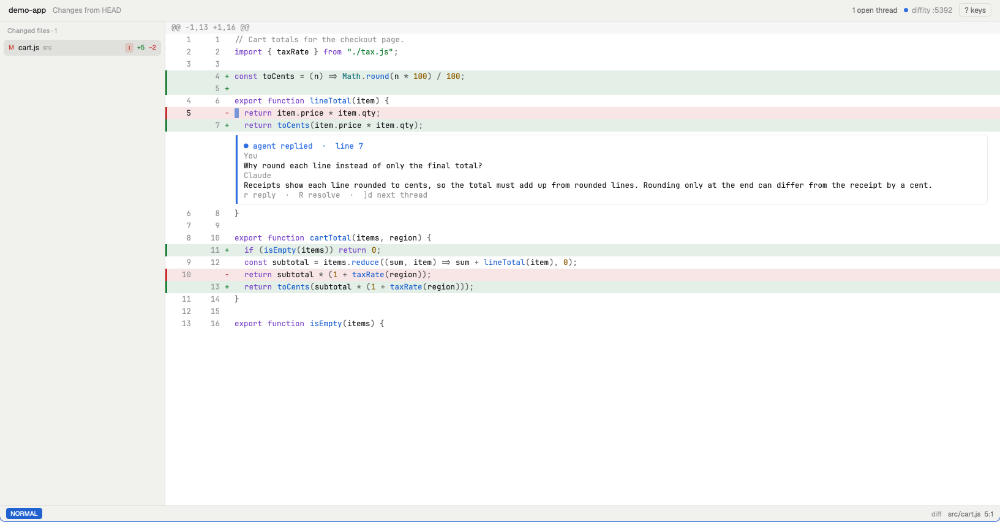

# difftate review

A **Review** tab that shows the diff a running [difftate](https://github.com/TripathyM/difftate) watcher serves, like a small code editor. Move with vim keys, select lines and comment on them. The agent's answers appear inline under the line, as a thread. Jump to definitions, open any file in the repo, and make small edits yourself and save them. Comments go through the watcher's review API, the same review every difftate viewer uses, so the coding agent attached to `difftate` answers them, and all views stay in sync.

## What you see

Top to bottom, filling the tab (the theme's colors throughout, light and dark):

- **Header, 36 px** (`chrome` background): the repo name (13 px, semibold), the review's base ("Changes against origin/main", `dim`), and on the right the open-thread count ("3 open threads · 1 with the agent", `muted`), a 7 px dot (`done` when connected, `dim` when not) with "review API :5391" or "not connected", and a "? keys" button.
- **Body**, a row:
  - **Changed files, 270 px** (`chrome`, right border): "Changed files · N", then one 26 px row per file: a status letter (M in `blocked`, A in `ansi2`, D in `ansi1`), the file name with its folder after it in `dim`, an open-thread count badge (`blocked` on a 15% tint), `+adds` in `ansi2` and `−dels` in `ansi1`. The shown file is `selected`.
  - **Code view** (`background`, the terminal font at 12.5 px, 20 px rows): hunk headers on `raised`; then each line with a 3 px change bar, the old and new line numbers (one column in full-file view), a `+`/`−` sign and the code. Added lines have an `ansi2` tint (12%), deleted lines an `ansi1` tint. A few colors highlight syntax: keywords `ansi5`, strings `ansi2`, numbers `ansi3`, types `ansi6`, calls `ansi4`, comments `dim`. The cursor is a one-character block in `accent` (a 2 px bar in insert mode). Selected lines use `selection`. Lines you edited but haven't saved have an `ansi3` bar.
  - **Threads** sit under the line they belong to, indented to the code: a rounded `surface` card with a 3 px stripe colored by state, a header line ("● waiting for agent · line 42"), then each comment as an author line (`dim`) and the wrapped body, then a hint line ("r reply · R resolve · ]d next thread"). Text is 16 px lines, in the code font.
- **Command bar** (only while typing): a label ("Comment on src/cart.js:7", "Reply on…", "/", ":") and a full-width input with an `accent` border.
- **Status bar, 26 px**: a mode badge (NORMAL on `accent`, V-LINE on `ansi5`, INSERT on `ansi2`), any keys typed so far, the latest message, then "diff" or "file", "[+] unsaved" in `ansi3` when there are unsaved edits, and "path line:col".
- **Pickers** (find files, definitions, references, threads, keys): a 760 px `popover` panel 40 px from the top, with a title, a match count, an input and up to 16 rows.

## How it behaves

- **Thread states**, from the review API (the same in every viewer and in the watcher): *waiting for agent* (`blocked` stripe), *queued* (`blocked`), *agent working* (`working`), *agent replied* (`done`), *failed: no reply* (its run ended without answering; `ansi1`), *resolved* (folded to one line, `dim`). An outdated thread says so in its header. Comments show as *you*, *agent* or *status* (difftate's notes, first 6 lines), from each comment's author.
- **Live**: threads refresh every 2 s. The diff refreshes when the changeset changes (an agent edit, your save), but never over unsaved edits or while in insert mode; it catches up afterwards. Without a running difftate the tab says how to start one and checks again every 2 s.
- **Keys** (all rebindable): `hjkl`, `w b e`, `0 ^ $`, `gg G`, `C-d C-u C-f C-b`, `zz`, with counts (`5j`). `]h [h` next/previous change, which crosses into the next file after the last one. `L H` next/previous file. `]d [d` next/previous open thread, across files. `V` to select lines. `gc` comments on the line or selection. `r` replies and `R` resolves the thread on the cursor's line. `gd` jumps to the definition (a picker if several), `gr` lists references, `C-o`/`Tab` move through the jump list. `Space Space` finds any file, `Space f c` changed files, `Space s d` threads. `Space v` switches diff ↔ full file, `Space e` hides the file list. `/ n N *` search. `?` lists every key, and Enter runs one.
- **Editing**: `i a I A o O` enter insert mode, `x dd yy p P` edit lines, `u`/`C-r` undo/redo. Edits happen in full-file view: an edit key on a diff line switches there at the same line (deleted lines can't be edited). `C-s`, `Cmd-S` or `:w` saves; `:w!` overwrites; `:e!` reloads; `:42` goes to a line. With unsaved edits, the tab won't switch files.
- **Clicks**: a line moves the cursor there; Shift-click extends a selection; a thread card selects that thread; a file in the list opens its diff; "? keys" opens the key list.
- **Opening**: `mod.open difftate` (bound to `cmd-shift-r` by this folder's `keys.json`) opens a **Review · ‹folder›** tab for the focused pane's folder, or switches to that tab if it's open. difftate's watcher does the same with `DT_OPEN=herdr`.

## Built from

- **One mod, `difftate`**, opened as a tab: `tab.new {name: "Review · <repo>", mod: "difftate", props: {folder}}`. `props.folder` is any folder in the repo. Opened with `mod.open` (as a popup: `mod.json` has an `overlay`), it acts as a launcher: it picks the focused pane's folder (else a terminal's in the same space), opens or selects the tab, and closes itself.
- **Files**: `main.js` (view, keys, pickers, navigation), `api.js` (review API client), `diff.js` (unified diff parser), `edit.js` (insert mode, edits, undo, save; mixed into the view), `syntax.js` (one-line tokenizer), `keymap.json` (default keys and options).
- **Code view**: one `v_virtual_list` with a height per item (20 px rows and thread cards of 16 px × lines + 28), `track_scroll` with a `VirtualListScrollHandle` for `scroll_to_item`, and `on_item_click` for clicks (rows can't have their own handlers). Thread text is wrapped by the mod to the measured width (`on_size_change`), so heights are exact.
- **Keys**: `on_key_down` on the focused root. Vim sequences, counts and the leader are the mod's own (`keymap.json`, then `~/.config/difftate/keymap.json` on top). Every action is also a `nextCommand()` command, so `herdr-app do difftate.<action>` works.
- **herdr**: `exec` (git, rg, sh, chmod), `readTextFile`, `writeTextFile` (with the loaded text as `expected`), `fetch` (the review API on localhost), `theme`, `settings` (font), `props`, `focused`, `panes`, `spaces`, `run` (`tab.new`, `tab.select`, `terminal.open`), `closeOverlay`, `nextCommand`, `appHome`, `home`.
- **Review API** (difftate's, see `lib/difftate/api.py`): finds the watcher from `<git common dir>/difftate/api.json` (its port) and `token` (sent as `Authorization: Bearer <token>`), then `GET /api/review`, `/api/changeset` (a unified diff, parsed by `diff.js`), `/api/threads`, and `POST /api/threads`, `POST /api/threads/:id/comments`, `PATCH /api/threads/:id/status`. A stale `api.json`, a refused connection or a 401 means no watcher: it looks again every 2 s.
- **Programs it runs**: `git` (repo root, file list), `rg` (definitions, references), `sh` with `realpath`/`stat`, and `chmod` (to keep a saved file's mode), `$EDITOR` or `vi` (`Space o`, in a split). It reaches the network only on localhost, and reads files under home: the repo (with the watcher's `api.json` and `token` in its git folder) and `~/.config/difftate/keymap.json`. It writes only the repo file you save.

## Watch out

- **Hot reload**: Herdr reloads a mod when files in `~/.config/herdr-app/mods/` change. Installed as a symlink into a git clone, the open tab keeps its old code after a `git pull`; a newly opened tab gets the new code. Close and reopen the Review tab after updating.
- **Herdr writes `gpui-kit.d.ts` and `jsconfig.json`** into the mod folder; through a symlink they land in the clone. They're gitignored.
- `h_flex()` centers its children vertically: give the code column `h_full()`, or it gets no height and the list draws nothing.
- Handlers inside a virtual list's rows throw. All row clicks go through `on_item_click(key)`, which gives no column or modifiers; Shift is tracked with `on_modifiers_changed`.
- Tabs: lines are drawn with tabs expanded (`tab_width`), but edits keep tabs. Columns convert between display and raw indexes.
- Saving goes through `writeTextFile`, which replaces the file atomically; the mod reads the mode before and restores it after, and writes to the symlink's target.
- `Herdr.app` vs `herdr-app`: the CLI may not be on `PATH`; difftate's `DT_HERDR` points at the app's binary.
- Definitions are found by ripgrep patterns (function, def, class, const, `name() {`, Go methods…), not a language server: some are missed, some extra hits show in a picker.
- No system clipboard (mods can't read it), no multi-key insert mappings (`jk`), no text objects.

## Done when

1. `herdr-app check ~/.config/herdr-app/mods/difftate` passes.
2. With `difftate HEAD~1` running in a repo, `herdr-app do tab.new '{"name":"Review · repo","mod":"difftate","props":{"folder":"<repo>"}}'` shows its changed files and the first file's diff, and the header says "review API :<port>".
3. A thread made with `POST /api/threads` shows under its line within 2 s; `herdr-app do difftate.next_thread` moves the cursor to it.
4. `difftate.find_files` opens a picker with every file in the repo.
5. `difftate.yank_line`, `difftate.put_below`, `difftate.save` on a changed line write the file; its tabs and permissions stay, and the diff refreshes by itself.
6. Changing the file on disk before `difftate.save` makes the save refuse, with a message about `:w!` and `:e!`; the disk keeps the outside change.
7. An invalid `~/.config/difftate/keymap.json` shows "Keymap not loaded: …" in the status bar of a new tab.
8. `mod.open difftate` twice opens one **Review · ‹folder›** tab, not two.
