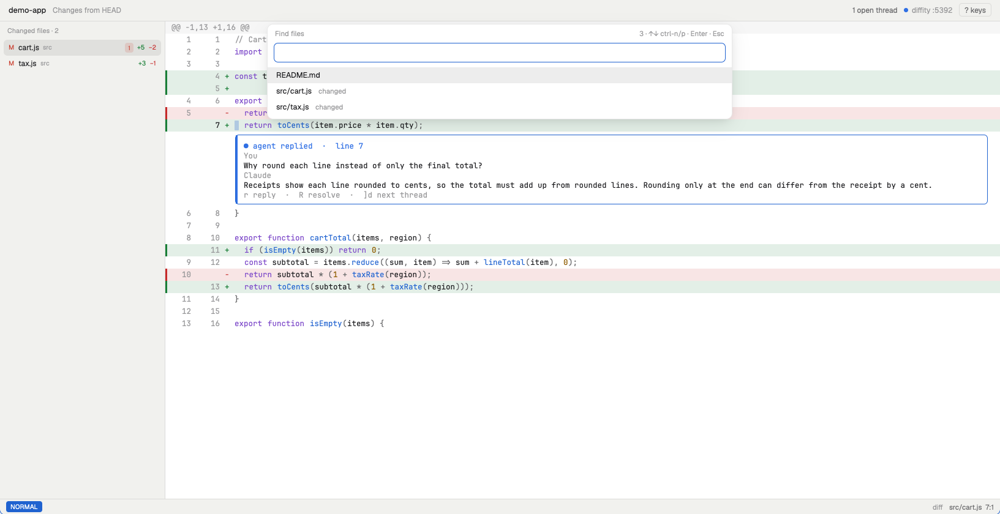
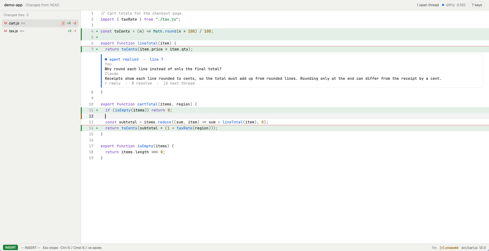

# difftate review (Herdr mod)

A code-editor-like review tab for the diff a running `difftate` (or `dtc`, `dto`) serves.
It reads and writes through the watcher's review API, so the agent answers its comments as it answers any viewer's.
It shows all changes against the review's base.
Installing it: see "Review in Herdr" in the difftate README.

## Use

1. In the repo, run `difftate` as usual. With `DT_OPEN=herdr` it opens a **Review · ‹repo›** tab
   by itself (or switches to it).
2. Or press `cmd-shift-r` in Herdr (if you added `herdr/keys.json`): the tab opens for the focused pane's repo.
   Or: `herdr-app do tab.new '{"name":"Review · repo","mod":"difftate","props":{"folder":"/path/to/repo"}}'`
3. Move with vim keys, `V` to select lines, `gc` to comment, Enter to send.

Without a running difftate the tab still browses and edits code; commenting needs it.
It connects within 2 seconds whenever difftate starts for that repo.

## Your own keys

`keymap.json` here holds the defaults and is replaced on update. Put your changes in
`~/.config/difftate/keymap.json`, with only the keys you change. It has the same shape and wins key by key:

```json
{ "leader": ",", "normal": { "<C-p>": "find_files", "H": "" } }
```

`""` unbinds a key. `Space R` reloads keys (and the diff) without reopening the tab.

## Actions

Bind any of these in your keymap. Each one also runs from a shell as `herdr-app do difftate.<action>`,
or from Herdr's `keys.json` as `"difftate.<action>"`.

| Action | Default keys | What it does |
|---|---|---|
| down / up / left / right | j k h l, arrows | Move (counts work: `5j`) |
| word_next / word_prev / word_end | w b e | Word motions |
| line_start / first_char / line_end | 0 ^ $ | In-line motions |
| top / bottom | gg G | File start / end |
| half_down / half_up / page_down / page_up | C-d C-u C-f C-b | Scroll by half or full screens |
| center | zz | Center the cursor line |
| next_hunk / prev_hunk | ]h [h, ]c [c | Next change; past the last one, the next file |
| next_file / prev_file | L H, ]b [b | Next changed file |
| next_thread / prev_thread | ]d [d, ]t [t | Next open review thread: the general threads first, then across files |
| visual_line | V v | Select lines |
| comment | gc, Space c c (visual: gc c Enter) | Comment on the line or selection |
| reply | r, Enter | Reply to the thread on this line |
| resolve / reopen | R, Space c R | Resolve or reopen that thread |
| toggle_viewed | Space m | Mark this file viewed, or not. A viewed file has a ✓ in the changed-files list; the mark stays across reloads and commits, and clears when the file's diff changes |
| goto_definition | gd | Jump to the definition (ripgrep patterns; a picker if several) |
| references | gr | Every use of the word under the cursor |
| jump_back / jump_forward | C-o, Tab | Jump list |
| find_files | Space Space, Space f f | Fuzzy open any file in the repo |
| changed_files | Space f c | Fuzzy pick a changed file |
| threads | Space s d | Fuzzy pick a review thread: every thread, outdated ones too, with the general threads (not on a file) in a group at the top. Picking one whose code isn't in this view switches to the view it was written in |
| views | Space V | Pick a view of the review: all changes, uncommitted, staged, unstaged, or the last N commits. Threads belong to the review, whatever view they were written in |
| toggle_view | Space v | Diff ↔ full file (full file marks added lines, red underline = deleted below) |
| toggle_explorer | Space e | Show or hide the changed-files list |
| search / search_next / search_prev / search_word | / n N * | Search in the file (smartcase) |
| open_in_editor | Space o | Open this line in `$EDITOR` (else vi) beside the review |
| refresh | Space R | Reload the diff and threads (they also refresh by themselves) |
| help | ? | Every binding; Enter runs one |
| escape | Esc | Leave visual or insert mode, close a picker |

In a comment, type `\n` for a line break.
Shift-click a line to extend a selection.

General threads (on the review, not on a file) are listed under **General threads**, above the changed files
when the review has some. `r` replies to the one picked, `R` resolves it, as on a file.

`Space Space` finds any file in the repo; changed files are marked:



## Editing

Edits happen in the full-file view. Pressing an edit key on a diff line switches there at the same line
(deleted lines can't be edited: they aren't in the file).

`o` on a diff line: the full file, a new line in insert mode, and the unsaved edit marked (yellow bar, `[+] unsaved`):



| Action | Default keys | What it does |
|---|---|---|
| insert / append | i a | Insert mode before / after the cursor |
| insert_line_start / append_line_end | I A | Insert at the first non-blank / end of line |
| open_below / open_above | o O | New line below / above, same indent, in insert mode |
| delete_char | x | Delete the character under the cursor (counts work) |
| delete_line | dd (visual: d x) | Delete lines; they go in the register and the clipboard |
| yank_line | yy (visual: y) | Copy lines to the register and the clipboard; in the diff this copies deleted lines too |
| put_below / put_above | p P | Put lines below / above: the clipboard's, if something else copied there since, else the register's |
| undo / redo | u, C-r | One step per command or per insert session |
| save | C-s, Cmd-S, `:w` | Write the file |
| save_force | `:w!` | Write even though the file changed on disk |
| revert | `:e!` | Reload from disk and drop unsaved edits |
| command | : | `:w` `:w!` `:e!` `:e` `:42` (go to line) |

In insert mode: Enter (keeps indent), Backspace, Delete, Tab (the file's own indent), arrows,
Home/End, Esc or C-c to leave. Tabs in the file stay tabs.

Saving checks the file still matches what was loaded. If the agent (or anything else) changed it
meanwhile, the save is refused: `:w!` overwrites, `:e!` takes the disk version. A dirty file
blocks switching files until you save or drop it. Saves keep the file's permissions and follow symlinks.
After a save, the watcher's changeset changes and the diff refreshes by itself.

Not supported: Cmd-V in insert mode (use `p` in normal mode), multi-key insert
mappings like `jk`, text objects (`ciw`, `dw`), and registers other than the one line register.
